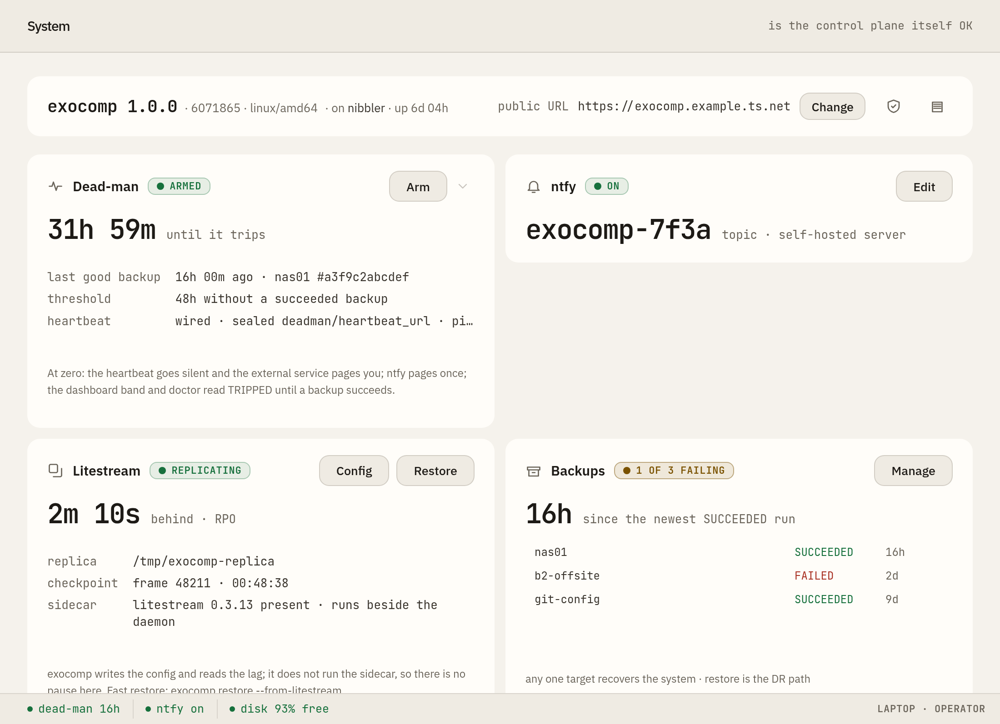
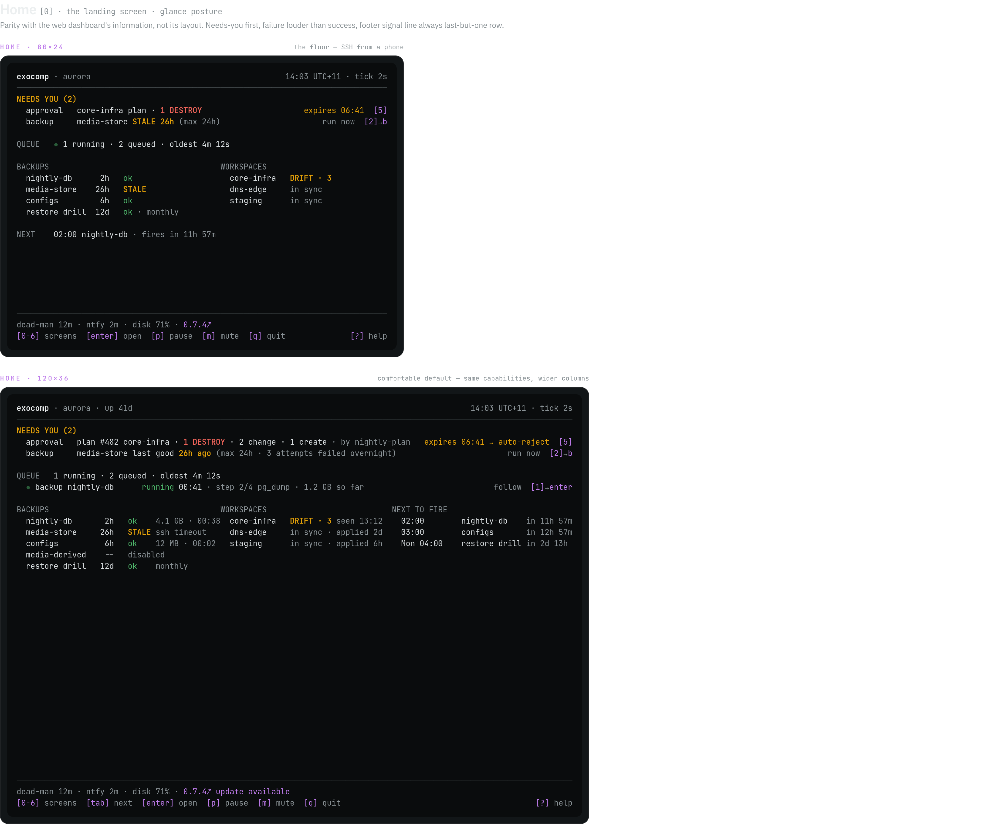

# exocomp

[](https://exocomp.dev/) [](https://exocomp.dev/docs/) [](https://deepwiki.com/agync/exocomp)

A single-binary homelab control plane: one operator, a handful of hosts, no
external database. One static Go binary (`exocompd`) owns state, sequencing, keys,
and recovery, and shells out to pinned tools (`ansible-core`, `opentofu`, `restic`,
`sops`, `age`, `git`) for the actual work.

Run it as a host service, a container, or a unit file — whatever keeps the host
best. State is the SQLite file beside it, never a database someone else operates.

## What it looks like

| Web console | OpenTofu plan diff | Live job output |
|:---:|:---:|:---:|
|  |  |  |

| System and self-care | Phone approvals | Terminal UI |
|:---:|:---:|:---:|
|  |  |  |

## What it combines

- **Ansible orchestration** — playbook and ad-hoc runs, inventories, schedules,
  drift checks (`--check`), with job history and live output.
- **OpenTofu orchestration** — plan-then-apply with the saved plan gated by CEL
  policy; state lives in an OpenTofu HTTP backend implemented in SQLite, so there
  is no MinIO/Garage conditional-write dependency and version history comes free.
- **Secret management** — an age-recipient → DEK → HKDF-subkey envelope. One
  printed recovery kit reconstructs every key, and secrets never reach logs, job
  events, or artifacts.
- **Backup and disaster recovery** — a three-leg fan-out (NAS, S3-compatible, and
  an age-encrypted private git repo) via restic, with the recovery key written
  outside the restic repo so restore needs only off-the-shelf `age` and `restic`.
- **Reactive automation** — webhooks (Alertmanager, Uptime Kuma, healthchecks,
  GitHub) normalized to one event shape, matched by sandboxed CEL rules, gated by
  cooldown/cap/dedup guardrails and single-use approval links before anything runs.

## Design properties

- **One queue, no side doors.** Every path — a TUI keypress, a schedule, a matched
  webhook, an API or MCP call, a drift check — converges on one SQLite-backed job
  queue before anything executes, which is what makes the guardrails enforceable
  rather than advisory.
- **Trivial bootstrap.** An idempotent first-run wizard stands an install up in
  minutes and does not finish until a restore drill has passed.
- **Trivial disaster recovery.** The recovery chain from a printed key to a
  restored host is executable by hand; it depends on no registry, vendor, or this
  project's own code.
- **Minimal footprint.** One process, one SQLite file. The image size and idle RSS
  are budgeted and checked in CI (`make budgets`).
- **Plain formats only.** Plain SQLite, plain restic repos, plain git bundles,
  plain age files, standard OpenTofu state — nothing bespoke.
- **Sandboxed jobs.** Executor tiers `local` / `local-sandboxed` (the default, via
  nono) / `container`; a sandboxed job is denied the database, the keys, and every
  powerful local socket.

## Interfaces

All faces are thin clients of one API:

- **TUI** (Bubble Tea) — local, or over SSH via a Wish listener.
- **Web** (templ (a-h/templ), embedded in the binary) — plus a phone-friendly approval
  surface over a token-gated TLS listener.
- **CLI** — machine-readable with `--output json` over a stable envelope and a
  documented exit-code and error taxonomy.
- **Remote CLI** — `exocomp login` and `--remote` drive another daemon over a
  tailnet with TOFU certificate pinning.
- **MCP over HTTP** — `POST /mcp` on the same listener exposes the write verbs to
  an agent under the same queue, sandbox, and approval governance.

## Quickstart

Build the static binary from source (Go 1.26+):

```sh
make build      # → bin/exocomp
make check      # fast gate: fmt, vet, lint, tidy, and -short tests
make check-race # full gate: fmt, vet, lint, tidy, and the race test suite
```

For a real deployment, install the binary and run it under a user systemd unit, or
drop the rootless Podman Quadlet units (with a Docker Compose fallback). Either way
the first-run wizard runs the same recoverable setup. The packaging is versioned
separately from `exocompd` so the recovery path never depends on the thing that
broke. See [docs/operations/bootstrap.md](docs/operations/bootstrap.md),
[docs/guide/quickstart.md](docs/guide/quickstart.md) and
[packaging/recovery.sh](packaging/recovery.sh).

## Documentation

The `docs/` tree is the reference for everything else, rendered at
[exocomp.dev/docs](https://exocomp.dev/docs/):

- [docs/index.md](docs/index.md) — architecture, decisions, design, operations, and
  provenance, in one place.
- [docs/architecture/](docs/architecture/overview.md) — component map, the one-queue
  property, the platform contract, execution tiers, the reactive layer.
- [docs/operations/](docs/operations/index.md) — bootstrap, running the daemon,
  disaster recovery, backups, remote access, the API and MCP surfaces, and more.
- [docs/decisions/](docs/decisions/index.md) — the accepted architecture decisions and their
  consequences.

## Contributing

Commits are logical units with conventional titles; `docs/` moves in the same
commit series as the code it describes. See [AGENTS.md](AGENTS.md) for the full
contract.

## License

[Apache License 2.0](LICENSE).
