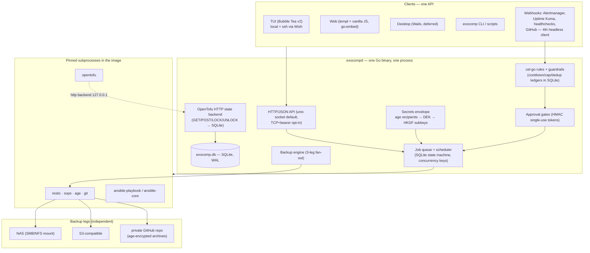

# Architecture overview

`exocompd` is one Go binary deployed as a systemd host service or rootless container. It owns **state, sequencing, keys,
and recovery**; `ansible-core`, `opentofu`, `restic`, `sops`, `age` and `git` are pinned
subprocesses that do the actual work. Rationale in
[ADR 0001](../adr/0001-thin-core-architecture.md).

## One queue, no side doors

Every execution path — a keypress in the TUI, a cron schedule, a matched webhook rule, an
API call, a drift check — converges on the same job queue before anything runs. This is the
architecture's single load-bearing property, and it is why the guardrails are enforceable
rather than advisory:

- **Guardrails live in the queue**, not in configuration: cooldown, daily cap (which
  *throttles* the rule — withholds the action but keeps it armed and pages, rather than
  disabling it into a state a flood could exploit), dedup, a global reactive kill switch, and
  default-deny on destructive runbook kinds. Their ledgers are SQLite rows, so a crash-loop
  restart does not reset the counters.
- **Serialization is a queue property.** `concurrency_key` (defaulting to the workspace or
  project) means one control plane never runs two applies against one workspace — which is
  what removes the dependency on storage-backend locking entirely
  ([ADR 0004](../adr/0004-opentofu-http-state-backend.md)).
- **Approval is a queue state**, not a UI convention. Plan-then-apply is two `job` rows
  linked by `parent_job_id`, so the approver sees the actual saved plan and the apply runs
  that plan file rather than a fresh one that may have drifted.
- **Every event is persisted with its outcome**, including `ignored` and `suppressed`, so
  "why didn't my rule fire?" is a query rather than an archaeology exercise.

The alternative — an execution engine with its own scheduler and its own Run button — leaves
dispatch paths the gate never sees. That is the structural flaw that eliminated two of the
three candidate designs.

**Backups run through the queue.** `exocomp backup run` enqueues one job per target
(kind `backup`, concurrency key `backup:<target>`) and drains the queue in place: a backup
goes through the same guardrails as everything else, and `exocomp schedule add --kind
backup` puts it on a cron expression via `internal/sched` (`robfig/cron/v3`), rebuilt from
the `schedule` table on every start. `exocomp restore` remains a direct CLI invocation,
outside the queue — restoring is an operator recovering from a cold start, not a target the
scheduler already reaches.

**Webhooks are the fourth headless client** of the same queue: `POST /hook/<derived token>`
on the daemon's own listener, normalized onto one event shape, matched by `cel-go` rules,
and gated by silence, dedup, cooldown, and daily cap before anything is enqueued. A
destructive action becomes a `job` row in `awaiting_approval` — a state no claim statement
admits — released only by a single-use HMAC decision link that fails closed on its TTL.
Every event is persisted with its outcome, its reason, and the trace that produced them
([reactive layer](reactive.md)).

## Components

| Component | Owns | Notes |
|---|---|---|
| API (`internal/api`) | the loopback OpenTofu HTTP state backend | `127.0.0.1` only, HKDF-derived per-workspace bearer; a separate listener from the operator `/api/v1` surface below |
| Operator API (`internal/web` `/api/v1`) | thin HTTP/JSON over `internal/service`, mounted on the ADR-0009 token-gated listener | read and write routes are both live — see [Machine output](../operations/machine-output.md) and [The API surface](../operations/api.md) |
| Service (`internal/service`) | the four write verbs (`PlanWorkspace`/`ApplyWorkspace`/`RunPlaybook`/`DecideApproval`) and their resolvers | the CLI, the `/api/v1` write routes, and MCP-over-HTTP (the agent-aware wrapper over `/api/v1`) all enqueue through these, so a write can't fork a divergent path; **reads go store-direct** in every face — only writes are unified through the service layer |
| Job queue + scheduler | state machine, concurrency keys, cancel, timeouts, event ingest | `robfig/cron/v3`; schedules live in SQLite and cron entries are rebuilt from the DB on boot and on mutation |
| Rule engine | normalization, `cel-go` matching, guardrail ledgers | CEL is sandboxed and non-Turing-complete with a hard time budget — arbitrary code must not be able to fire an apply |
| Approval gates | HMAC single-use tokens, TTL, constant-time compare | delivered via ntfy action button, TUI, or web to one endpoint |
| Secrets envelope | keyring, DEK, HKDF subkeys, redaction filter | [ADR 0003](../adr/0003-secrets-envelope.md) |
| OpenTofu state backend | `tfstate` versions, `tflock` | [ADR 0004](../adr/0004-opentofu-http-state-backend.md) |
| Backup engine | staging tree, three-leg fan-out, retention, verification, drills | [disaster recovery](../operations/disaster-recovery.md) |
| Executor drivers | subprocess isolation tier | [execution](execution.md) |
| Clients | TUI (priority 1), web (2), desktop (3) | all thin clients of the one API |

State is one SQLite file (`exocomp.db`, WAL, `modernc.org/sqlite` — pure Go, so
`CGO_ENABLED=0` builds are genuinely static and cross-compile to arm64 without a toolchain)
plus one blob directory for job artifacts and plan files. `job_event` is the only
high-write table; it is append-only, retained 90 days, with full stdout gzipped into
artifact storage — which keeps the database small enough that a `VACUUM INTO` snapshot is
sub-second, which is what makes a consistent backup cheap enough to run constantly.

## Commitments

- **Single container, honestly stated.** `ansible-core` is Python, so the artifact is an
  image with one static Go binary inside it. Podman Quadlet is primary, compose is the
  documented fallback — see [the platform contract](platform-contract.md).
- **Subprocess correctness is exit codes only.** Parsed `--json` output enriches the UI, so
  an upstream schema change degrades the display, not the result.
- **The recovery chain is a feature, not a cron job.** `keyring.age` is written to every
  backup target root *outside* the restic repository; every arrow from printed key to
  restored host is executable with off-the-shelf `age`, `openssl` and `restic`.
- **Nothing is stored in a bespoke format** — plain SQLite, plain restic repos, plain git
  bundles, plain age files, standard OpenTofu state.
