# Visual showcase and interface gallery

exocomp provides three dedicated operator surfaces:
1. **The Web UI**: High-density single-operator instrument panel.
2. **The Mobile Companion**: One-thumb triage and approval surface.
3. **The Terminal UI (TUI)**: Fast, keyboard-driven SSH/console interface.

---

## 1. Web dashboard in both themes

Dark is the native theme; Light is a warm, low-chroma remap inspired by a physical lab notebook.

### Native Dark Theme

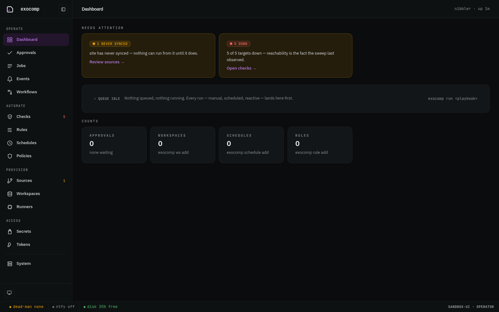

### Warm Light Theme

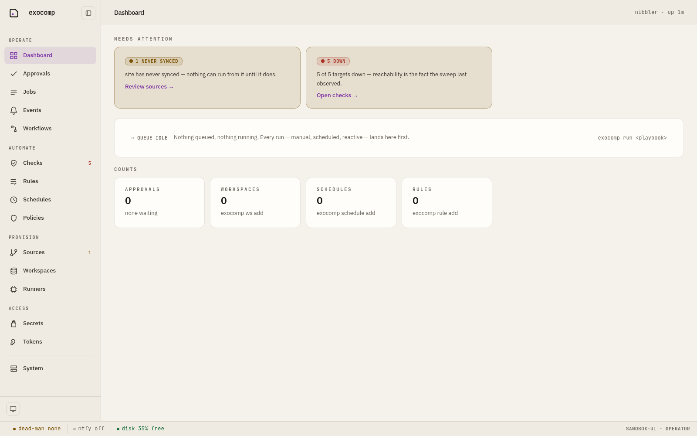

---

## 2. Infrastructure & OpenTofu diffs

The OpenTofu plan diff viewer adheres to strict visual hierarchy:
- High contrast values with embedded `+` / `-` indicators.
- Non-server-set top-level key counts.
- Redacted secrets rendered in place.

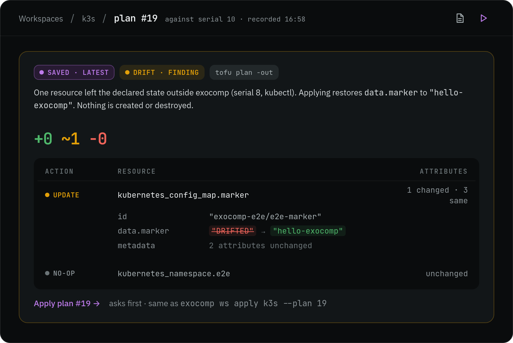

### Value shapes and multi-line structures

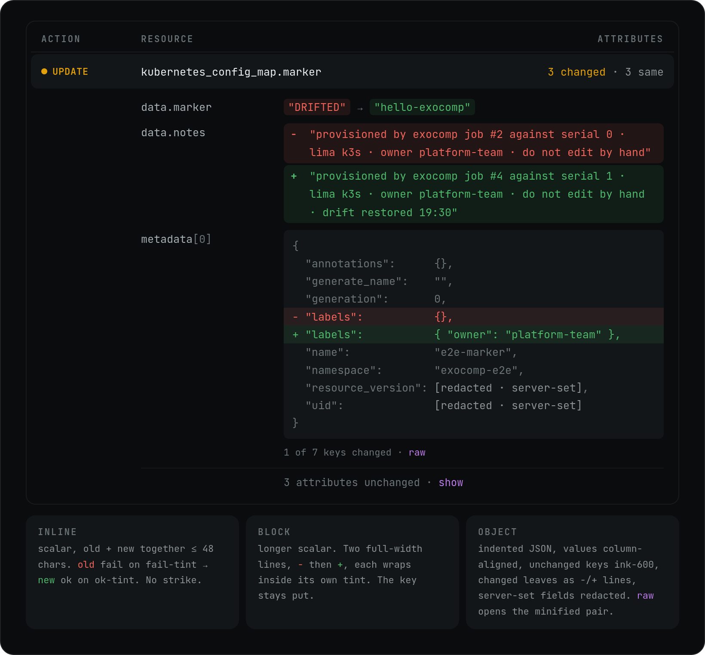

---

## 3. Real-time job logs and queue execution

Every execution displays start time, queue latency, sandbox status, and live output stream.

### Live log tailing

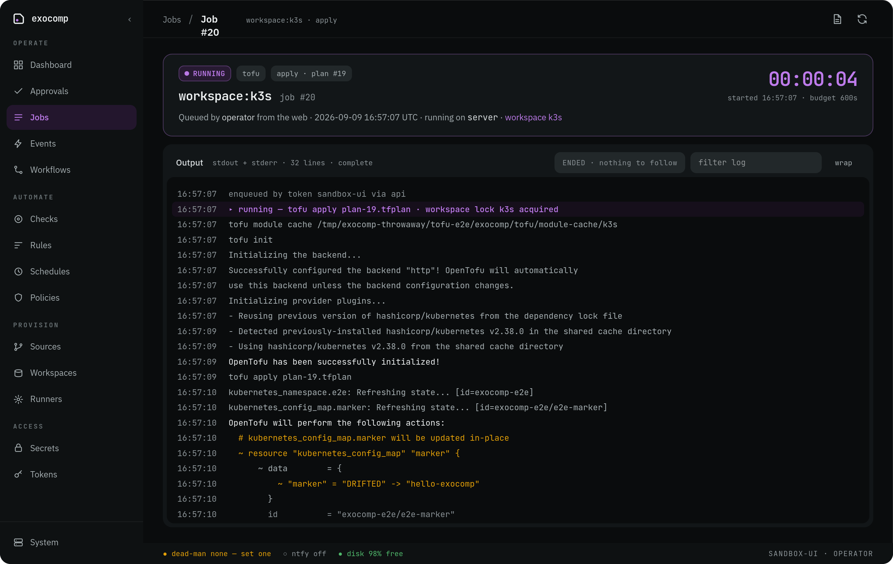

### Degraded job state (unreachable roaming hosts tolerated)

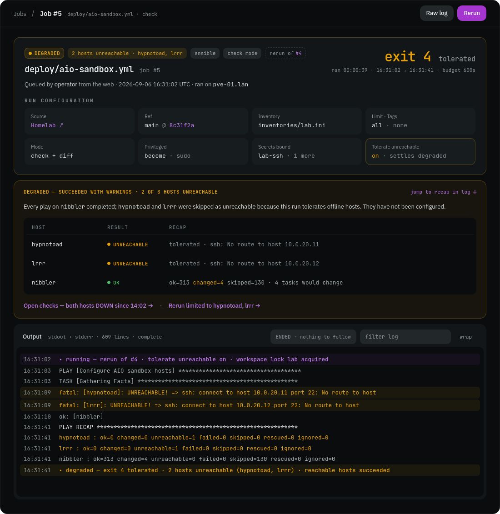

---

## 4. Mobile companion and approvals

Tailored for responsive viewing and rapid decision-making on phone screens.

### Quiet status overview & pending approvals
| Quiet Home Screen | Approval Drawer |
|---|---|
| 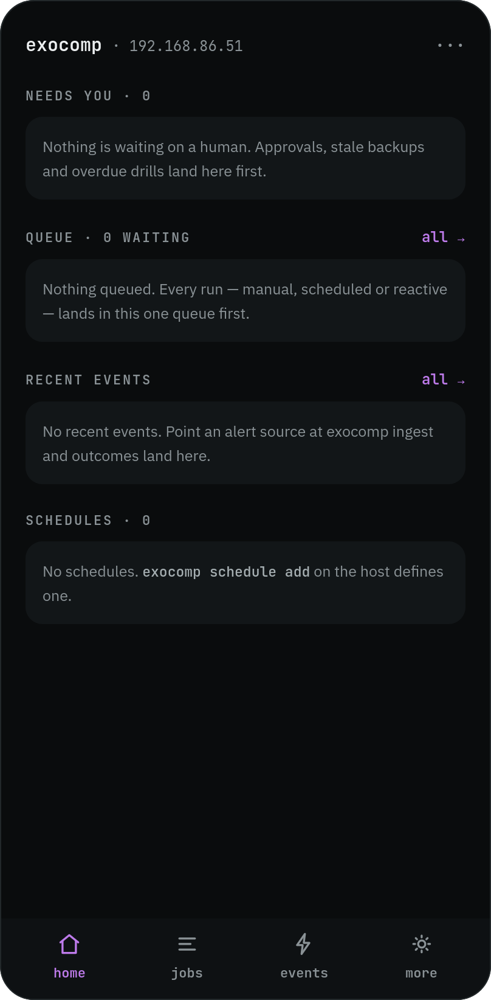 | 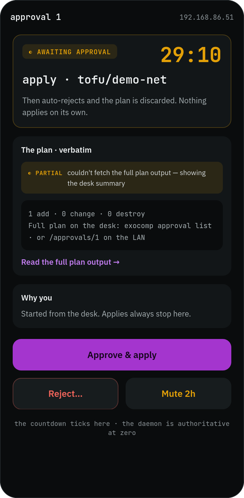 |

---

## 5. Reachability and secrets interfaces

### Checks, probes, and netgroups
State is strictly color plus word (`UP`, `DOWN`, `UNOBSERVED`).

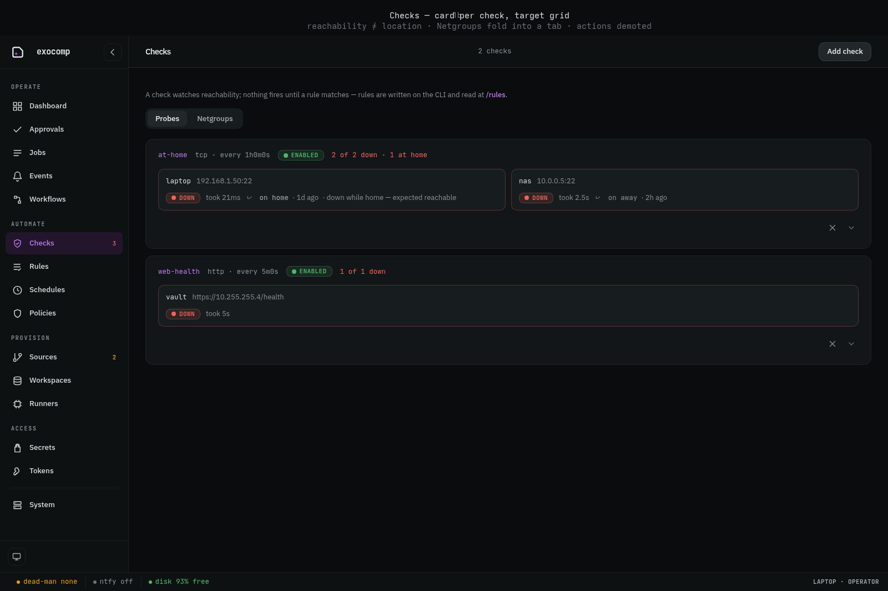

### Secrets envelope metadata
Values never appear in the DOM, logs, or network payloads.

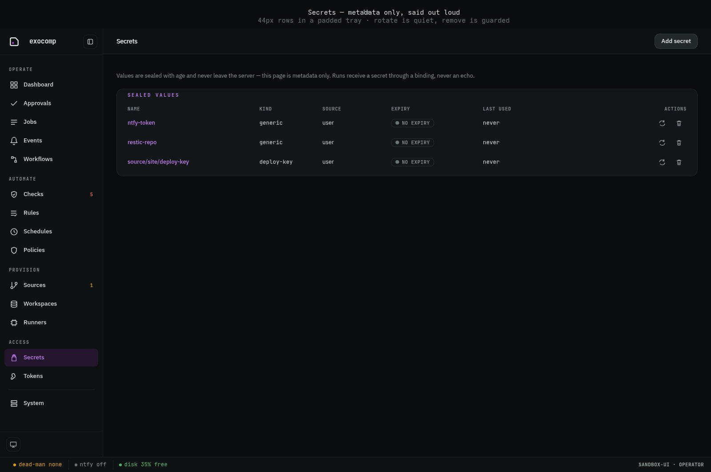

---

## 6. Terminal UI (TUI)

The 80x24 terminal interface provides an identical operational contract to the Web UI.

### Keymaps and navigation

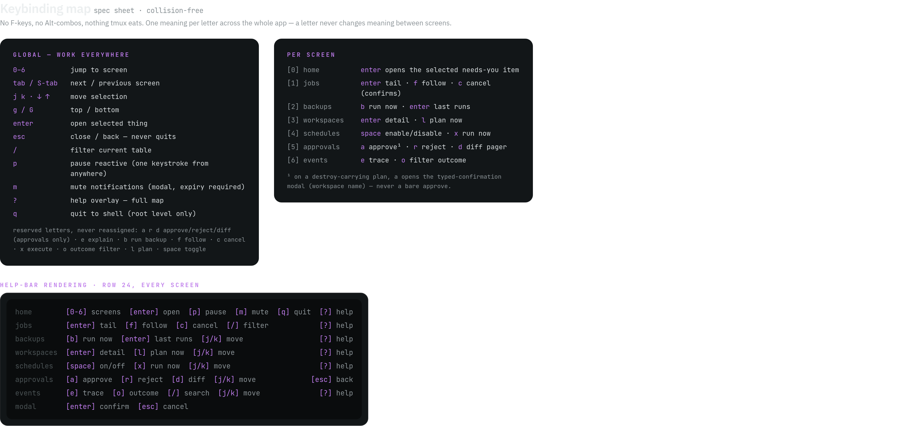

### Palette and status banners

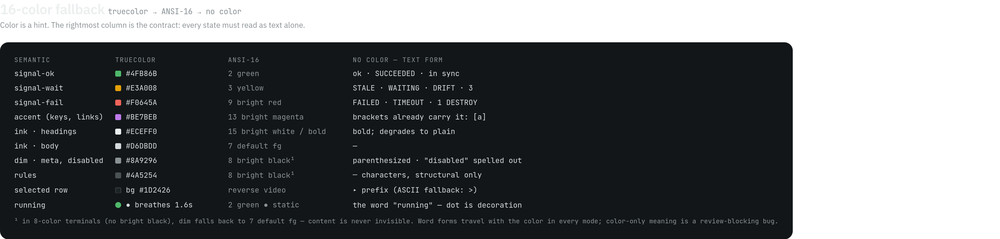

