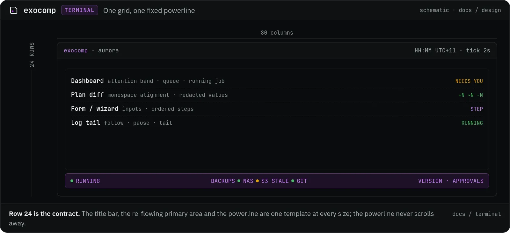

# Terminal UI design system

The exocomp Terminal UI (`exocomp tui`) is built on Charm's Bubble Tea and Lip Gloss libraries. It runs over local console or SSH sessions (`exocomp ssh-serve`).

It shares an exact operational and security parity with the Web UI: approvals, rejections, plan-diff inspection with sensitivity redaction, and global pause/resume controls.

## Terminal geometry and structure

The TUI targets a standard **80 columns by 24 rows** terminal grid:

*Figure — the terminal grid, schematic rather than a live capture. The title bar, primary area and powerline are one template at every size.*

## Standard keymap

| Key | Action | Context |
|---|---|---|
| `j` / `↓` | Move selection down | Lists, tables, diffs |
| `k` / `↑` | Move selection up | Lists, tables, diffs |
| `Enter` | Open detail / submit | Lists, forms |
| `Esc` / `q` | Back / close modal / quit | Universal |
| `a` | Approve execution | Pending approval gates |
| `x` | Reject execution | Pending approval gates |
| `p` | Toggle queue pause/unpause | Universal |
| `?` | Toggle keymap help banner | Universal |

## The powerline status strip (Row 24)

Row 24 is fixed across all screens and mirrors the Web UI's powerline strip:
- **Left segment**: Active service status (`RUNNING`, `CORDONED`, `PAUSED`).
- **Center segment**: Backup freshness indicators (NAS, S3, Git).
- **Right segment**: Active daemon version and pending approval count.

This is the target layout. The shipped 80x24 frame currently renders a dead-man/notify/version
footer there; the grid and row placement are the same.

## TUI colors and Lip Gloss styles

TUI colors align directly with the dark native palette:
- Normal text: White `#ECEFF0` (Lip Gloss `Color("255")`).
- Subdued text / timestamps: Gray `#8A9296` (Lip Gloss `Color("245")`).
- Accent highlight: Amethyst `#BE7BEB` (Lip Gloss `Color("177")`).
- Signals: Green `#4FB86B` (OK), Yellow `#E3A008` (Wait/Drift), Red `#F0645A` (Fail).
