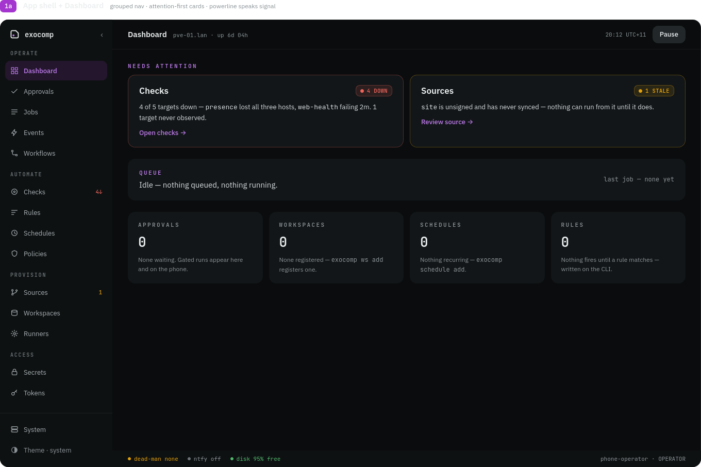

# Quickstart

exocomp runs as a single rootless container (`exocompd`) holding one Go binary, a SQLite database, and the pinned execution toolchain (`ansible-core`, `opentofu`, `restic`, `sops`, `age`, `git`).

Two hard constraints govern setup: **trivial bootstrap** and **trivial disaster recovery**. A setup is only considered complete once the recovery card is printed and verified.

## 1. Deploy the Quadlet container

Install the Quadlet definition into your user systemd directory:

```bash
mkdir -p ~/.config/containers/systemd
cp packaging/quadlet/exocomp.container ~/.config/containers/systemd/
cp packaging/quadlet/exocomp.volume ~/.config/containers/systemd/
systemctl --user daemon-reload
systemctl --user start exocomp
```

The container starts rootless, mounts its dedicated volume to `/var/lib/exocomp`, and listens on loopback `127.0.0.1:8642`.

## 2. Complete the setup wizard

Run the interactive setup wizard via CLI or open the browser at `http://127.0.0.1:8642`:

```bash
exocomp setup
```

The wizard guides through four atomic steps before committing anything to disk:
1. **Operator & identity**: Captures operator display name, detects host machine name, and generates an `exo-{machine}-{id}` ntfy topic.
2. **Recovery kit phrase**: Displays the age recovery phrase and blocks until typed confirmation matches exactly.
3. **First backup & restore drill**: Runs an immediate test backup and restores to a scratch path to prove recovery works before first operational use.
4. **Hand over & commit**: Atomically mints identity, generates root secrets envelope, seals the ntfy configuration, attempts a test push, and prints the permanent recovery kit. Nothing is written to disk until this step is confirmed.

## 3. Save the recovery card

Disaster recovery never depends on the running system. Save the age recovery secret key printed during setup, and re-render the stored public recovery card recipe at any time with:

```bash
exocomp recovery-kit > recovery-card.txt
```

Print this card or save it onto physical media. The card contains:
- The age recovery secret key.
- The off-host read-only S3 and Git credentials.
- The exact shell commands to restore the control plane onto a blank machine using only `age`, `restic`, and `curl` (no exocomp binary required).

## 4. Verify system health

Run `exocomp doctor` to verify environment permissions, sandboxing, and dependencies:

```bash
exocomp doctor
```

```
go runtime:   go1.23.0
data dir:     /var/lib/exocomp — ok (mode 0700)
secrets:      mlock active, host key encrypted via systemd-creds
executor:     nono (tier: enforcing)
optional tools (probe subset):
  ansible     2.17.3
  opentofu    1.8.1
  restic      0.17.0
  uv          0.4.0
status:       HEALTHY
```

## 5. Explore the dashboard

Open `http://127.0.0.1:8642` to view the attention-first dashboard:



The dashboard presents the system status before detail: active alerts, pending approval gates, backup freshness, and running queue jobs.
