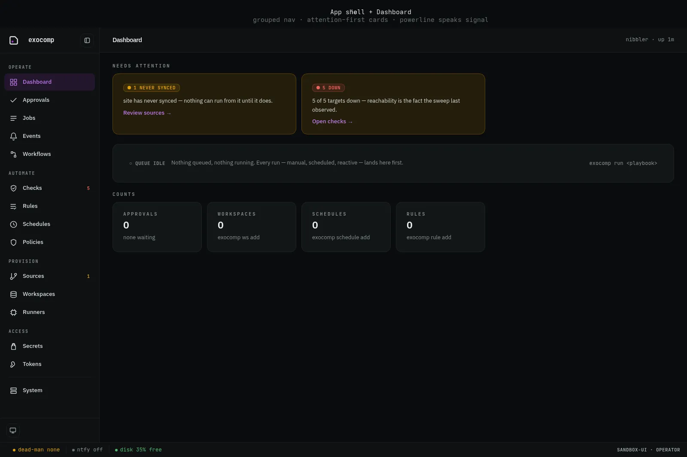

# Quickstart

exocomp runs as a single Go binary — `exocomp`, also installed as `exocompd` — deployed
as a systemd host service or a rootless container, holding state in SQLite, and shelling
out to the pinned execution toolchain (`ansible-core`, `opentofu`, `restic`, `sops`,
`age`, `git`).

Two hard constraints govern setup: **trivial bootstrap** and **trivial disaster
recovery**. A setup is only complete once the recovery card is printed, its confirmation
phrase typed back, and a backup restored in a drill.

## 1. Deploy

Build the binary with `make build` (it lands at `bin/exocomp`), or download the release
asset (`exocomp` plus `exocomp.sha256`) and verify it before installing.

### Option A: User systemd host service

Give the host key a passphrase held outside the data dir, then run the first-run wizard
before the unit starts. The wizard mints the identity and prints the recovery kit:

```bash
install -Dm755 exocomp ~/.local/bin/exocomp

install -d -m 700 ~/.config/exocomp
openssl rand -base64 32 > ~/.config/exocomp/host-key.passphrase
chmod 600 ~/.config/exocomp/host-key.passphrase

EXOCOMP_HOST_KEY_PASSPHRASE_FILE=$HOME/.config/exocomp/host-key.passphrase exocomp setup
```

The unit passes the same file at start, so the passphrase-wrapped `host.key.age` in the
data dir is useless without it:

```bash
mkdir -p ~/.config/systemd/user
cat << 'EOF' > ~/.config/systemd/user/exocomp.service
[Unit]
Description=exocomp control plane
After=network-online.target
Wants=network-online.target

[Service]
Environment=EXOCOMP_HOST_KEY_PASSPHRASE_FILE=%h/.config/exocomp/host-key.passphrase
ExecStart=%h/.local/bin/exocomp serve --port 8643 --web-addr 127.0.0.1:8642
Restart=on-failure
RestartSec=3s

[Install]
WantedBy=default.target
EOF
systemctl --user daemon-reload
systemctl --user enable --now exocomp
```

`serve` binds two loopback listeners: the state/API backend on `--port`, and — with
`--web-addr` — the token-gated web surface over TLS. Add `--public-url https://your.host`
once the surface has an address a phone can reach, so approval links and push deep links
point at it.

### Option B: Rootless Quadlet container

The unit needs an active web token and a host-key passphrase before it will start.

```bash
mkdir -p ~/.config/containers/systemd
cp packaging/quadlet/exocomp.container packaging/quadlet/exocomp.volume ~/.config/containers/systemd/
systemctl --user daemon-reload
podman volume create systemd-exocomp

podman run --rm --userns keep-id -v systemd-exocomp:/var/lib/exocomp \
  ghcr.io/agync/exocomp:latest --no-input token new web

install -d -m 700 ~/.config/exocomp
openssl rand -base64 32 > ~/.config/exocomp/host-key.passphrase
chmod 600 ~/.config/exocomp/host-key.passphrase

podman run --rm -it --userns keep-id \
  -e EXOCOMP_HOST_KEY_PASSPHRASE_FILE=/run/secrets/host-key.passphrase \
  -v ~/.config/exocomp/host-key.passphrase:/run/secrets/host-key.passphrase:ro,Z \
  -v systemd-exocomp:/var/lib/exocomp \
  ghcr.io/agync/exocomp:latest setup

systemctl --user start exocomp
```

`setup` needs a terminal and is the same four-screen wizard as Option A. The unit passes
`~/.config/exocomp/host-key.passphrase` in as a systemd credential and points
`EXOCOMP_HOST_KEY_PASSPHRASE_FILE` at it inside the container, so the passphrase never
enters the data volume. Quadlet needs Podman 4.4 or newer. Container installs without a
user systemd, and the Compose fallback, are in [containers](../operations/containers.md).

## 2. The first-run wizard

The wizard from step 1 has four screens and writes nothing to disk until you leave the
third:

1. **Operator & identity**: captures the operator display name, detects the machine
   name, and generates an `exo-{machine}-{id}` ntfy topic.
2. **Recovery kit phrase**: displays the age recovery phrase and blocks until the typed
   confirmation matches exactly.
3. **Mint**: leaving this screen mints the host identity and keyring, saves the operator
   and ntfy topic, attempts a test push, and prints the recovery kit. This is the single
   write; quitting earlier leaves no trace.
4. **Hand over**: shows the kit again with the notify status.

The wizard does not take a backup. That is a separate step, below.

Steps 4–6 run `exocomp` on the host. On the Quadlet deployment the binary lives in the
container: prefix a command with `podman exec exocomp exocompd`, for example
`podman exec exocomp exocompd backup drill --target nas`, and skip the token in step 6
because step 1 minted one. A `restic_local` target path is resolved inside the container,
so it must be a bind mount there; the S3 kind needs no mount.

## 3. Save the recovery card

Disaster recovery never depends on the running system. The **age recovery secret key is
printed once**, at the wizard (or at a rotation); it is never written to the database, and
`exocomp recovery-kit` cannot reprint it. Print the card at setup and store the key on
physical media or an offline copy — without it, a lost host key is unrecoverable by
design.

Re-render the rest of the card — the recipients, their fingerprints, the HKDF salt, and
the exact restore recipe — at any time:

```bash
exocomp recovery-kit > recovery-recipe.txt
```

The card as printed at setup carries the age recovery secret key, the off-host read-only
S3 and Git credentials, and the exact shell commands to restore the control plane onto a
blank machine using only `age`, `restic`, and `curl` (no exocomp binary required).

## 4. Prove recovery

Register a backup target, run a backup, then restore it in a drill:

```bash
exocomp backup add-target --name nas --kind restic_local --uri /mnt/nas/exocomp
exocomp backup run --target nas
exocomp backup drill --target nas
```

The drill restores the newest snapshot into a directory it creates and removes, verifies
the manifest digests, and opens the restored database for `integrity_check`. The live data
dir is never touched. [Disaster recovery](../operations/disaster-recovery.md) has the
three-leg target setup, the restore chain, and what to check.

## 5. Verify system health

Run `exocomp doctor` to verify environment permissions, sandboxing, and dependencies:

```bash
exocomp doctor
```

```
go runtime:   go1.26.10
data dir:     /var/lib/exocomp — mode 0700 — writable
secrets protection:
  host key at rest   passphrase-wrapped — a stolen data volume alone does not yield it
  memory lock        mlock available — the DEK is pinned out of swap and core dumps
sandbox:
  tier               enforcing (requested enforcing)
  probe              enforced — key read, abstract socket, and ungranted TCP all refused
```

The data directory line names the deployment: `/var/lib/exocomp` in the image,
`~/.local/share/exocomp` for a host service. The full report adds the tool manifest,
per-job caps, run-secret staging, and the self-observability gauges.

## 6. Explore the dashboard

The listener accepts only a web token. Option B minted one in step 1; on the host
service, mint it now:

```bash
exocomp token new web
```

Open `https://127.0.0.1:8642` and present the token:

<p></p>

The dashboard presents the system status before detail: active alerts, pending approval
gates, backup freshness, and running queue jobs.

## 7. Drive it from another machine

The same binary on a laptop drives the daemon over its LAN listener. Bind `--web-addr` to an
address the laptop can reach ([LAN access](../operations/lan-access.md)), mint an `operator`
token on the daemon's host, then pin the daemon from the laptop:

```bash
exocomp token new laptop --scope operator --expires 720h   # on the daemon's host (--local if it has a default remote)
exocomp login server.tailnet.ts.net:8642 --token exo_...   # on the laptop
exocomp doctor
```

The first `login` makes that daemon the default remote, so every command on the laptop goes
there without a flag, and the laptop keeps no data dir of its own. A command that has to run
where the daemon's data dir is, such as `token new` or `init`, refuses and names `--local`. Run
it on the daemon's host. See [Driving a remote daemon](../operations/remote-access.md).
