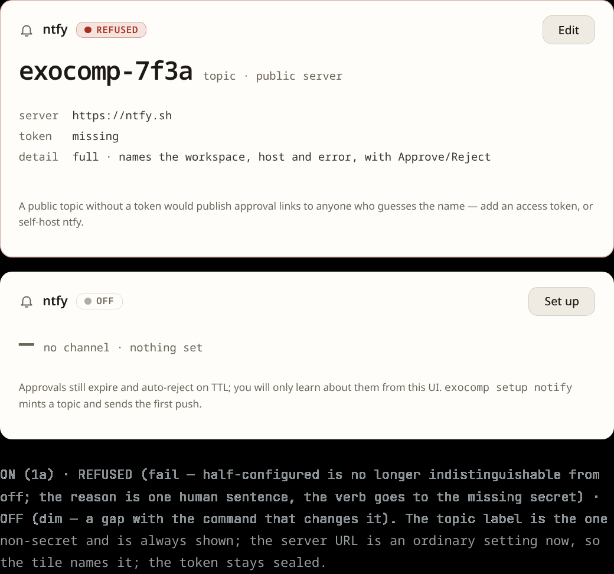

# Reactive automation

exocomp can react automatically to monitoring alerts, webhooks, and internal health checks through an embedded Common Expression Language (CEL) evaluation engine.

Every triggered run is submitted to the single job queue, ensuring all reactive executions adhere to the same sandboxing, redacting, and logging constraints.

## Webhook ingress

Send external events (e.g. from Alertmanager, Grafana, or GitHub) to the ingress endpoint:

```bash
curl -X POST http://127.0.0.1:8642/api/v1/events \
  -H "Authorization: Bearer $TOKEN" \
  -H "Content-Type: application/json" \
  -d '{
    "source": "alertmanager",
    "kind": "alert",
    "payload": {
      "alertname": "DiskPressure",
      "instance": "nas.lan",
      "severity": "warning"
    }
  }'
```

## Writing CEL event rules

Define event rules using `exocomp rule add`:

```bash
exocomp rule add auto-disk-cleanup \
  --source alertmanager \
  --expr "event.payload.alertname == 'DiskPressure' && event.payload.severity == 'warning'" \
  --action playbook \
  --repo-source homelab \
  --playbook playbooks/clean-cache.yml \
  --limit nas.lan \
  --require-approval
```

The `--expr` expression is compiled and evaluated using Google CEL:
- Safe execution: CEL expressions cannot invoke system calls, allocate unbounded memory, or hang indefinitely.
- Idempotent: Rules evaluate strictly against the normalized event payload and system status.

## Approval gates and notifications

If a rule sets `--require-approval`, the triggered job does not run immediately. Instead:
1. An approval request is recorded in the SQLite step ledger.
2. A push notification is dispatched to your configured `ntfy` topic (configurable in the Web UI via the contextual setup modal on `/system`):

   

3. The operator approves or rejects the execution from the Web UI, TUI, or mobile interface.

## Silence windows

To suppress automated remediations during planned maintenance:

```bash
exocomp silence add \
  --host nas.lan \
  --reason "Planned storage upgrade" \
  --for 2h
```

Or silence by alert name:

```bash
exocomp silence add \
  --alert DiskPressure \
  --reason "Investigating disk space" \
  --for 1h
```

Any matching events that arrive during the silence window are recorded in the event log but will not trigger associated actions.
