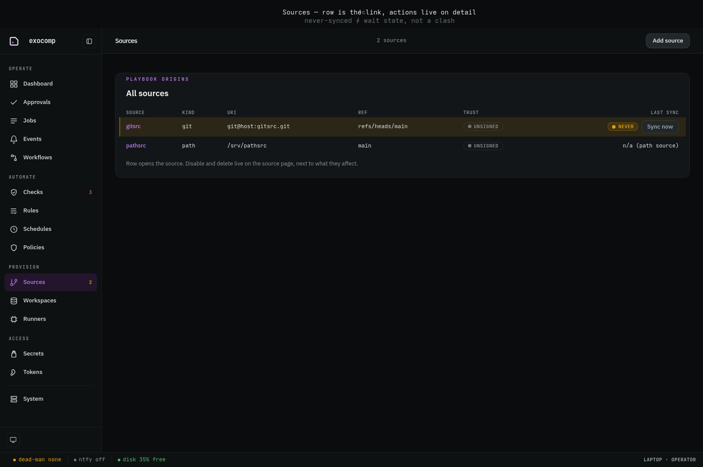
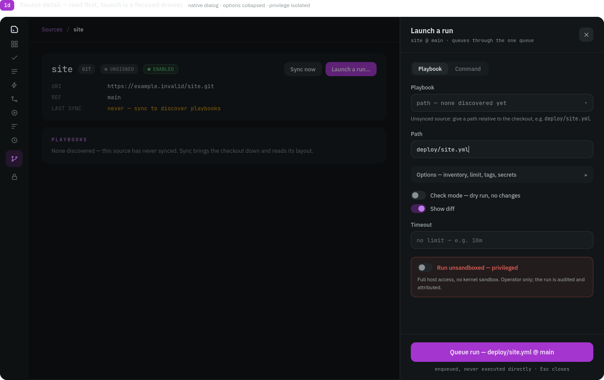

# Sources and inventory

All automation in exocomp executes against registered **Sources**. A source represents a Git repository, local directory, or storage mount containing Ansible playbooks, roles, collections, and OpenTofu configurations.

## Registering a source

Register a Git repository with `exocomp source add`:

```bash
exocomp source add homelab \
  --kind git \
  --url git@github.com:example/homelab.git \
  --branch main
```

View configured sources in the CLI or Web UI:

```bash
exocomp source list
```

```
NAME     KIND  REF    LAST SYNC            TRUST
homelab  git   main   2026-10-11 22:30:00  trusted
```

In the Web UI, the sources list shows synchronization health, branch tracking, and active execution cards:



Selecting a source opens its detail view, where you can inspect playbooks, run histories, and trigger new executions:



## Dependency management in sources

exocomp enforces strict per-source isolation:

1. **Python dependencies (`pyproject.toml` or `requirements.txt`)**:
   If a playbook directory contains a Python dependency manifest, exocomp uses `uv` to build an isolated virtualenv under `cache/python/<source>/<hash>` (ADR 0011). If no manifest is present, it executes using the pinned container toolchain.
2. **Ansible collections (`requirements.yml`)**:
   Per-source collection manifests are resolved via `ansible-galaxy` into `cache/collections/<source>/<hash>` (ADR 0015). Under the enforcing sandbox, local collection artifact paths (e.g. `type: dir` or `type: file` pointing to sibling directories) are granted read-only permissions automatically so collections install without sandbox permission violations.

## SSH fleet keys and host onboarding

To manage target nodes without distributing individual SSH keys, exocomp maintains a single **fleet identity key** in the age envelope.

1. **Display the public key**:
   ```bash
   exocomp host key
   ```
   Add this public key to the target node's `~/.ssh/authorized_keys`.

2. **Onboard target hosts**:
   ```bash
   exocomp host add router.lan --fingerprint SHA256:abc123xyz...
   ```
   exocomp strictly verifies host fingerprints against its trusted `known_hosts` store. Connecting to an unpinned or changed host key is refused.
