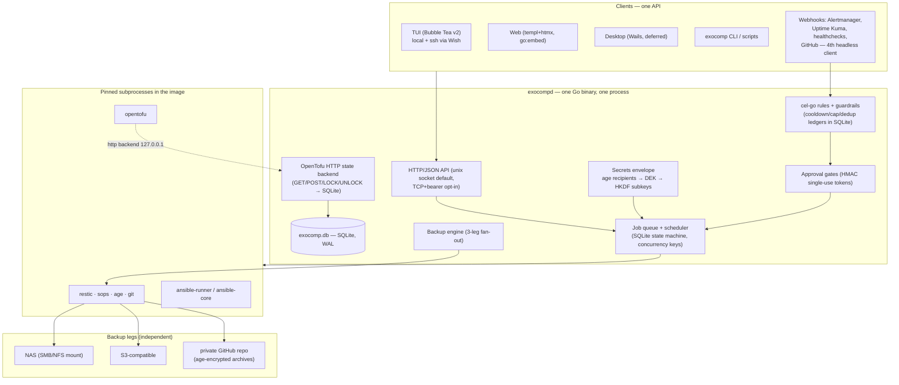

# exocomp — Technical Design (v1)

Status: **accepted** · Date: 2026-08-21
Supersedes: `candidate-compose-first.md`, `candidate-thin-core.md`, `candidate-hybrid.md` (kept as records)
Inputs: `../research/*.md` (8 landscape notes), `critique.md` (22-gap adversarial review)

---

## 1. Decision

**Build the thin-core architecture**: one static Go binary (`exocompd`) that owns only
*state, sequencing, keys, and recovery*, shipped inside one rootless container together
with pinned copies of `ansible-core`, `opentofu`, `restic`, `sops`, `age`, and `git`,
which do all the actual work as subprocesses.

This is `candidate-thin-core.md`, adopted with the amendments in §3 (each amendment
closes a gap the adversarial critique found). Read the candidate doc for full component
tables, data model, and diagrams; this document is the authoritative summary plus the
deltas.

### 1.1 Why not the other two candidates

Three designs were produced independently and reviewed adversarially (22 gaps found,
`critique.md`). The comparison was decided by *structural* flaws — ones that cannot be
patched without abandoning the premise of the design:

| | compose-first (Semaphore + `ctl` glue) | hybrid (Semaphore + `keel` supervisor) | **thin-core** |
|---|---|---|---|
| Guardrails (approvals, cooldowns, caps) | **Bypassable** — Semaphore's own scheduler and Run button dispatch jobs the gate never sees | **Bypassable** — same hole | Enforced in the only queue that exists |
| Secret redaction in job logs | None — Semaphore's log capture persists plaintext, which then flows into backups | None | Designed in (redaction filter + known-secret scan, fuzzed) |
| Auth | Two login systems, two session cookies, one origin | Same | One identity source |
| Backup consistency | Backup runs *as a Semaphore task*, so the DB can never be quiescent at snapshot time | Quiesce window exists, but two state stores with no shared transaction | One SQLite file, `VACUUM INTO` |
| Key rotation | — | **Silently destroys Semaphore's key store** (rotates the derived encryption key without re-encrypting the store) | Sequenced single job with rollback point |
| Effort to v1 | ~42 person-days | ~46–63 person-days | ~22 FTE-weeks |

Compose-first and hybrid are cheaper, but their cost advantage evaporates once you fix
the bypass hole: you must disable Semaphore's scheduler, block its Run button, and
restrict task creation to the companion's token — at which point you have paid for
Semaphore and thrown away most of what it does. The guardrails, the redaction filter,
and the recovery chain are the *point* of this project; a design where they are advisory
is not a candidate. Thin-core's flaws found in review were all detail-level and are
fixed in §3.

The honest cost of thin-core — ~22 FTE-weeks and solo-maintainer bus factor — is
accepted because **nothing is stored in a bespoke format** (plain SQLite, plain restic
repos, plain git bundles, plain age files, standard tofu state): the exit cost from
abandonment is a weekend of scripting, not data loss.

### 1.2 Key research verdicts this design rests on

- **AWX is frozen** (no release since 24.6.1, July 2024; needs k8s + 16 GB) — disqualified.
- **Semaphore UI** is the closest prior art (MIT, Go, single binary, runs Ansible +
  OpenTofu) but is web-only, paywalls Terraform state (Pro), has open backup/restore
  defects (#1024, #2227), and has no seam for approval gates. Used as a data-model
  reference and an explicit export target, not a dependency.
- **OpenTofu over Terraform** (MPL-2.0 vs BSL; native client-side state encryption since
  1.7). No packaged TACoS platform fits homelab scale (Terrakube = Java multi-service,
  Burrito/tofu-controller = k8s, OTF = pre-1.0 solo project, Atlantis = PR-driven CI glue).
- **sops + age** is the secrets-at-rest layer; **OpenBao deferred** (single-binary and
  Vault-compatible, but the seal/unseal lifecycle fights "trivially easy to recover";
  seam kept open, see §3.10).
- **restic** (shelled out, pinned — its no-Go-library stance is deliberate and permanent)
  for encrypted backup; **Litestream** optional sidecar for seconds-level RPO;
  Kopia's embeddable API is pre-1.0, rustic is beta, Borg is Python — all rejected for v1.
- **No event-automation platform fits** (StackStorm heavy, Grafana OnCall archived
  2026-03, ansible-rulebook ≈250 MB + Drools, n8n fair-code + heavy): normalized
  webhooks + **cel-go** rules + guardrails in the queue, approvals via ntfy action buttons.
- **Go UI stack end-to-end**: Bubble Tea v2 TUI (also served over SSH via Wish),
  templ + htmx web UI via `go:embed` (no Node), Wails desktop wrapper deferred.
  Textual/Python rejected (no static binary; Textualize wound down 2025).

### 1.3 Post-decision component reviews (2026-08-21)

Three components were evaluated against the accepted design after the fact
(full notes: `../research/addendum-turso-pglite-ghostty.md`). None changes a decision:

- **Turso (libSQL + Turso Database)** — *discard, defer-watch on the Rust rewrite.*
  libSQL's sync requires CGO and gravitates to Turso Cloud (violates static-build and
  vendor-free-DR pillars); Turso Database is maintainer-described beta/pre-1.0 and its
  non-CGO Go driver dlopens a runtime-extracted `.so`. Its differentiators (replicas,
  cloud sync) serve multi-node fan-out, which is out of scope. `modernc.org/sqlite`
  stands. Watch trigger: Turso Database 1.0 **plus** a self-hosted sync target — and
  even then it competes with Litestream, not with SQLite.
- **PGlite** — *discard.* No supported CGO-free Go embedding exists (it targets JS
  hosts); single-user-mode Postgres behind a multiplexer; and the `pglite-socket`
  escape hatch reintroduces exactly the external stateful DB process the design
  forbids. It also does **not** un-reject Windmill/OTF/Terrakube, which need real
  multi-connection Postgres.
- **Ghostty / libghostty (wasm)** — *defer-watch, no integration.* Ghostty is a
  beneficiary of TUI-over-SSH, not a component. `ghostty-web` (Coder's wasm wrapper of
  `libghostty-vt`, faster than xterm.js) is recorded as the chosen library **iff** an
  opt-in in-browser TUI panel is ever added; the web tier's job (phone-tap approvals)
  stays plain HTML. The desktop path stays Wails (libghostty's embedding API is
  unstable, no Windows, no webview story).

### 1.4 Naming (2026-08-21)

The project is **exocomp** — canonical domain **exocomp.dev** (registered), daemon
`exocompd`, CLI `exocomp`, installer at `get.exocomp.dev`. The CLI is never aliased to
`exo` (collides with the exo-lang compiler).

The working name "control" was dropped after a collision check: Windscribe's **Control D**
DNS service ships an open-source daemon literally named `ctrld` (one-liner router
installs, Docker image) aimed at the same homelab audience — a binary named `controld`
would be a standing source of confusion. `control.dev`/`controld.dev` are also
registered, and Trek's own "Control" (the Section 31 rogue AI) is the wrong omen for an
automation daemon.

Why Exocomp: the exocomps (TNG *"The Quality of Life"*) are small self-directed repair
units that maintain station infrastructure autonomously — and famously refuse orders
that would destroy them. Autonomous maintenance with built-in refusal of destructive
commands is this design's thesis (queue-enforced guardrails, default-deny destructive,
approval gates). Namespace verified clean in the infra space; `exocomp.dev` and
`exocomp.sh` were both unregistered at check time (the former now ours).

Historical documents (`candidate-*.md`, `critique.md`, the research notes) retain the
working name; they are records of the process, not living specs.

---

## 2. Architecture summary

Commitments (unchanged from the candidate):

- **Single container, honestly stated** (ansible-core is Python, so the artifact is an
  image with one static Go binary inside). Podman Quadlet primary, compose fallback.
- **Terraform Cloud role**: `exocompd` implements the OpenTofu HTTP state backend
  (~400 LOC) — locking via a SQLite UNIQUE row (immune to the MinIO/Garage
  conditional-write gaps), state version history + rollback as UI objects, applies
  additionally serialized by `concurrency_key`. State encrypted by tofu itself
  (`TF_ENCRYPTION`, PBKDF2 passphrase HKDF-derived from the DEK).
- **Secrets envelope**: N age recipients (TPM-sealed host key via systemd-creds,
  printed recovery identity, optional YubiKey) each wrap one 32-byte DEK; secrets are
  AES-256-GCM under the DEK; everything else (restic passwords, tofu passphrases,
  webhook HMACs, vault passwords, approval-token keys) is HKDF-derived, so the printed
  kit carries **one** secret.
- **Recovery chain as a feature**: `keyring.age` (safe ciphertext) written to every
  backup target root *outside* the restic repo; printed key → fetch keyring.age →
  unwrap DEK → HKDF → restic password → restore, every arrow executable with
  off-the-shelf `age`/`openssl`/`restic` and no project code.
- **Reactive path**: normalize → CEL match → guardrails *in the queue* (cooldown,
  daily cap that disables the rule, dedup, kill switch, default-deny destructive) →
  approval via ntfy action button / TUI / web → same job path as manual and scheduled
  runs. Plan-then-apply is two linked jobs; the approver sees the saved plan.
- **Bootstrap**: `install.sh` + six-screen idempotent wizard that refuses to pass the
  recovery-kit screen and runs a full backup **and a restore drill** before setup
  completes. Monthly automated `dr-drill` thereafter.

---

## 3. Amendments (critique gaps → design changes)

Each amendment below is **normative** and overrides the candidate doc where they differ.

### 3.1 The recovery kit closes the credential loop (gap 1)

The printed kit carries, in addition to the recovery age key:
- a **dedicated read-only storage credential** per off-host leg (scoped S3 key with
  GET/LIST only; a GitHub fine-grained PAT with read-only contents on the backup repo),
- the healthchecks (dead-man) ping URL (§3.7),
- the ansible-pull trust anchor fingerprint if pull mode is enabled (§3.12).

These are stored in the DB as `secret` rows tagged `on_recovery_kit=true`; the kit
renderer refuses to render without them, and rotating one regenerates the kit (with a
nag until reprinted). The **monthly DR drill runs from a scratch container holding only
the kit contents** — no host state, no shell history — so the circular dependency class
fails a scheduled test instead of a real disaster.

### 3.2 GitHub backup leg that actually reclaims space (gap 3)

Git history keeps every blob reachable forever, so "git rm on retention" never shrinks
the repo and eventually hits GitHub's limits. The GitHub leg therefore:
- pushes each snapshot as a **single orphan commit, force-pushed** to a rolling window
  of refs (`backup/latest`, `backup/weekly-N`) — old objects become unreachable and GC
  on GitHub's side reclaims them;
- **chunks archives at 90 MB** (GitHub hard-rejects files ≥100 MB) with a manifest;
- checks repo size via the API before pushing and **fails the leg loudly** at 4 GB
  (GitHub guidance is 5 GB) instead of degrading silently;
- documents that this is within GitHub's acceptable-use for private repos at
  control-plane data volumes (MBs, not media libraries), and recommends the S3 leg as
  primary off-site regardless.

### 3.3 Upgrade and rollback of the control plane itself (gap 5)

- Every upgrade takes a **mandatory automatic pre-upgrade snapshot** (full backup, all
  legs, tagged `pre-upgrade-<version>`); the upgrade job refuses to proceed if it fails.
- `install.sh --rollback --image-tag <X>` restores the pre-upgrade snapshot and pins
  the previous image — tested in CI, and independent of `exocompd` (the installer is
  separately versioned).
- DB migrations remain forward-only; **rollback = restore**, stated explicitly, which
  the pre-upgrade snapshot makes safe.
- A scheduled **upgrade rehearsal** mirrors the restore drill: restore last night's
  snapshot into a scratch instance, run the new image's migrations, assert, discard.
- Self-update stays opt-in and approval-gated; recovery never depends on the thing
  being upgraded.

### 3.4 Whole-container resource budget (gap 6)

Target hardware named: **runs comfortably on a 4 GB N100 / Raspberry Pi 4** (arm64 and
amd64 images).
- Image size ≤ 800 MB (measured in CI).
- Quadlet unit ships `MemoryMax=1.5G`; `exocompd` idle RSS ≤ 60 MB (CI fails > 80 MB).
- **Max 2 concurrent jobs by default** (derived from memory: ansible forks + tofu
  providers are the real consumers); configurable with a documented sizing table.
- Disk: provider/collection caches (§3.8) and blobs live in the data volume with a
  free-space guard (§3.11); `job_event` retained 90 days, full logs gzipped in
  `artifact` with retention.
- CI measures image size, idle RSS, and peak RSS of a reference ansible + tofu job.

### 3.5 Escalation, scoped honestly (gap 7)

v1 **is not PagerDuty** and says so: v1 ships (a) ntfy priorities with re-publish at
`urgent` at 50 % of an approval/alert TTL, (b) acknowledgement tracking on notifications
that request it (`ack` action button; unacked → re-notify per policy), and (c) the
dead-man's switch. **healthchecks (self-hosted or .io) is a first-class bootstrap step**:
provisioned by the wizard, its ping URL stored, backed up, and printed on the kit.
A `notifier` interface seam is reserved for GoAlert/ntfy-emergency-class escalation
post-v1; on-call rotations are explicitly out of scope.

### 3.6 ansible-vault is designed, not asserted (gap 8)

- `project.vault_ids` maps **multiple `--vault-id` labels** to key-store entries
  (`dev@…`, `prod@…`), each either imported or HKDF-derived.
- The wizard's first-project screen has an **"import existing vault password"** flow
  (paste/point at a file → stored as a `vault_pass` secret → bound to a vault-id).
- A seeded **`vault-rekey` runbook** automates `ansible-vault rekey` across a repo for
  a chosen vault-id, as an approval-gated job with a pre-run git-bundle snapshot.
- `become_pass` / `ansible_ssh_pass` in host_vars are sourced via the `community.sops`
  lookup or vault files — never stored plaintext in the repo; the doctor scans for
  plaintext credentials in host_vars and warns.
- **Ownership rule stated**: sops+age owns new secrets (group_vars/*.sops.yml, tfvars);
  ansible-vault is the compatibility path for pre-existing content. Both feed from the
  same DEK root.

### 3.7 The printed card is tested code (gap 9)

The candidate's manual-recovery one-liner was broken as written. Normative rule: **the
exact rendered text of the recovery card is executed in CI** on a clean image against a
fixture backup, and the derived restic password is diffed against `exocompd`'s own
derivation. The card is a build artifact, not documentation.

### 3.8 Offline-restorable runtime dependencies (gap 11)

DR must not depend on registry.opentofu.org or Ansible Galaxy being reachable:
- `TF_PLUGIN_CACHE_DIR` + a **filesystem provider mirror** live in the data volume,
  populated on first `init` and refreshed by a scheduled job; `.terraform.lock.hcl` is
  respected and the mirror is part of every backup.
- **Galaxy collections/roles are vendored** into the data volume (`ansible-galaxy
  install -r requirements.yml -p <cache>`) the same way — including `community.sops`,
  which the design itself depends on.
- The restore drill asserts a play and a plan run **with network egress disabled**.

### 3.9 Remote access and approval transport (gap 10)

- Defaults: unix socket locally; **ntfy defaults to self-hosted or token-authenticated**
  — the wizard never defaults to a public `ntfy.sh/<random>` topic, because approval
  URLs are bearer capabilities.
- The supported remote pattern is **Tailscale/WireGuard-first**: the wizard detects a
  tailnet and configures the TCP listener bound to the tailnet address, with tailnet
  URLs in notifications (and optional Tailscale Serve for TLS). Fallback: Caddy + ACME
  reverse proxy recipe shipped in docs. Approval callbacks are HMAC single-use,
  TTL-bounded, constant-time compared — but the transport they ride is now specified,
  not assumed.

### 3.10 Root-of-trust seam + adoption paths (gap 22)

- The envelope's key-provider is an interface: the local age identity is the default
  implementation; an **external KMS/OpenBao Transit key can substitute at bootstrap**
  (OpenTofu already supports Transit as a state-encryption key provider, so both halves
  line up).
- Explicit, reversible **adoption runbooks**, tested against fixtures: take over
  existing OpenTofu state (`tofu init -migrate-state` onto the HTTP backend, with a
  documented back-out while the old backend still exists), import an existing vault
  password (§3.6), and register an existing restic repo (verify + adopt rather than
  re-init).

### 3.11 Operational hardening (gaps 12, 17, 19, 20, 18, 21)

- **Host onboarding** is a seeded, first-class runbook: push SSH key, create
  `ansible_user`, sudoers, record host key. `known_hosts` is stored in the DB and
  backed up; DR restores host trust. The supported connection matrix is documented
  (Linux over SSH; network devices via `network_cli`; jump hosts via
  `ProxyJump`; non-SSH appliances are out of scope for v1). Per-host credentials are
  `secret` rows bound per inventory group, not one global key.
- **Mount and disk guards**: before any NAS leg, assert mountpoint (`mountinfo`),
  canary file, and free space — an unmounted `/mnt/nas` must fail, not silently fill
  the local disk. A global free-space guard refuses new jobs and alerts before the
  volume-full cliff. NAS/SMB mount credentials are managed config (systemd mount units
  generated from the DB), inside the backup.
- **Self-observability**: `/metrics` (Prometheus) plus a seeded alert-rules file
  covering: reactive engine paused, approvals pending > TTL/2, backup leg stale > 48 h,
  drill failed, tflock held stale, disk low, job queue stuck. The control plane is
  monitored by the same stack it reacts to; "the automation stopped automating" is
  itself an alert.
- **Boot-time reconciliation**: on startup, jobs in `queued/running` whose process is
  gone are swept to `interrupted` (terminal, notified, never auto-retried); stale
  `tflock` rows whose owning job is dead are flagged with an audited one-click
  force-unlock. Asserted in the restore drill (every restored snapshot contains such
  rows by construction).
- **Token lifecycle**: API tokens get their own table — scope, expiry, `last_used_at`,
  revocation — and every audit row records the resolved operator identity, whether the
  action arrived via TUI, web, token, or approval callback.
- **Honest security claims**: state ciphertext in `tfstate` is opaque *to backup
  targets*, not to the control plane (which derives the passphrase). The threat model
  section states plainly: `exocompd` can decrypt everything it manages; the envelope
  protects backups, stolen disks, and off-host attackers — not root on the box.

### 3.12 ansible-pull, if enabled, is inside the guardrails (gap 16)

Fleet-wide `ansible-pull` (optional self-healing mode) must not be a guardrail bypass:
pull targets pin to a **tag the control plane advances only after a successful gated
run** (never a moving branch), commits/tags must be **signed**, and the trust anchor is
distributed at host onboarding and printed on the recovery kit.

---

## 4. Expected bill of materials

Indicative pins as of 2026-08; exact versions are recorded per build in `MANIFEST.json`
and enforced by `exocomp doctor`. The license boundary is deliberate: GPL components
(ansible-core, git) are **subprocesses**, never linked, so `exocompd`'s own license
stays unencumbered — the same reason Dagu (GPL-3.0, would-be-linked) was rejected.

### 4.1 Compiled into `exocompd` (one static Go binary)

| Component | Pin | License | Role |
|---|---|---|---|
| Go toolchain | 1.24+ | BSD-3 | `CGO_ENABLED=0` static builds, amd64 + arm64 |
| `modernc.org/sqlite` | latest stable | BSD-3 | embedded DB (pure Go, no CGO); `exocomp.db`, WAL |
| `filippo.io/age` | 1.2.x | BSD-3 | envelope crypto as a library (recipients → DEK) |
| Go stdlib `crypto` (GCM, `crypto/hkdf`) | 1.24 stdlib | BSD-3 | secret encryption + subkey derivation — zero novel crypto |
| `robfig/cron/v3` | 3.x | MIT | schedules, rebuilt from DB on boot |
| `google/cel-go` | 0.2x | Apache-2.0 | sandboxed, non-Turing-complete event rules |
| `containrrr/shoutrrr` | 0.8.x | MIT | notification fan-out (ntfy, gotify, SMTP, webhook) as a library |
| Bubble Tea v2 + Bubbles + Lip Gloss | v2 | MIT | TUI (priority-1 interface) |
| `charmbracelet/wish` | 1.x | MIT | TUI over SSH (`ssh exocomp.home`) |
| `a-h/templ` + htmx | 0.3.x / 2.x | MIT / 0BSD | server-rendered web UI, `go:embed`, no Node build |
| `spf13/cobra` | 1.x | Apache-2.0 | CLI surface |
| *(deferred)* Wails | v2 | MIT | desktop wrapper of the web UI |

Binary target: ~20 MB; idle RSS ≤ 60 MB (CI fails > 80 MB).

### 4.2 Pinned subprocess tools (shipped in the image)

| Tool | Pin | License | Role | Interface contract |
|---|---|---|---|---|
| uv | 0.8.x | Apache-2.0/MIT | build: `uv tool install` of the pinned ansible toolchain (constraints-file pinned, frozen into `MANIFEST.json`). Runtime: operator-only escape hatch — `UV_TOOL_DIR` in the data volume, doctor-gated, never invoked by exocompd (§7.1) | build stage + operator shell |
| ansible-core (+ Python via uv) | 2.1x / 3.12+ | GPL-3.0+ / PSF | playbook execution | via ansible-runner; exit codes gate success |
| ansible-runner | 2.4.x | Apache-2.0 | per-task JSON event stream, artifact capture | `--json` NDJSON, golden-file tested |
| vendored Galaxy collections (`community.sops`, …) | `requirements.yml` lock | GPL-3.0 (mostly) | playbook deps, offline-restorable (§3.8) | data volume cache, in every backup |
| OpenTofu | 1.12.x | MPL-2.0 | plan/apply/drift; native state encryption | `-json` UI stream; HTTP backend → exocompd |
| restic | 0.19.x (sha256-pinned) | BSD-2 | encrypted backup engine, all 3 legs | `--json`; exit codes only for correctness |
| sops | 3.x | MPL-2.0 | repo-file secret ops (same behavior as operator CLI) | shelled out |
| age (CLI) | 1.2.x | BSD-3 | repo-file ops + printed-card manual recovery path | shelled out |
| git | 2.4x | GPL-2.0 | project sources; bundle/push for GitHub backup leg | plumbing only |
| nono | ≥0.55.0 (sha256-pinned) | Apache-2.0 | kernel sandbox around job subprocesses (`local-sandboxed` tier, Linux default; §7.3) | `nono run --profile job-<kind>`; doctor probes Landlock ABI |
| Litestream *(optional sidecar)* | 0.5.x | Apache-2.0 | continuous WAL→S3, seconds-level RPO | own process, config generated from DB |

Image target: ≤ 800 MB total (measured in CI); base is a slim glibc image (Python
requirement rules out distroless-static).

### 4.3 Deployment substrate (host-provided)

| Component | License | Role |
|---|---|---|
| Podman + Quadlet (systemd) | Apache-2.0 | primary deployment: rootless, `MemoryMax=1.5G`, journald |
| docker-compose file | — | fallback for Synology/TrueNAS/Docker-only hosts |
| systemd-creds + TPM2 *(optional)* | LGPL/GPL (host) | TPM-sealed host age identity |
| age-plugin-yubikey *(optional)* | MIT/Apache-2.0 | hardware recipient in the keyring |
| `install.sh` | project | separately-versioned bootstrap/restore/rollback — never depends on exocompd |

### 4.4 Operator-supplied services (composed, not shipped)

| Service | License | Role | Required? |
|---|---|---|---|
| ntfy (self-hosted or token-authed) | Apache-2.0/GPL-2.0 | approval action buttons, notifications | yes (approvals UX) |
| healthchecks (self-hosted or .io) | BSD-3 | dead-man's switch; ping URL on recovery kit (§3.5) | yes (backup honesty) |
| Prometheus + Alertmanager (existing) | Apache-2.0 | event source in, `/metrics` + seeded rules out (§3.11) | recommended |
| NAS share (SMB/NFS) | — | restic leg 1 | ≥1 of the |
| S3-compatible store (MinIO/Garage/B2/R2) | varies | restic leg 2; optional Litestream target | three legs |
| private GitHub/Gitea repo | — | leg 3: age-encrypted orphan-commit archives (§3.2) | required |
| Git forge for ops repos | — | playbook/tofu sources (bundled into every backup) | yes |
| Tailscale/WireGuard *(optional)* | BSD-3 | remote access path for approvals (§3.9); Caddy (Apache-2.0) fallback | recommended |

### 4.5 Budget rollup

| Budget | Value | Enforced |
|---|---|---|
| Image size | ≤ 800 MB | CI |
| `exocompd` idle RSS | ≤ 60 MB (fail > 80) | CI |
| Container memory | `MemoryMax=1.5G` | Quadlet unit |
| Concurrent jobs | 2 default (memory-derived) | queue config |
| Target hardware | 4 GB N100 / Raspberry Pi 4, amd64+arm64 | reference bench in CI |

## 5. Delivery plan

Order preserves the rule that the recovery chain is right on day one and never
invalidated afterward.

| Milestone | Contents | Effort (FTE-wks) |
|---|---|---|
| **v0.1 "provable core"** | skeleton, secrets envelope (+ redaction filter, fuzzed), job queue/executor, Ansible executor (runner + vault/sops wiring §3.6), backup engine (3 legs incl. §3.2), restore + install.sh + tested recovery card (§3.7), 2-screen TUI | ~7.5 |
| **v0.5 "both halves"** | OpenTofu executor + HTTP state backend + drift + plan-gated applies, scheduler, offline caches (§3.8), full TUI (8 screens + wizard), Wish/SSH | ~7 |
| **v1.0** | event ingress + CEL rules + guardrails, approvals + ntfy (§3.9), notifications/escalation scope (§3.5), web UI, /metrics + seeded alerts, host onboarding, upgrade/rollback (§3.3), packaging + budgets in CI (§3.4), docs incl. threat model + adoption runbooks (§3.10) | ~8.5 |
| Deferred | Wails desktop, OpenBao resolver, Litestream embedding, GoAlert-class escalation | — |

Total ≈ 23 FTE-weeks (~3 focused months). Every milestone is independently useful.

## 6. Top risks (carried forward, with amendments applied)

1. **Solo-maintainer bus factor** — mitigated by no-bespoke-formats + `exocomp export
   --portable` (Semaphore-importable) + the CI-tested manual recovery path.
2. **Crypto envelope subtly wrong** — zero novel crypto (filippo.io/age, stdlib GCM +
   HKDF), fuzzed redactor, canary secret in every drill, external review of
   `internal/secrets` (~600 lines) before v1.0.
3. **Subprocess contract drift** — pinned versions + golden-file corpora + success
   from exit codes only, never parsed output.
4. **Reactive loop causes the outage** — guardrails live in the queue with SQLite
   ledgers; caps disable rules; kill switch one keystroke away; every event persisted
   with outcome.
5. **Scope creep into a bad AWX** — contract in the README: one operator, one
   container, no external DB, no RBAC beyond operator/readonly, no DAGs, no plugins;
   idle-RSS budget enforced by CI.

## 7. Post-acceptance refinements (2026-08-21)

### 7.1 uv-managed Python toolchain — build-time install, operator escape hatch

The image's Python layer is built with **uv**: `uv python install` (standalone CPython)
plus one keyed tool install —
`uv tool install ansible-core==X --with ansible-runner --with <module deps>` pinned by
a committed constraints file — with the resolved set frozen into `MANIFEST.json`
alongside the tool pins. (`uv tool install` doesn't consume a project `uv.lock`; the
constraints file + frozen manifest give the same determinism.) Module-side deps
(netaddr, jmespath, pywinrm, …) live inside the tool venv via `--with`, which is also
what keeps the escape hatch below coherent. The 800 MB image ceiling stands; the
working target drops to **~500 MB**.

**uv ships in the image, and `UV_TOOL_DIR` + `UV_CACHE_DIR` point into the data volume**
(`/var/lib/exocomp/toolchain/`). That one decision turns "uv happens to be present"
into a designed **operator escape hatch**: a human can
`uv tool install ansible-core==Y` to switch versions, and the switch (a) persists
across container restarts, (b) rides inside every backup — so a restore comes back
with the switched version, no registry on the DR path, §3.8 intact — and (c) is
visible: `exocomp doctor` reports which binary each shim resolves to and diffs it
against `MANIFEST.json`.

Boundary rules that keep the hatch from becoming a hole:

- **The control plane never invokes uv.** No `uvx`, no on-demand installs on the job
  path — the hatch is operator-initiated at a shell, on purpose.
- **Out-of-range versions are loud.** The golden-file parsing corpus is valid only for
  tested version ranges; `doctor` flags a switched toolchain and jobs refuse to run
  against it unless the project carries an explicit, acknowledged override.
- **DR-path runbooks (backup, restore drill, host onboarding) always execute the
  baked-in image pins**, never the volume toolchain — a fresh restore has the image
  before it has the volume. Enforced by the doctor, asserted by the drill.
- Per-project Python module deps may likewise be uv-installed into cached venvs under
  the same volume toolchain dir — backed up, offline-restorable, drill-covered.

### 7.2 Executor isolation seam — `local` default, `container` opt-in

The queue executes jobs through an `ExecutorDriver` interface, present from v0.1:

- **`local` (default, and the only topology bootstrap/DR requires):** pinned tools in
  the image, subprocess boundary, per-job tmpfs, separate executor UID, rootless
  container. One image + one volume = working system; nothing else to pull at restore.
- **`container` (opt-in, post-v1):** per-job sibling containers via
  **ansible-runner's native podman process isolation / execution environments** (the
  AWX EE pattern — a capability of a dependency we already ship, not new
  orchestration), and plain `podman run` for tofu. Buys: privilege separation
  (playbooks — arbitrary code from git — no longer share a namespace with the mlocked
  DEK, the per-job ssh-agent, or the API socket; the runner sees only its job tmpfs),
  per-project EE images with independent ansible/collection pins, and per-job memory
  caps.

Stated trades for `container`, so the choice is informed: `exocompd` must mount the
podman socket, which is effectively host-user power — the sensitive capability moves
rather than disappears; EE images are a restore-time dependency, so any EE used by a
runbook on the DR path must be rebuildable from the ops repo or mirrored in the data
volume (default: DR-path runbooks are `local`-only, enforced by the doctor); and
per-project tool versions widen the golden-file test matrix, so EEs are tested
per-project, not globally.

Delivery impact: the `ExecutorDriver` interface costs ~0 extra in v0.1 (the queue
already isolates execution behind one call); the `container` driver itself is deferred
post-v1 alongside Wails and OpenBao.

### 7.3 Job sandboxing — `local-sandboxed` tier via nono (adopted)

Reviewed 2026-08-21 (full note: `../research/addendum-turso-pglite-ghostty.md` §nono).
**nono** (nono.sh, Apache-2.0, Rust; Landlock on Linux / Seatbelt on macOS, seccomp
user-notif network filtering, unprivileged self-restriction — works under rootless
podman) supplies the middle tier §7.2 was missing:

- **`local-sandboxed`** — the **default executor on Linux** where the kernel supports
  it: every job subprocess runs under `nono run --profile job-<kind>` with default-deny
  filesystem. Allowed: the job tmpfs, repo checkout, artifact dir, tool paths,
  provider/collection caches. Denied: `exocomp.db`, `host.key`, the keyring, other
  jobs' tmpfs, **the exocomp API socket, and any podman socket**. Network per runbook
  kind: ansible gets SSH to inventory hosts; tofu gets provider endpoints plus the
  127.0.0.1 state backend.
- This captures most of the `container` driver's privilege-separation prize — arbitrary
  playbook code can no longer read the DB or keys — with **no podman socket handed to
  exocompd and no registry on the DR path** (Landlock is local; sandboxing applies even
  during restore). The `container` driver's remaining justification narrows to
  per-project EE versioning and hard per-job resource caps.
- Policy lesson generalized from nono's CVE-2026-47128 (escape via the user systemd
  D-Bus socket, fixed 0.55.0): the escape class is *"sandboxed process reaches a
  powerful local unix socket."* Exocomp ships such sockets itself; job profiles deny
  them explicitly and `exocomp doctor` asserts the denial (attempts a socket connect
  from inside a probe sandbox and expects failure).
- Version floor ≥0.55.0, sha256-pinned like restic. `doctor` probes the Landlock ABI
  (network rules need ABI v4+, kernel ≥6.7) and **degrades loudly** to plain `local`
  with a warning on older kernels — never silently.
- Fallback seam if the dependency sours: in-process `go-landlock` self-restriction
  (filesystem-only) applied between fork and exec — no new binary, weaker network
  story, same profiles. nono's agent-oriented features (AGENTS.md signing, snapshot
  rollback, credential injection) are unused.

Delivery impact: profiles + doctor probes ≈ 0.5 FTE-week inside the v1.0 hardening
line; BOM §4.2 gains one pinned binary (~10 MB).

### 7.4 Platform integration contract (systemd · podman · docker/compose · SELinux)

"Works with" is a tested contract, not an adjective. Tiers:

| Platform | Tier | What makes it true |
|---|---|---|
| systemd (Quadlet) | first-class | `Type=notify` + `WatchdogSec` (sd_notify readiness after DB integrity + keyring unwrap; watchdog pinged from the scheduler loop, so a *wedged* daemon restarts, not just a dead one); installer runs `loginctl enable-linger`; `MemoryMax=` in the unit; journald |
| podman (rootless) | first-class | Quadlet units, podman ≥ 4.4 floor; podman auto-update disabled for our unit (self-update is the approval-gated job, §3.3); socket mount confined to the deferred `container` driver |
| docker / compose | supported, degraded loudly | shipped compose file; `restart: unless-stopped` + json-file logs instead of systemd; **no systemd-creds path → host key is the 0400 file (threat tier 1, §6.2), TPM sealing unavailable**; rootful unless operator runs rootless Docker; `install.sh` detects the engine and states the tier |
| SELinux enforcing | supported, CI-tested | see items below |

SELinux items (target platform includes Fedora/RHEL-family, enforcing):

- **Labels everywhere**: data volume via Quadlet `.volume` (implicit relabel) and `:Z`
  on every documented bind mount — no example may depend on permissive mode.
- **NAS leg**: network filesystems cannot be relabeled (`:Z` fails on NFS/CIFS);
  installer sets/verifies `virt_use_nfs` / `virt_use_samba` booleans; the §3.11 mount
  canary converts an AVC-denial EACCES into a loud pre-backup failure rather than a
  silently missing leg.
- **nono/Landlock stacks with SELinux** (stackable LSM, policies AND together) —
  asserted in the enforcing CI job, not assumed.
- **container-selinux's socket confinement** is treated as a second enforcement of the
  §7.3 "jobs reach no local sockets" rule. Exception documented where it bites: the
  deferred `container` driver's podman-socket mount needs `label=disable` on that
  mount.
- **CI gate**: a Fedora VM job runs install → bootstrap → backup → restore drill with
  `setenforce 1`. SELinux support that is not tested enforcing is a wish (same rule as
  the RSS budget). `exocomp doctor` surfaces recent AVC denials touching our paths.
