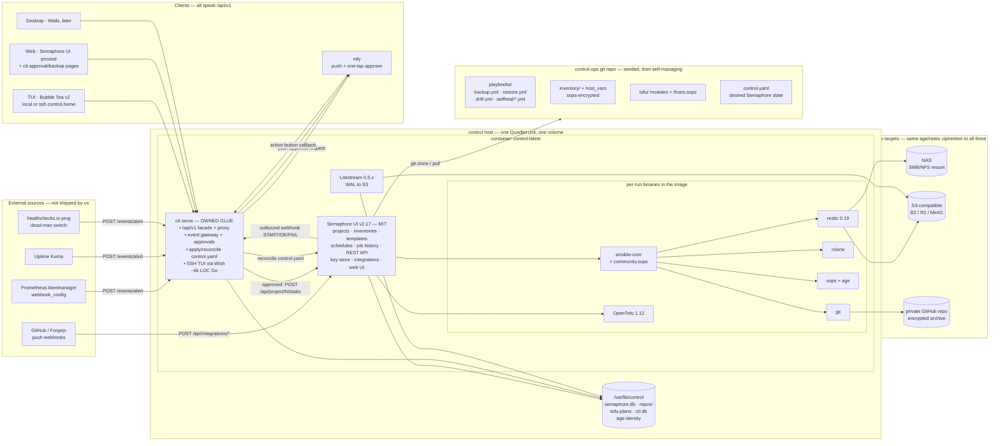
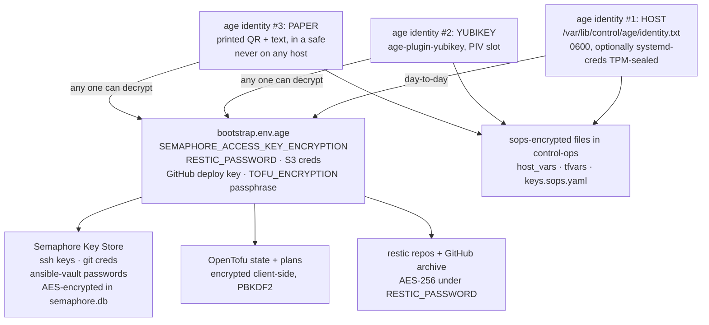
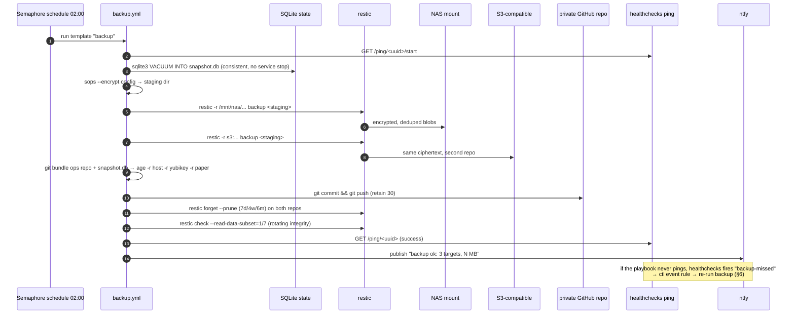
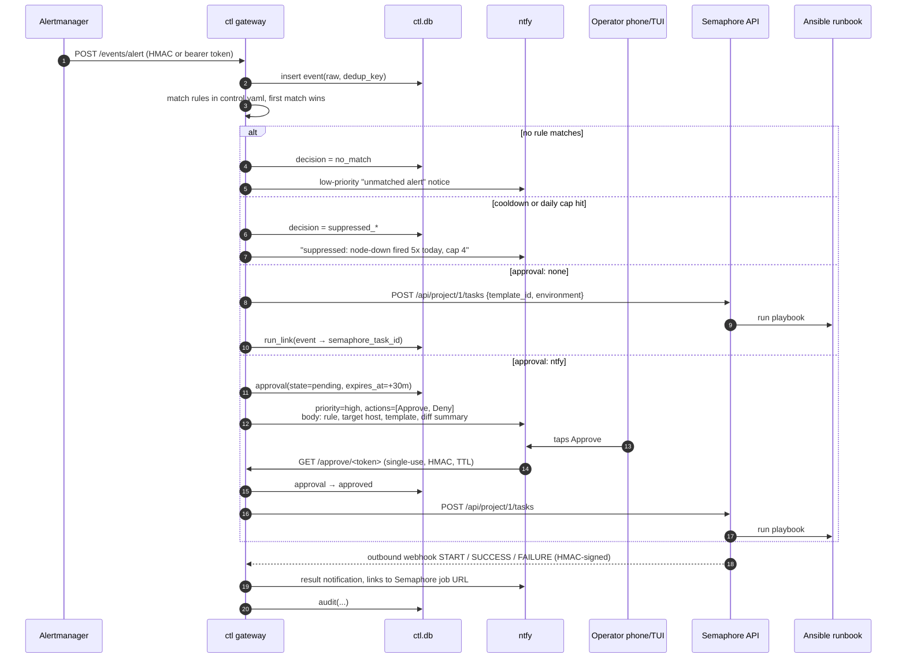
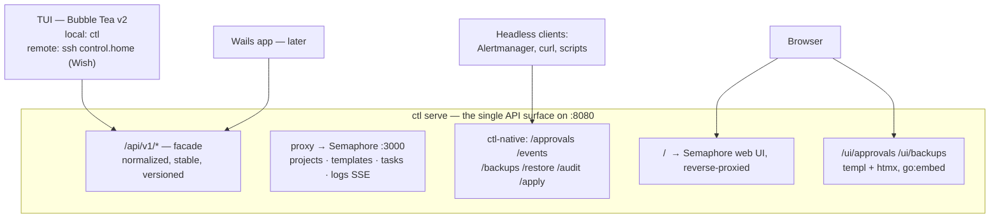

# Candidate design: COMPOSE-FIRST

**Angle:** maximally reuse existing OSS; own as little code as possible. Every requirement that an
existing, healthy, permissively-licensed tool already solves gets delegated to that tool. The
project's own deliverable is a **thin glue binary plus a seeded ops repo** — not a control plane.

**Design date:** 2026-08-21. Sourced from `docs/research/*.md`.

---

## 0. The one-paragraph version

Run **Semaphore UI** (MIT, single Go binary) as the execution core: it already is the
Ansible-Tower half (projects, inventories, task templates, cron schedules, job history, REST API,
inbound webhook integrations, ansible-vault key store) and it already runs OpenTofu as a
first-class task type. Do **not** rebuild any of it. Add one small Go binary, `ctl`, that does the
four things Semaphore does not: (1) reconcile a declarative `control.yaml` into Semaphore's API so
the whole instance is reproducible from a file, (2) receive alerts and gate them behind approval /
cooldown / caps before calling Semaphore's own trigger endpoint, (3) present a Bubble Tea TUI over
a unified API facade, and (4) bootstrap/restore the whole thing from an age-encrypted backup.
Everything else — backups, drift checks, self-healing runbooks — is expressed as **Ansible
playbooks in a seeded git repo, run by Semaphore templates on Semaphore schedules**, so backup
history *is* job history and no second scheduler, queue, or history store gets written.

The rule that drives every decision below: **if it can be a playbook or a Semaphore object, it is
not Go code.**

---

## 1. Architecture overview

One container (or one Podman Quadlet unit set), one data volume, one root-of-trust key.
Inside the container, a trivial supervisor runs three long-lived processes: `semaphore server`,
`ctl serve`, and `litestream replicate` (conditional — see §11 R2). Everything else is invoked
per-run by Semaphore's own task runner.



### The four layers, and who owns them

| Layer | Owner | Code we write |
|---|---|---|
| Run engine: playbooks, tofu, inventory, schedules, history, RBAC, key store, web UI | **Semaphore UI** | none |
| IaC runtime + state encryption + locking | **OpenTofu 1.12 + S3-compatible backend** | none |
| Secrets at rest | **sops + age** (+ ansible-vault where a role demands it) | none |
| Backup engine | **restic** (+ rclone, + git) | ~300 lines of YAML playbook |
| SQLite durability | **Litestream** | none (config only) |
| Notification / approval channel | **ntfy** (Apprise optional) | HTTP calls |
| Declarative instance config → Semaphore | **`ctl apply`** | ~1200 LOC Go |
| Alert → approval → runbook | **`ctl serve` gateway** | ~1000 LOC Go |
| TUI | **Bubble Tea + Bubbles + Lip Gloss + Wish** | ~2500 LOC Go |
| Bootstrap / DR | **`install.sh` + `ctl init` + `ctl restore`** | ~300 lines sh + ~800 LOC Go |

---

## 2. Chosen components, with justification

### 2.1 Execution core — Semaphore UI v2.17 (MIT)

The only surveyed tool that is simultaneously single-binary, actively released (v2.16 Aug 2025 →
v2.17 Feb 2026), and *already scoped to the exact combined requirement*: Ansible + OpenTofu +
Terragrunt + Bash task templates, inventories, cron and one-time schedules, job history, a REST
API with Swagger, inbound integrations with matchers/extractors, HMAC-signed outbound webhooks, and
a Key Store that natively holds SSH keys, git credentials, and **ansible-vault passwords**.

Rejected alternatives and why: **AWX** is frozen since 24.6.1 (Jul 2024) and wants 4 vCPU/16 GB
plus Kubernetes. **Rundeck** is a JVM with the useful webhook handler paywalled. **Terrakube** is
the closest Terraform Cloud clone but is Java + Postgres + MinIO + Keycloak-class auth. **Kestra /
Windmill / n8n / StackStorm / Dagu** are workflow engines, not inventory/IaC-aware run engines —
adopting one means running a *second* scheduler and history store next to Semaphore, which is
exactly the code-and-ops surface this angle is trying to avoid.

**What we accept:** the Terraform HTTP state backend, HA, and the Vault/OpenBao secret backend are
Pro/Enterprise tier. We do not pay and do not reimplement — see §2.2.

### 2.2 IaC — OpenTofu 1.12.x (MPL-2.0), not Terraform

Terraform is BSL since Aug 2023. OpenTofu is the CNCF-hosted MPL continuation and is the only one
with **native, backend-agnostic state and plan encryption** (1.7+): state is encrypted client-side
before it reaches the backend, so the backend need not be trusted. That single feature deletes the
entire "Terraform Cloud state storage" requirement — we don't need Semaphore Pro's HTTP backend, we
don't need Terrakube, and encrypted state becomes just another opaque file the backup sweep picks
up with zero Terraform-specific backup logic.

- **Backend:** S3-compatible bucket, `use_lockfile = true` (native conditional-write locking, 1.11+,
  no DynamoDB).
- **Key provider:** PBKDF2 passphrase for v1 — the passphrase lives in Semaphore's key store as a
  template variable, and in the age-encrypted recovery kit. `tofu-age-encryption` is the upgrade
  path to a shared age identity; OpenBao Transit key provider is still experimental upstream and is
  explicitly *not* on the DR critical path.
- **Locking caveat:** MinIO rejects the `If-None-Match: *` wildcard that `use_lockfile` requires, and
  Garage has no conditional PUT at all. Mitigation costs zero code: point state at B2/R2/real S3, **and**
  set the OpenTofu templates in Semaphore to non-concurrent so only one apply is ever in flight.
  At one-operator scale, serialization at the run engine is a strictly stronger guarantee than
  backend locking anyway.
- **Drift:** a Semaphore cron schedule running a `drift.yml` playbook that does
  `tofu plan -detailed-exitcode` per workspace and posts a summary to `ctl` on exit code 2. Drift
  detection is a schedule + 40 lines of YAML, not a subsystem.

### 2.3 Secrets — sops + age primary, ansible-vault secondary, OpenBao deferred

`age` keypair is the single root of trust (§4). `sops` encrypts values in place inside YAML/tfvars
so git diffs stay reviewable; `community.sops` gives Ansible an inline lookup plugin with no daemon
and no network round-trip. ansible-vault stays available and is wired through Semaphore's Key Store
for third-party roles that expect `!vault` values — but no new secret is authored in it.

**OpenBao is deliberately not deployed in v1.** It is the only option with genuine dynamic secrets
and revocation, but it costs a seal/unseal lifecycle to automate and a Raft snapshot to add to the
DR procedure — real operational weight for a capability a one-operator homelab has not yet needed.
The seam is left clean: Semaphore's Vault connector (Pro) and OpenTofu's OpenBao key provider both
speak the same API when the need arrives.

Rejected: **Infisical** (server + Postgres + Redis, ~2 vCPU/4 GB, dynamic secrets behind a license
key), **1Password Connect** (two containers + paid SaaS dependency in the DR path), **Vaultwarden as
machine backend** (its OSS server does not implement Bitwarden's Secrets Manager API — it is a fine
place to keep the *operator's* copy of the age recovery key, and that is the role it gets here).

### 2.4 Backup — restic core, rclone transport, git for the GitHub leg, Litestream for the hot path

**restic 0.19.1** (BSD-2): client-side AES-256 + Poly1305, zstd compression, native S3/B2 backends,
and a mounted SMB/NFS share is just a local path — the NAS leg needs no NAS-specific code. Mature
`check --read-data-subset`, `restore`, `mount`, `dump`. Its refusal to be a Go library is fine: we
shell out from a playbook and parse `--json`, and the process boundary means a backup crash cannot
take the control plane with it.

**rclone** only where restic lacks a native backend (WebDAV, Drive, an odd NAS protocol) — as
restic's `rclone:` backend, not as a second encryption story.

**GitHub leg:** no exotic remote helper. `git bundle` the ops repo + a consistent SQLite snapshot +
sops-encrypted config → one `age`-encrypted archive → `git commit && git push` into a private repo,
pruned on a retention schedule. `git-remote-gcrypt` and `git-remote-restic` are real but
low-velocity projects and do not belong on a DR critical path.

**Litestream 0.5.x** streams the SQLite WAL to the same S3 bucket continuously, so the worst-case
data loss window for job history and instance config is seconds rather than a backup interval, and
`litestream restore -if-db-not-exists` drops straight into the container entrypoint as a self-healing
step. Conditional on Semaphore running on SQLite — see §11 R2.

Rejected: **Borg/borgmatic** (Python runtime, no native object storage), **rustic** (upstream says
beta, not production), **Kopia** (better Go embedding story, but pre-1.0 API and we are shelling out
anyway so the advantage is unrealized), **LiteFS** (frozen; solves multi-node HA we don't have).

### 2.5 Reactive layer — `ctl` gateway + ntfy, not a platform

The trigger side is already solved by Alertmanager's generic `webhook_config`, Uptime Kuma's webhook
notifier, and healthchecks' webhook integration — all three POST JSON to a URL. The execution side
is already solved by Semaphore's task API. The **only** genuinely missing piece is what sits between
them: approval, cooldown, daily caps, and audit. That is a few hundred lines of state machine, so
`ctl` owns it.

- **`ansible-rulebook` rejected** for v1 despite being the Ansible-native answer: ~250 MB RAM, a
  Java/Drools-backed rules engine, no native approval gate (you build the same ntfy-callback glue
  anyway), and Red Hat is mid-reshuffle moving event sources between `ansible.eda` and
  `community.eda` with some sources requiring Red Hat decision-environment images. We would take on
  that churn to gain a condition DSL we can express in 30 lines of Go matcher.
- **adnanh/webhook / OliveTin rejected** as the gateway: both are excellent stateless
  webhook→command runners, but neither can hold a *pending* approval across a human's response, and
  neither can enforce a cooldown window. They solve the easy 80%.
- **Windmill rejected as the engine**, noted as a selective escape hatch: its suspend/resume
  approval step is the best primitive surveyed, but adopting it means Postgres plus a second
  workflow language for a capability ntfy action buttons cover at this scale.
- **StackStorm, Grafana OnCall, Keep rejected**: multi-service, deprecated (OnCall archives Mar
  2026), and multi-service-plus-startup-risk respectively. **GoAlert** is the documented fallback if
  real phone/SMS escalation ever becomes a requirement — single binary + Postgres, Apache-2.0.

**ntfy** (Apache-2.0/GPLv2, single Go binary) is the notification and approval channel: priority
levels, mobile apps, and **action buttons that call back a URL** give one-tap approve/deny for free.
`apprise` is supported as an optional fan-out target (one HTTP call, no hard dependency) for
operators who want Slack/Discord/SMTP too.

### 2.6 UI — Bubble Tea + Wish for TUI; Semaphore's own web UI for web; Wails later

TUI-first is the one requirement no surveyed tool satisfies, so it is the one UI we build. Bubble
Tea v2 + Bubbles + Lip Gloss v2 (MIT, Feb 2026 release, production users at AWS/Azure/Cockroach) —
plain Go, compiles into the same binary, no interpreter. **Wish** serves the same `tea.Program` over
SSH so `ssh control.home` is the whole management interface from any device, with SSH keys as auth
and no TLS cert to manage.

The web UI requirement is satisfied by **not writing one**: Semaphore's Vue UI already covers
projects, templates, inventories, schedules, and job history, and `ctl` reverse-proxies it at `/`.
We add exactly two glue pages in templ + htmx (`go:embed`ed, no Node): the approval queue and the
backup/restore panel. Desktop is Wails wrapping that same surface, deferred, near-zero incremental
UI work.

**leg100/pug** and **ansible-navigator** ship inside the image as optional operator tools for ad hoc
tofu/playbook work — free capability, zero integration cost, and `pug` is the best available design
reference for what an IaC TUI should feel like.

### 2.7 Deployment — Podman Quadlet primary, Compose fallback

Quadlet makes the container a native systemd unit: `systemctl status`, `journalctl -u`, boot
ordering, `Restart=on-failure`, and rootless-by-default execution — a materially smaller blast
radius for a box holding root-of-trust key material. A `docker-compose.yml` ships alongside for
Synology/TrueNAS/non-systemd users; it costs one file.

---

## 3. Data model sketch

Three stores, and we only design one of them.

### 3.1 Semaphore's schema — reused as-is, never written to directly

```
project ──┬── repository        (git URL + branch + access key)
          ├── inventory         (static file | file-in-repo | terraform/tofu workspace)
          ├── access_key        (ssh | login_password | ansible_vault_password | none)
          │                      encrypted at rest with SEMAPHORE_ACCESS_KEY_ENCRYPTION
          ├── environment       (JSON vars + secret vars, per-template)
          ├── template          (app: ansible|terraform|tofu|bash, playbook, inventory,
          │                      environment, repository, survey vars, cron)
          ├── schedule          (cron expr | one-time, → template)
          ├── integration       (inbound webhook: matchers + extractors → template)
          └── task              (run: status, start/end, template_id, user_id, output chunks)
```

`ctl` reads and writes this **only through the REST API**, never the DB file. Job history for every
kind of run — manual, scheduled, alert-triggered, and *backup* — is `task`. We do not own a job
table.

### 3.2 `control.yaml` — the desired-state spec `ctl apply` reconciles

This is the actual data model we own. It is what makes the instance reproducible and what gets
backed up; the Semaphore DB is downstream of it.

```yaml
version: 1
instance:
  name: control.home
  semaphore_url: http://127.0.0.1:3000

repos:
  ops:
    url: git@github.com:me/control-ops.git
    branch: main
    key: ops-deploy-key            # → Semaphore access_key

keys:                              # values are sops-encrypted or literal refs, never plaintext
  ops-deploy-key:   { type: ssh,   from: sops://secrets/keys.sops.yaml#ops_deploy_key }
  vault-pass:       { type: ansible_vault_password, from: sops://secrets/keys.sops.yaml#vault_pass }
  restic-repo-pass: { type: none,  from: sops://secrets/keys.sops.yaml#restic_password }

inventories:
  homelab: { type: file, repo: ops, path: inventory/hosts.yml, key: ops-deploy-key }

templates:
  site:            { app: ansible, repo: ops, playbook: playbooks/site.yml, inventory: homelab }
  backup:          { app: ansible, repo: ops, playbook: playbooks/backup.yml,  inventory: localhost }
  restore-verify:  { app: ansible, repo: ops, playbook: playbooks/restore-verify.yml, inventory: localhost }
  drift:           { app: tofu,    repo: ops, path: tofu/,  args: ["plan","-detailed-exitcode"] }
  tofu-apply:      { app: tofu,    repo: ops, path: tofu/,  concurrency: 1, approval: required }
  restart-service: { app: ansible, repo: ops, playbook: playbooks/selfheal/restart-service.yml,
                     inventory: homelab, survey: [service, host] }

schedules:
  - { template: backup,         cron: "0 2 * * *" }
  - { template: drift,          cron: "0 6 * * *" }
  - { template: restore-verify, cron: "0 3 * * 0" }   # weekly DR rehearsal

# ── ctl-owned section: everything below has no Semaphore equivalent ──
events:
  - name: node-down
    match: { source: alertmanager, labels: { alertname: NodeDown, severity: critical } }
    action: { template: restart-service, vars: { host: "{{ .labels.instance }}" } }
    approval: none
    cooldown: 15m
    max_per_day: 4
  - name: disk-pressure
    match: { source: alertmanager, labels: { alertname: DiskWillFillIn4Hours } }
    action: { template: site, vars: { tags: "logrotate,prune" } }
    approval: ntfy            # one-tap approve, 30 min TTL
    cooldown: 1h
    max_per_day: 2
  - name: backup-missed
    match: { source: healthchecks, check: nightly-backup, status: down }
    action: { template: backup }
    approval: none
    cooldown: 6h
    max_per_day: 2

backup:
  targets:
    - { name: nas,    type: restic, repo: "/mnt/nas/control-restic" }
    - { name: s3,     type: restic, repo: "s3:https://s3.us-west-002.backblazeb2.com/homelab-control" }
    - { name: github, type: git,    url: "git@github.com:me/control-backup.git", keep: 30 }
  include: [ /var/lib/control/semaphore.db, /var/lib/control/ctl.db,
             /var/lib/control/config, /var/lib/control/repos ]
  retention: { daily: 7, weekly: 4, monthly: 6 }
```

### 3.3 `ctl.db` — the only schema we own (SQLite, five tables, no ORM)

```sql
event(id, received_at, source, dedup_key, raw_json, rule_name, decision)
     -- decision: fired | pending | denied | suppressed_cooldown | suppressed_cap | no_match
approval(id, event_id, rule_name, template_id, vars_json, created_at, expires_at,
         state, decided_by, decided_at, channel)      -- state: pending|approved|denied|expired
rate_bucket(rule_name, window_start, count)           -- cooldown + per-day cap
run_link(id, event_id, approval_id, semaphore_task_id, project_id, created_at)
audit(id, ts, actor, action, subject, detail_json)    -- append-only, never pruned
```

Deliberately absent: no job table (Semaphore's `task`), no backup-snapshot table (`restic
snapshots --json` is the index), no inventory/host table (the ops repo is the source of truth), no
user table (Semaphore's, or SSH keys for the TUI).

### 3.4 `control-ops` repo layout — the real source of truth

```
control.yaml                    # §3.2 — the instance definition
inventory/hosts.yml             # + group_vars/, host_vars/ (sops-encrypted values)
secrets/keys.sops.yaml          # age-encrypted; recipients: host, yubikey, paper
playbooks/
  site.yml                      # baseline config for all hosts
  backup.yml                    # restic fan-out + git leg  (the backup "engine")
  restore-verify.yml            # restore into a scratch dir, assert, report
  drift.yml                     # tofu plan -detailed-exitcode per workspace
  selfheal/restart-service.yml  # ...and friends: the reactive runbooks
tofu/                           # modules + backend.tf + *.tfvars.sops
.sops.yaml                      # creation rules → age recipients
```

`ansible-pull` + a systemd timer on each managed host runs `playbooks/site.yml` against this same
repo on a schedule. That gives baseline drift-correction that keeps working **even when the control
plane is dead**, and costs one playbook role to deploy.

---

## 4. Secrets: root of trust and recovery

### 4.1 The trust chain



**One key recovers everything.** All three age identities are sops recipients on every encrypted
file and can each decrypt `bootstrap.env.age` independently (an OR group, not a 2-of-3 threshold —
at one-operator scale, availability beats split custody; sops key *groups* with a Shamir threshold
are available as a hardening option and are a config change, not a code change).

`bootstrap.env.age` is the chicken-and-egg breaker. Semaphore cannot start without
`SEMAPHORE_ACCESS_KEY_ENCRYPTION`, and that key must not live inside the thing it protects — the
k3s bootstrap-token cautionary tale. So it lives in an age-encrypted env file that the container
entrypoint decrypts with the host identity at start, exports, and never writes to disk in plaintext.
On a systemd host the identity itself can be wrapped with `systemd-creds encrypt` so it is TPM-sealed
at rest and only materializes in the unit's non-swappable tmpfs.

### 4.2 The recovery kit

Generated once by `ctl init`, regenerated by `ctl kit`. One printable page, modeled on the
Bitwarden/Vaultwarden emergency kit:

1. **age paper identity** — `AGE-SECRET-KEY-1…` as text *and* QR.
2. **restic repository password** and the three repo URLs.
3. **OpenTofu state-encryption passphrase**.
4. **The one-line restore command**, verbatim and copy-typable.
5. Instance fingerprint + creation date + the `control-ops` repo URL.

`ctl` refuses to complete `init` until the operator confirms the kit was captured, and the paper
identity's private key is never written to the data volume — it exists only in the terminal output
and the printed artifact.

### 4.3 Key rotation

`ctl keys rotate --add-recipient <age1…>` re-encrypts `bootstrap.env.age`, rewrites `.sops.yaml`
creation rules, and shells out to `sops updatekeys` across the ops repo — then commits. Semaphore's
own key-store encryption key rotation is a separate, documented, stop-the-service procedure; it is a
runbook, not automation, and it is rare.

---

## 5. Backup and restore

### 5.1 The insight that removes most of the code

The backup **engine** is `playbooks/backup.yml`, run by a Semaphore template on a Semaphore
schedule. That means: backup runs appear in job history like any other run; failures fire
Semaphore's outbound webhook into `ctl` and then ntfy; manual "back up now" is the same Run button;
retries and logs are Semaphore's. **We write no scheduler, no history store, and no backup UI.**

### 5.2 Flow



Litestream runs continuously alongside this, streaming `semaphore.db` and `ctl.db` WAL frames to
the S3 target, so the RPO for control-plane state is seconds; restic's nightly snapshot is what
covers the NAS and GitHub legs, the ops repos, and the historical retention window.

### 5.3 Restore

`ctl restore --from <nas|s3|github> [--snapshot <id>] [--dry-run]` is a thin wrapper: it lists
snapshots (`restic snapshots --json`), restores into a staging dir, runs the same assertions
`restore-verify.yml` uses, and swaps the data volume into place. The weekly `restore-verify`
schedule runs that path into a scratch directory every Sunday and fails loudly if it cannot
reconstruct a working DB — because an untested backup is not a backup, and Gitea is the standing
example of a project with a good `dump` and no `restore`.

---

## 6. Event → runbook, with approval gates

### 6.1 Flow



### 6.2 Guardrails — mandatory, not optional

Every source consulted that discussed self-healing automation flagged the same failure mode: a
remediation loop that re-triggers itself turns a minor alert into an outage. So:

- **cooldown** per rule (minimum enforced: 60s; no rule may set 0).
- **max_per_day** per rule, hard cap, resets at local midnight.
- **dedup_key** derived from source + alertname + instance, so Alertmanager's repeat sends do not
  create N runs.
- **approval required by default** for any template whose `app` is `tofu`/`terraform`, or any
  template flagged `approval: required` in `control.yaml`. Denying by default for IaC applies is
  the single most valuable guardrail here.
- **approval TTL** (default 30m) — an unanswered approval expires and is audited, never silently
  fires later.
- **single-use HMAC callback tokens** with a TTL, because an ntfy action button URL is a
  bearer capability that will sit in a notification history.
- **append-only `audit` table**, never pruned, surfaced in the TUI as an event timeline.
- **kill switch**: `ctl pause` (and a TUI keybind) sets a global flag that makes every rule
  evaluate to suppressed, for when something is flapping at 3 a.m.
- Alertmanager routes keep `continue: true` so a human still gets paged even when automation fires.

### 6.3 Where escalation lives

ntfy priority levels plus its mobile apps cover "make sure a human sees this" at this scale.
Multi-step escalation with acknowledgement timeouts and SMS/voice is explicitly out of scope for
v1; **GoAlert** (Apache-2.0, single Go binary + Postgres) is the named fallback if it ever becomes
real, and it plugs in as one more notification target in `ctl`, not as a rework.

---

## 7. UI plan: one API, three clients



**Why a facade rather than pointing the TUI at Semaphore directly:** the TUI needs approvals,
backups, events, and audit — none of which Semaphore has — so it would need two clients and two
auth stories anyway. One facade means one auth path, one place secrets are ever decrypted, and one
API to keep stable as Semaphore's own API evolves. The facade is thin: proxy handlers for
Semaphore's endpoints, native handlers for the four `ctl` domains.

**TUI screens (v1):**
`Runs` (live job list, tail logs over SSE, re-run, cancel) · `Templates` (run with survey vars) ·
`Inventory` (browse hosts/groups from the ops repo, ping) · `Approvals` (pending queue, approve/deny
with the diff summary visible) · `Backups` (snapshot list per target, restore, dry-run) · `Events`
(audit timeline, why a rule suppressed) · `Drift` (last tofu plan per workspace, apply behind
approval) · `Health` (are all three backup targets reachable, is the last restore-verify green).

**Discipline note:** decrypted secret values never enter Bubble Tea model state (crash dumps) or
htmx response bodies (browser cache). Secrets are referenced by key-store name in every UI path;
the only place plaintext exists is inside a task's process environment.

**Web:** Semaphore's existing Vue UI does the heavy lifting at zero cost. The two htmx pages exist
because approvals need to work from a phone browser when ntfy's action button was missed.

**Desktop:** Wails, wrapping the same embedded web surface. Deferred until TUI and web are stable;
it is packaging work, not UI work. Tauri is the fallback if Wails' multi-window/notification gaps
matter, at the cost of a Rust shim.

---

## 8. Bootstrap: cold host to working in minutes

One manual step, and it is the **same** step for first install and for disaster recovery.

```bash
curl -fsSL https://control.example/install.sh | sh
```

`install.sh` is dependency-free POSIX shell, versioned *separately* from the control-plane image
(k3s/Tailscale installer pattern), so it still works when the control plane itself is what is
broken. It: detects podman-or-docker, pulls the pinned image, writes the Quadlet unit (or
compose file), creates `/var/lib/control`, and runs `ctl init`.

`ctl init` is a Bubble Tea wizard, every step check-before-create so it is safe to re-run
(explicitly *not* Miniflux's `CREATE_ADMIN=1` footgun):

1. **Generate the age root of trust** — host identity, optional YubiKey enrolment, paper identity.
2. **Print the recovery kit** and require typed confirmation before continuing.
3. **Ask three questions**: ops repo URL (or "create one locally and push later"), backup targets
   (NAS path / S3 endpoint+bucket+creds / GitHub repo), ntfy topic URL.
4. **Generate `bootstrap.env`**, seal it to all age recipients, discard the plaintext.
5. **Seed the ops repo** from an embedded template if it is empty: `control.yaml`, the four ops
   playbooks, a starter inventory, `.sops.yaml` wired to the recipients from step 1.
6. **Start Semaphore**, wait for health, create the admin user and an API token.
7. **`ctl apply`** — reconcile `control.yaml` into Semaphore: repos, keys, inventories, templates,
   schedules, integrations. This is the step that makes the instance reproducible.
8. **Run `backup` once immediately** and verify all three targets are writable — a backup target
   that is only discovered to be broken during a restore is worse than none.
9. **Drop the operator into the TUI.**

Target: under five minutes on a warm image pull, with the only typing being three URLs and a
confirmation.

**Dogfooding:** the control host is host zero in its own inventory. Its Quadlet unit, its ntfy
config, its `ansible-pull` timer, and its own backup schedule are all managed by
`playbooks/site.yml` in the ops repo — the Flux `bootstrap` pattern, where the control plane's own
definition becomes one more thing it manages, with git as the actual root of truth.

---

## 9. Disaster recovery runbook: the control plane is gone

**Preconditions:** you have the recovery kit (paper or YubiKey age identity + restic password), and
at least one of the three backup targets survives. Note that the ops repo on GitHub is *also* a
recovery source for everything except job history.

```
0. New host: any Linux box with podman (or docker). Nothing else.

1. curl -fsSL https://control.example/install.sh | sh -s -- --restore

2. Wizard asks for ONE thing: the age recovery identity.
   Paste AGE-SECRET-KEY-1... or scan the QR, or insert the YubiKey.

3. ctl restore --discover
   Tries, in order, each target it can reach:
     s3     → restic snapshots (also: litestream restore, for the freshest DB)
     nas    → restic snapshots on the mount
     github → git clone the backup repo, age -d the newest archive
   Prints what it found: target, snapshot id, timestamp, size. You pick.

4. ctl restore --from s3 --snapshot latest
   - restic restore → staging
   - litestream restore -if-db-not-exists semaphore.db  (recovers to seconds-ago)
   - age -d bootstrap.env.age  → in-memory only
   - integrity assertions: semaphore.db opens, schema version matches,
     ctl.db opens, ops repo bundle unbundles, tofu state decrypts
   - swap staging into /var/lib/control

5. systemctl start control.service    (or: the wizard does it)

6. ctl verify
   - Semaphore health + template count vs control.yaml
   - all three backup targets writable
   - one no-op ansible ping across the inventory
   - one `tofu plan` to confirm state decrypts and the backend is reachable

7. If the DB is unrecoverable but the ops repo survived:
   ctl init --from-repo git@github.com:me/control-ops.git
   → rebuilds the entire Semaphore instance from control.yaml via ctl apply.
     You lose job history. You lose nothing else.
```

**The three-way redundancy that makes this hold:** the *instance definition* is in git (GitHub),
the *state* is in restic (NAS + S3) and Litestream (S3), and the *key* is on paper and a YubiKey,
outside every one of them. Losing any single leg is survivable. And because managed hosts run
`ansible-pull` against the ops repo on a timer, they keep converging to their desired state during
the entire outage — the control plane being dead is a management inconvenience, not a fleet-wide
freeze.

**Rehearsal is scheduled, not aspirational:** the weekly `restore-verify` template exercises steps
3–4 into a scratch directory and pages via ntfy if it fails.

---

## 10. Build effort

Assumes one competent Go developer who already knows Ansible. Person-days of focused work.

| Work item | Days | Notes |
|---|---:|---|
| `ctl` skeleton: config load, API facade + Semaphore reverse proxy, auth, logging | 4 | Mostly stdlib `net/http` + `httputil.ReverseProxy` |
| `ctl apply` — `control.yaml` → Semaphore API reconciler | 5 | The highest-value glue; idempotent create-or-update per object type |
| Event gateway: sources, matcher, cooldown/caps, approvals, ntfy callbacks, audit | 5 | Includes the HMAC token scheme and the kill switch |
| Ops playbooks: `backup.yml`, `restore-verify.yml`, `drift.yml`, `site.yml`, seed selfheal set | 4 | YAML + restic/rclone/git/sops invocations |
| `ctl init` wizard + `install.sh` + Quadlet unit + compose fallback + recovery kit | 4 | Includes the "confirm you saved the kit" gate |
| `ctl restore` / `--discover` / integrity assertions | 3 | Shells to restic + litestream, parses `--json` |
| TUI: 8 screens, SSE log tailing, Wish SSH server | 8 | The single largest owned chunk; Bubbles gives tables/viewport/list free |
| Web glue: approvals + backups pages, templ + htmx, `go:embed` | 3 | Deliberately only two pages |
| Container image, CI, multi-arch build, release signing, pinned tool versions | 3 | restic/tofu/ansible/sops/age/rclone/pug pinned in the image |
| Docs: bootstrap, DR runbook, rotation, "how to add a rule" | 3 | The DR runbook must be tested, not just written |
| **Total v1** | **~42** | ≈ 8–10 weeks at homelab-hobby pace |
| Wails desktop wrapper | +3 | Deferred; packaging, not UI |

**Owned-code estimate: ~6–8k LOC Go, ~1.5k lines YAML, ~300 lines shell.** For comparison, the
functionality being *delegated* — Semaphore, OpenTofu, restic, Litestream, sops, age, ntfy, Ansible
— is several million lines we do not maintain, patch, or restore.

**Minimum viable slice (~20 days)** if you want something usable sooner: `ctl apply` + gateway +
backup playbooks + `install.sh`/`init`, using Semaphore's web UI for everything and deferring the
TUI. That already delivers scheduled runs, alert-triggered runbooks with approval, and
three-target encrypted backup with a tested restore.

---

## 11. Top 5 risks

**R1 — Semaphore's OSS/Pro line moves.** State backend and the Vault connector are already Pro.
If integrations, schedules, or the API get gated next, the core of this design is compromised — and
`ctl apply` is coupled to exactly those surfaces.
*Mitigation:* pin the image and vendor the exact version; keep `control.yaml` as the durable source
of truth so the instance can be rebuilt against a fork, an older tag, or a replacement engine;
`ctl apply` is deliberately the only component that touches Semaphore's API, so a swap is one
adapter, not a rewrite. **Exit plan on file:** the fallback engine is `ansible-runner` + a minimal
task table in `ctl.db`, which is the same shape AWX and Semaphore both build on — roughly 10 extra
days, not a restart.

**R2 — Semaphore's embedded DB may be BoltDB, not SQLite.** The research is inconsistent on this
(one source says BoltDB/MySQL/Postgres, another says SQLite/MySQL/Postgres). **Litestream only works
on SQLite.** If Semaphore's OSS default is BoltDB, the continuous-replication leg silently does not
apply to the most important file in the system, and community reports of restores not working
cleanly (issue #2227) make the export/import path a weak substitute.
*Mitigation:* **verify this before writing any code** — it is the single most load-bearing unknown
in the design. If BoltDB: either run Semaphore against SQLite/Postgres explicitly if supported, or
drop Litestream for that file and accept a nightly RPO via a quiesced restic snapshot, and treat
`ctl apply` from `control.yaml` (not a DB restore) as the primary recovery path. The design already
degrades gracefully because the instance definition lives in git.

**R3 — Reactive automation causes the outage it was meant to prevent.** A remediation loop that
re-triggers itself, or an alert-driven `tofu apply` that destroys a resource, is the classic
failure. Blast radius here includes production homelab infrastructure.
*Mitigation:* the guardrails in §6.2 are non-negotiable defaults, not options — cooldown floor,
daily caps, dedup, approval-required-by-default for all IaC applies, TTL'd single-use approval
tokens, append-only audit, and a global `ctl pause`. Ship the seed rule set with `approval: ntfy`
on everything and let the operator relax it deliberately, per rule.

**R4 — Root-of-trust concentration and single-host blast radius.** One age identity decrypts
`bootstrap.env.age`, which unlocks the Semaphore key store, tofu state, and every backup repo. That
identity sits on the same host as the thing it protects, and the container has SSH access to the
whole fleet.
*Mitigation:* rootless Podman via Quadlet so a container breakout gets the operator's UID, not root;
`systemd-creds` TPM-sealing of the host identity; the paper and YubiKey identities never touch the
host; sops key groups with a Shamir threshold available as a hardening step; `ctl keys rotate` built
in from day one so rotation is routine rather than a project. Accept honestly that a compromised
control host is game over for the homelab — that is true of AWX and Terraform Cloud too, and the
mitigation is blast-radius reduction, not elimination.

**R5 — Coupling to Semaphore's API semantics.** `ctl apply` reconciles against endpoints whose
exact create/update semantics, ID stability, and error shapes are not contractual. A minor Semaphore
release can break reconciliation silently — worst case, by creating duplicate templates or
orphaning schedules rather than erroring.
*Mitigation:* pin the Semaphore version and gate upgrades behind a `ctl apply --dry-run` diff plus
the weekly restore-verify; make every reconcile operation compute and display a diff before writing;
tag every `ctl`-managed object with a marker in its description field so reconciliation can detect
drift and orphans; keep an integration test that stands up the pinned image, applies a fixture
`control.yaml`, and asserts the resulting object graph.

### Runners-up worth tracking

**R6** — OpenTofu `use_lockfile` does not work against MinIO (wildcard etag) or Garage (no
conditional PUT); mitigated by serializing applies at the run engine, but verify the chosen provider
before trusting the lock. **R7** — restic offers no supported Go library, so `ctl` depends on the
stability of CLI `--json` output across versions; pin restic in the image and parse defensively.
**R8** — ntfy action-button URLs are bearer capabilities living in notification history; single-use
HMAC tokens with short TTLs are the answer, and they must actually be single-use.
