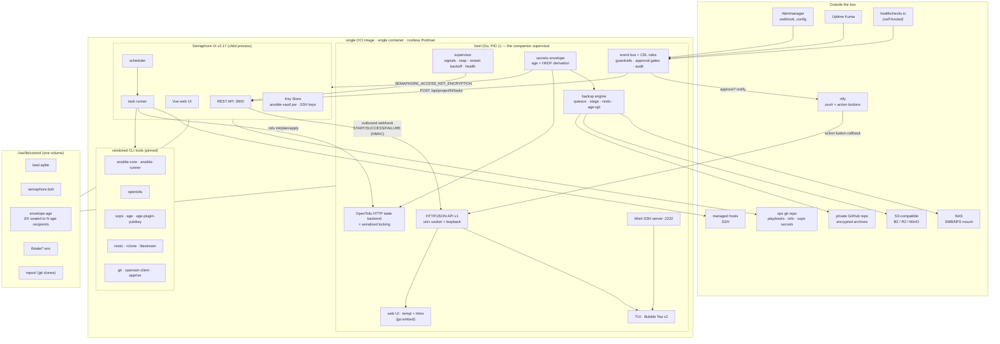
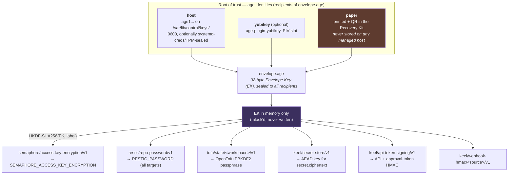
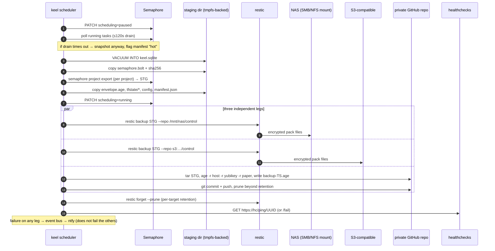
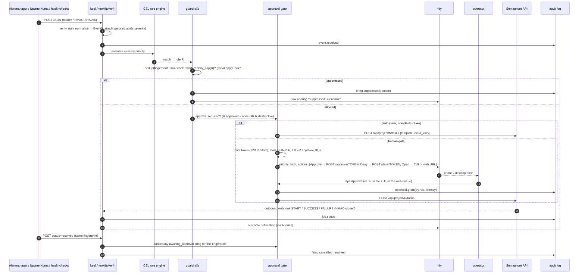

# Candidate design: HYBRID — Semaphore engine + `keel` companion supervisor

**Angle:** one container image bundling a *proven execution engine* (Semaphore UI) plus a *thin
companion supervisor binary* (`keel`, Go) that adds the six things Semaphore does not have:
a secrets envelope, encrypted backup/restore fan-out, a Terraform state backend, an event→runbook
rules engine with approval gates, a TUI, and a bootstrap/DR story.

**Optimising for:** time-to-working, with acceptable code ownership. We write ~7k lines of Go
instead of ~40k, and we never write a job scheduler, an inventory model, a playbook executor,
a log streamer, or a web run-history UI — Semaphore already has all of those and is MIT, single
binary, and actively released (v2.17, Feb 2026).

**Status:** design candidate. Not the only viable shape; see
[`docs/research/prior-art.md`](../research/prior-art.md) for the alternatives that were rejected.

---

## 1. Architecture overview

The unit of deployment is **one OCI image, one container, one systemd (Quadlet) unit, one data
volume.** Inside the container, `keel` is PID 1 and supervises Semaphore as a child process.
`keel` owns the outward-facing API, the TUI, and everything Semaphore lacks; Semaphore owns
everything Semaphore is already good at.

The division of responsibility is deliberately sharp:

| Concern | Owner | Why |
|---|---|---|
| Playbook/OpenTofu execution, log capture, live log stream | **Semaphore** | Already solved, battle-tested, MIT |
| Inventory, projects, task templates, variable groups | **Semaphore** | Its native data model |
| Cron schedules, job history, run RBAC | **Semaphore** | v2.17 has one-time + recurring schedules |
| ansible-vault password storage, SSH keys, git creds | **Semaphore Key Store** | Native, encrypted at rest with an operator-supplied key |
| Root-of-trust key material + derived-secret envelope | **`keel`** | Nothing upstream does this |
| Terraform/OpenTofu **state backend + locking** | **`keel`** | Semaphore gates this behind Pro ($490/yr) |
| Backup snapshot/fan-out/restore, recovery kit | **`keel`** | Open upstream gap (semaphore#1024, #2227) |
| Event ingress, rule matching, guardrails, approval gates | **`keel`** | Semaphore's integrations are match+fire only, no rules/cooldowns/approvals |
| TUI (local + over SSH) | **`keel`** | Semaphore is web-only |
| Process supervision, health, first-run wizard, DR | **`keel`** | This is the "glue" the project brief calls for |

`keel` never re-implements execution. Every runbook — manual, scheduled, or alert-triggered —
is dispatched as a **Semaphore task** via Semaphore's REST API, so there is exactly one job
history, one log store, one secrets-injection path, and one place a playbook can run.

### 1.1 Component diagram



### 1.2 Process model inside the container

`keel` is PID 1. That means it must do three unglamorous things correctly, and they are the
first code written:

1. **Reap orphans.** Loop on `unix.Wait4(-1, ..., WNOHANG, nil)` when `os.Getpid() == 1`, so
   `ansible-playbook` → `ssh` → `sudo` chains that get orphaned don't accumulate zombies.
2. **Forward signals.** `SIGTERM`/`SIGINT` → graceful: stop accepting events, cancel pending
   approvals as `expired`, tell Semaphore to stop scheduling, wait up to `stop_grace` (default
   120s) for running tasks, then `SIGTERM` Semaphore, then exit.
3. **Supervise with backoff.** Semaphore is health-probed on `GET /api/ping` every 5s; three
   consecutive failures → restart with exponential backoff (1s→60s cap, reset after 5min
   healthy). Crash-looping (>5 restarts in 10 min) flips `keel` into **degraded mode**: the API,
   TUI, backup engine and recovery paths stay up (you can still take a backup and read the
   recovery kit) while task dispatch returns `503 engine_unavailable` and an ntfy alert fires.

Rejected alternative: `s6-overlay` or `tini` + a shell script. Doing it in `keel` is ~150 lines,
removes a dependency, and lets supervision state be a first-class thing the TUI renders. The
process boundary between `keel` and Semaphore is kept deliberately: a Semaphore crash must never
take down the thing that knows how to restore Semaphore.

---

## 2. Chosen components (exact, with justification)

Everything below is either MIT/Apache-2.0/BSD/MPL — no BUSL, no fair-code, no "Pro tier required".

| Layer | Choice | License | Why this, not the alternatives |
|---|---|---|---|
| Execution engine | **Semaphore UI v2.17.x** (`semaphoreui/semaphore`) | MIT (core) | Only surveyed tool that is simultaneously single-binary, actively released (v2.16 Aug 2025 → v2.17 Feb 2026), and natively covers *both* Ansible and Terraform/OpenTofu/Terragrunt with inventory, schedules, job history, REST API, and inbound/outbound webhooks. AWX is frozen since 24.6.1 (Jul 2024) and needs 4 vCPU/16 GB + Kubernetes. Rundeck is a JVM and paywalls its good webhook handler. |
| Semaphore DB | **embedded BoltDB** | — | Zero external services. Postgres remains a documented escape hatch if the operator ever wants Litestream-style WAL streaming on the Semaphore side too. |
| Companion binary | **`keel`** — Go 1.24, one module, `CGO_ENABLED=0` | ours | The glue layer. ~7k LOC (§9). |
| `keel` DB | **SQLite via `modernc.org/sqlite`** | BSD-3 | Pure-Go, no cgo, so the image stays `FROM alpine` / distroless-friendly. WAL mode → Litestream-compatible. |
| IaC runtime | **OpenTofu ≥1.12** | MPL-2.0 | Terraform is BUSL since Aug 2023. OpenTofu is CNCF-hosted and is the only one with **native client-side state/plan encryption** (1.7+), which is load-bearing for the backup story: encrypted state is opaque, so it can be shipped to NAS/S3/GitHub with no Terraform-specific backup logic. |
| Terraform state | **`keel`'s built-in HTTP backend** (`/tfstate/{workspace}`) + **OpenTofu native state encryption** (PBKDF2 key provider, passphrase derived from the envelope) | ours | Semaphore's state backend is Pro-only. The Terraform HTTP backend protocol is 5 verbs (`GET`, `POST?ID=`, `LOCK`, `UNLOCK`, `DELETE`) — ~350 LOC. This sidesteps both the $490/yr and the **MinIO conditional-write gap** (minio#20346) that breaks `use_lockfile` on self-hosted S3: `keel` serializes applies itself with a single-row lock table, which at homelab scale (one worker) is strictly stronger than backend-level locking. |
| Ansible | **`ansible-core`** + **`ansible-runner`** in the image | GPL-3.0 / Apache-2.0 | Semaphore invokes `ansible-playbook`; `ansible-runner` is kept available for the one case Semaphore can't express (structured event streaming from a bespoke job). Not used in v1. |
| Static secrets | **sops** + **age** (+ optional **`age-plugin-yubikey`**) | MPL-2.0 / BSD-3 / MIT | Per-value encryption keeps git diffs reviewable; `community.sops` gives an Ansible lookup plugin and the `carlpett/sops` provider gives a Terraform data source. The private key is one line of text — the entire DR story rests on that property. |
| ansible-vault | **kept, secondary** | GPL-3.0 | Semaphore's Key Store holds vault passwords natively. Use it where a third-party role expects `!vault`; do not author new secrets in it. |
| Dynamic secrets | **OpenBao — deferred, not in v1** | MPL-2.0 | Genuinely the right tool for leased DB creds / PKI / SSH CA, but it adds a seal/unseal lifecycle that fights the "trivially bootstrap and recover" goal. `keel`'s secret-resolution interface has a `bao://` scheme reserved so adding it later is a driver, not a redesign. |
| Backup engine | **restic ≥0.19** (shelled out, `--json`) | BSD-2 | Client-side AES-256 + Poly1305 before anything leaves the host, native S3/B2/SFTP backends, NFS/SMB "for free" via a mount point, `check --read-data-subset` for cheap rotating integrity verification. restic deliberately has no Go library API (restic#4406) — that is *fine*: the process boundary means a restic crash can't take down the control plane. |
| SQLite continuous replication | **Litestream 0.5.x — optional, off by default** | Apache-2.0 | Gives seconds-level RPO on `keel.sqlite` and an idempotent `litestream restore -if-db-not-exists` in `ExecStartPre`. **Caveat honoured:** Litestream does not encrypt. Enable it only against a LAN-local MinIO or an rclone-crypt-fronted endpoint; restic remains the authoritative encrypted leg. |
| Transport for odd targets | **rclone** | MIT | Used as a restic *backend* (`rclone:remote:path`) for anything restic lacks natively, and to mount WebDAV-class NAS shares. Not used as a backup tool. |
| Notification fan-out | **Apprise** (CLI) → **ntfy** primary | BSD-2 / Apache-2.0 | One `apprise -t ... -b ...` call per notification means the channel is config, not code. ntfy is the primary sink specifically because its **notification action buttons can call back into a URL** — that is the cheapest possible approval gate (§6). |
| Dead-man's-switch | **healthchecks (self-hosted)** — external, optional | BSD-3 | Catches "the backup didn't even try". Runs outside our container (it's Django + a DB); `keel` just pings its URL. |
| Rule expressions | **`google/cel-go`** | Apache-2.0 | Sandboxed, non-Turing-complete, typed expression language. Rules are data in SQLite, not Go code, so they're editable from the TUI and survive restore. Chosen over embedding a Lua/Starlark interpreter (too much power in an alert-triggered path) and over `ansible-rulebook` (Python + a JVM-backed Drools engine, ~250 MB RAM, and Red Hat is currently reshuffling its event-source collections). |
| TUI | **Bubble Tea v2** + **Bubbles** + **Lip Gloss v2** | MIT | Compiles into the same binary; v2 (Feb 2026) added synchronized-output for flicker-free live log tailing. |
| Remote TUI | **Wish** | MIT | `ssh control.lan -p 2222` → the TUI, with SSH-key auth as the access-control mechanism. Proven by Charm's own soft-serve. Means the primary UI needs no TLS cert and no browser. |
| Web UI | **templ** + **htmx**, `go:embed` | MIT / 0BSD | No Node build step, no second business-logic layer, same binary. Semaphore's own Vue UI is reverse-proxied under `/semaphore/` rather than reimplemented. |
| Desktop | **Wails v2** — later, optional | MIT | Wraps the identical embedded web UI. Zero incremental UI work; packaging only. |
| Deployment | **Podman Quadlet** `.container` primary, **docker-compose.yml** fallback | — | Quadlet gives `systemctl status`, `journalctl -u`, boot ordering, `Restart=`, and rootless-by-default — a materially smaller blast radius for a box holding root-of-trust key material. Compose ships too, for Synology/TrueNAS users. |
| Ad hoc tools kept in the image | **`ansible-navigator`**, **`leg100/pug`** | Apache-2.0 / — | Not part of the control plane. `pug` in particular is the reference for what a TUI-first tofu driver should feel like, and is useful for interactive state surgery during an incident. |

### Explicitly not chosen

- **Semaphore Pro** — the two features that would tempt us (HTTP state backend, Vault secret
  backend) are exactly the two we replace with ~500 lines of `keel`. Revisit only if HA or SSO
  ever matters, which at one operator it will not.
- **Dagu / Kestra / Windmill / n8n as a second engine** — a second scheduler means two job
  histories, two secret paths, two things to back up. `keel`'s CEL rules + Semaphore's task API
  cover the homelab-shaped subset. (Windmill's suspend/resume approval step is genuinely the
  best-in-class primitive here; we're rebuilding a thin version of it rather than adding an
  AGPL Rust service + Postgres.)
- **StackStorm / AWX / Terrakube / OTF** — right features, wrong weight class (RabbitMQ+Mongo,
  K8s, JVM+Postgres, Postgres respectively).
- **git-remote-gcrypt / git-remote-restic** for the GitHub leg — real but low-activity projects;
  a five-line "tar | age | git commit | git push" covers it with zero new dependencies.

---

## 3. Data model sketch

`keel.sqlite` (WAL mode). Semaphore's own schema is *not* mirrored — we hold references, never
copies, so there is nothing to keep in sync. Roughly 12 tables:

```sql
-- ── identity / secrets ───────────────────────────────────────────────
CREATE TABLE envelope_meta (          -- one row. The EK itself lives in envelope.age on disk.
  id INTEGER PRIMARY KEY CHECK (id = 1),
  ek_fingerprint  TEXT NOT NULL,      -- SHA-256 of the EK, for "is this the right key?" checks
  recipients      TEXT NOT NULL,      -- JSON: [{label:"host",pubkey:"age1..."},{label:"yubikey"...},{label:"paper"...}]
  kdf             TEXT NOT NULL DEFAULT 'hkdf-sha256',
  created_at      INTEGER NOT NULL,
  kit_issued_at   INTEGER,            -- NULL blocks bootstrap completion (§5.2)
  kit_ack_at      INTEGER
);

CREATE TABLE secret (                 -- operator-supplied secrets we must store (not derived)
  id          INTEGER PRIMARY KEY,
  name        TEXT NOT NULL UNIQUE,   -- 's3.backblaze', 'github.deploy_token', 'ntfy.token'
  kind        TEXT NOT NULL,          -- password|token|sshkey|json
  ciphertext  BLOB NOT NULL,          -- AEAD under a key derived from EK; never plaintext at rest
  version     INTEGER NOT NULL DEFAULT 1,
  rotated_at  INTEGER,
  created_at  INTEGER NOT NULL
);

-- ── backup ───────────────────────────────────────────────────────────
CREATE TABLE backup_target (
  id        INTEGER PRIMARY KEY,
  name      TEXT NOT NULL UNIQUE,     -- 'nas', 'b2', 'github'
  kind      TEXT NOT NULL,            -- restic_local | restic_s3 | restic_rclone | git_age
  uri       TEXT NOT NULL,            -- '/mnt/nas/control', 's3:https://…/bucket/control', 'git@github.com:me/control-backup.git'
  secret_id INTEGER REFERENCES secret(id),
  retention TEXT NOT NULL,            -- JSON: {"hourly":24,"daily":14,"weekly":8,"monthly":12}
  enabled   INTEGER NOT NULL DEFAULT 1,
  last_ok_at INTEGER, last_err TEXT
);

CREATE TABLE backup_run (
  id           INTEGER PRIMARY KEY,
  target_id    INTEGER NOT NULL REFERENCES backup_target(id),
  trigger      TEXT NOT NULL,         -- schedule|manual|pre_upgrade|event
  started_at   INTEGER NOT NULL, finished_at INTEGER,
  status       TEXT NOT NULL,         -- running|ok|failed|partial
  snapshot_id  TEXT,                  -- restic short-id, or git commit sha for git_age
  manifest     TEXT,                  -- JSON: {files:[{path,sha256,bytes}], semaphore_version, keel_version, schema_version}
  bytes_added  INTEGER, duration_ms INTEGER, log BLOB
);

CREATE TABLE restore_drill (          -- proof the backups actually restore (§5.4)
  id INTEGER PRIMARY KEY, backup_run_id INTEGER, ran_at INTEGER,
  outcome TEXT, detail TEXT           -- ok|integrity_fail|decrypt_fail|schema_fail
);

-- ── terraform state ──────────────────────────────────────────────────
CREATE TABLE tf_workspace (
  id INTEGER PRIMARY KEY, name TEXT NOT NULL UNIQUE,
  serial INTEGER NOT NULL DEFAULT 0, lineage TEXT,
  blob_path TEXT,                     -- /var/lib/control/tfstate/<ws>/<serial>.enc (opaque; tofu-encrypted)
  size_bytes INTEGER, md5 TEXT, updated_at INTEGER,
  keep_serials INTEGER NOT NULL DEFAULT 20
);
CREATE TABLE tf_lock (                -- at most one lock per workspace, enforced by the PK
  workspace_id INTEGER PRIMARY KEY REFERENCES tf_workspace(id),
  lock_id TEXT NOT NULL, who TEXT, operation TEXT, info TEXT, created_at INTEGER NOT NULL
);
CREATE TABLE tf_drift (               -- populated by the scheduled `tofu plan -detailed-exitcode` template
  id INTEGER PRIMARY KEY, workspace_id INTEGER, checked_at INTEGER,
  exit_code INTEGER,                  -- 0 = no drift, 2 = drift, 1 = error
  add_count INTEGER, change_count INTEGER, destroy_count INTEGER, summary TEXT
);

-- ── events / rules / approvals ───────────────────────────────────────
CREATE TABLE event_source (
  id INTEGER PRIMARY KEY, name TEXT NOT NULL UNIQUE,
  kind TEXT NOT NULL,                 -- alertmanager|uptimekuma|healthchecks|ntfy|generic
  path_token TEXT NOT NULL UNIQUE,    -- /hook/<path_token>
  auth TEXT NOT NULL,                 -- bearer|hmac_sha256|none_loopback
  secret_id INTEGER REFERENCES secret(id), enabled INTEGER NOT NULL DEFAULT 1
);

CREATE TABLE event (                  -- canonicalised; raw payload retained for replay
  id INTEGER PRIMARY KEY, source_id INTEGER NOT NULL, received_at INTEGER NOT NULL,
  status TEXT NOT NULL,               -- firing|resolved|ping
  fingerprint TEXT NOT NULL,          -- stable identity for dedup + resolve-cancels-pending
  severity TEXT, labels TEXT, annotations TEXT, raw BLOB
);
CREATE INDEX event_fp ON event(fingerprint, received_at DESC);

CREATE TABLE rule (
  id INTEGER PRIMARY KEY, name TEXT NOT NULL UNIQUE, enabled INTEGER NOT NULL DEFAULT 1,
  source_id INTEGER,                  -- NULL = any source
  match_cel TEXT NOT NULL,            -- e.g. event.labels.alertname == "NodeDiskFillingUp" && event.status == "firing"
  action_kind TEXT NOT NULL,          -- semaphore_template | tofu_run | notify_only
  action_ref TEXT NOT NULL,           -- JSON: {project_id:1, template_id:7, extra_vars_cel:"{...}"}
  destructive INTEGER NOT NULL DEFAULT 0,   -- forces approval regardless of `approval`
  approval TEXT NOT NULL DEFAULT 'ntfy',    -- none|ntfy|tui|web|any
  approval_ttl_s INTEGER NOT NULL DEFAULT 900,
  cooldown_s INTEGER NOT NULL DEFAULT 900,
  daily_cap INTEGER NOT NULL DEFAULT 6,
  dry_run INTEGER NOT NULL DEFAULT 0,
  priority INTEGER NOT NULL DEFAULT 100
);

CREATE TABLE firing (                 -- one row per (rule, event) match; the state machine
  id INTEGER PRIMARY KEY,
  rule_id INTEGER NOT NULL, event_id INTEGER NOT NULL,
  state TEXT NOT NULL,                -- matched|suppressed_cooldown|suppressed_cap|suppressed_dup
                                      -- |awaiting_approval|approved|denied|expired|dispatched|failed|cancelled_resolved
  reason TEXT,
  approval_token_hash TEXT, approval_expires_at INTEGER,
  approved_by TEXT, approved_via TEXT,      -- ntfy|tui|web|api
  job_ref_id INTEGER, created_at INTEGER NOT NULL, updated_at INTEGER NOT NULL
);

-- ── job references (Semaphore is the source of truth; we hold pointers) ──
CREATE TABLE job_ref (
  id INTEGER PRIMARY KEY,
  semaphore_project_id INTEGER NOT NULL, semaphore_template_id INTEGER NOT NULL,
  semaphore_task_id INTEGER NOT NULL UNIQUE,
  trigger TEXT NOT NULL,              -- manual|schedule|event|api|drift
  firing_id INTEGER REFERENCES firing(id),
  status TEXT NOT NULL,               -- pending|running|success|error|stopped
  started_at INTEGER, finished_at INTEGER
);

-- ── audit (hash-chained; tamper-evident) ─────────────────────────────
CREATE TABLE audit (
  id INTEGER PRIMARY KEY, ts INTEGER NOT NULL,
  actor TEXT NOT NULL,                -- operator:<ssh-key-fp> | system | source:<name>
  action TEXT NOT NULL,               -- rule.fire, approval.grant, backup.run, secret.read, restore.begin, …
  subject TEXT, detail TEXT,
  prev_hash TEXT NOT NULL, hash TEXT NOT NULL   -- hash = SHA256(prev_hash || ts || actor || action || subject || detail)
);
```

Design notes worth calling out:

- **No mirrored Semaphore data.** `job_ref` holds `semaphore_task_id`, not the log. The TUI streams
  logs straight from Semaphore's API. This means a Semaphore schema change can never corrupt
  `keel`'s DB, and the two backup legs (physical bolt copy + logical `semaphore project export`)
  are independent of anything `keel` stores.
- **`firing` is an explicit state machine**, not a boolean. Every suppression reason is recorded,
  which is what makes "why didn't my automation run?" answerable at 2am.
- **The audit log is hash-chained.** Cheap (one SHA-256 per row), and it makes the DR question
  "was this restore tampered with?" answerable by verifying the chain after restore.
- **Secrets are never plaintext in the DB.** `secret.ciphertext` is XChaCha20-Poly1305 under
  `HKDF(EK, "keel/secret-store/v1")`. Derived secrets (§4) are never stored at all.

---

## 4. Secrets: root of trust and recovery

### 4.1 One key, everything else derived

The whole design collapses to a single sentence: **there is exactly one secret to protect, and
it is one line of text.**



Why derivation rather than storage: **nothing derived ever needs to be backed up.** The restic
repo password, Semaphore's at-rest encryption key, and every OpenTofu state passphrase are
recomputed from the EK on every start. A recovered `keel` with the right age identity can open a
restic repo it has never seen before. The recovery kit therefore contains *one* secret, not five,
which is the difference between a DR procedure that works and one that doesn't.

Explicit anti-pattern avoided (k3s's documented footgun): **the master secret never lives only
inside the thing it protects.** `envelope.age` is in the backup, but the age identity that opens
it is not — it's on paper, and optionally on a YubiKey.

### 4.2 sops in the ops repo uses the same recipients

`.sops.yaml` in the ops git repo lists the same three age public keys. Consequence: the operator's
Ansible vars and `.tfvars` are decryptable by exactly the same key material as the control plane's
own state, so there is **one key story, not two**. `community.sops` decrypts inline during a
playbook run; `carlpett/sops` provides the OpenTofu data source. `keel` exposes the host identity
to Semaphore task runs via `SOPS_AGE_KEY_FILE` pointing at a **tmpfs** path, written at task start
and unlinked at task end.

### 4.3 Recovery kit

`keel kit print` (also offered, and *mandatorily acknowledged*, during bootstrap) renders a single
page — plain text, HTML for printing, and an ASCII QR — containing:

```
CONTROL PLANE RECOVERY KIT            issued 2026-08-21T14:02Z   ek: sha256:9f3c…a71b
────────────────────────────────────────────────────────────────────────────────────
1. RECOVERY IDENTITY (paper)   AGE-SECRET-KEY-1QYQSZQGPQYQSZQGPQYQSZQGP…      [QR]
2. BACKUP TARGETS (not secret) nas   /mnt/nas/control
                               b2    s3:https://s3.us-west-002.backblazeb2.com/…
                               gh    git@github.com:<owner>/control-backup.git
3. ONE-LINE RESTORE
   curl -fsSL https://<host>/install.sh | sh -s -- restore --target b2
   …then paste the recovery identity when prompted.
4. WHAT THIS DOES NOT CONTAIN  Your S3/GitHub credentials (they are IN the backup,
   encrypted to this key). Your host SSH keys (regenerated by the ops playbook).
────────────────────────────────────────────────────────────────────────────────────
Store offline. Anyone holding this page can decrypt every backup you have ever made.
```

Modelled directly on the Bitwarden/Vaultwarden "emergency kit" pattern, and deliberately including
the restore command so the page is self-sufficient with no network research at 3am.

### 4.4 Key rotation and revocation

`keel key add-recipient <age1…>` re-seals `envelope.age` to the enlarged recipient set (EK
unchanged — no re-encryption of anything). `keel key rotate-ek` generates a new EK, re-encrypts
`secret.ciphertext` rows, re-keys the restic repos (`restic key add` with the new derived
password, then `restic key remove` the old), and re-encrypts OpenTofu state by running one
`tofu apply -refresh-only` per workspace under the new passphrase. Rotation is a scheduled
Semaphore template so it shows up in job history like everything else. Rotating out a *lost*
YubiKey is `remove-recipient` + `rotate-ek`, in that order.

---

## 5. Backup and restore

### 5.1 What gets backed up

| Item | Where it lives | How it is captured | Encrypted by |
|---|---|---|---|
| `keel.sqlite` | volume | `VACUUM INTO staging/keel.sqlite` (consistent, no locking games) | restic |
| Semaphore BoltDB | volume | quiesced file copy + `sha256` | restic |
| Semaphore projects (logical) | Semaphore | `semaphore project export` per project (v2.17 CLI) → JSON | restic |
| `envelope.age` | volume | copied verbatim | age (already) + restic |
| OpenTofu state blobs | volume | copied verbatim | OpenTofu native (already) + restic |
| `config.toml`, Quadlet unit, `.sops.yaml` | volume | copied | restic |
| git clones of the ops repo | volume | **not backed up** — remote URL + branch recorded in the manifest instead | n/a |
| Secrets in the ops repo | ops repo | already sops/age ciphertext in git | age (already) |

The **logical + physical pairing** is the important part. A physical BoltDB copy restores fast but
is tied to a Semaphore version; the JSON project export survives a Semaphore major upgrade. Both
go in every snapshot; restore prefers physical and falls back to logical.

### 5.2 Backup flow



Key decisions:

- **Three legs, one encryption story.** restic's repo password and the age recipients both derive
  from / point at the same root. There is no third key to lose.
- **NAS is not special.** An SMB/NFS share mounted into the container is a local path to restic.
  Zero NAS-specific code.
- **GitHub leg is a single `.age` file per run**, not a git-remote-helper. At homelab scale the
  staging dir is tens of MB; retention prunes to the last N (default 30) plus monthlies. If it ever
  exceeds ~500 MB, `keel` refuses the GitHub leg with a clear error rather than silently
  bloating a repo past GitHub's guidance.
- **Legs are independent.** One failing target degrades, never aborts, and each has its own
  `last_ok_at` surfaced in the TUI as a per-target freshness indicator.
- **Verification is a scheduled job, not a subsystem.** `restic check --read-data-subset=1/12`
  weekly per target, run as a Semaphore template — so it has job history, retries, and alerting for
  free. This is deliberate dogfooding: the control plane's own maintenance is visible in the same
  place as everything else.

### 5.3 Restore flow

```
keel restore --target b2 [--snapshot latest|<id>] [--dry-run]
```

1. Prompt for (or read from `--identity`) the age identity. Nothing else is asked for.
2. Derive the restic repo password from the EK → open the repo. **If this fails, the error says
   "wrong recovery key" rather than "repository does not exist"** — the single most important
   error-message decision in the whole design.
3. `restic restore --target /tmp/restore <snapshot>`; verify `manifest.json` hashes.
4. Refuse to proceed if `manifest.schema_version > keel.schema_version` (a newer backup into an
   older binary), with the exact `keel` version to install.
5. Stop Semaphore. Move current `/var/lib/control` aside to `…/pre-restore-<ts>` (never delete).
6. Place `keel.sqlite`, `semaphore.bolt`, `envelope.age`, `tfstate/`, config. Run schema migrations.
7. Re-clone the ops repos from the manifest's remote URLs (not from the backup).
8. Start Semaphore; health-probe; if the physical BoltDB fails to open, fall back to a fresh
   Semaphore DB + `semaphore project import` of the JSON exports, and say so loudly.
9. Verify the audit hash chain; write a `restore.complete` audit entry; print a diff summary
   (N projects, N templates, N schedules, N tf workspaces, last job at T).

`--dry-run` does steps 1–4 and stops. That is the rehearsal command.

### 5.4 Rehearsal (the part everyone skips)

A stock scheduled template `control-restore-drill` runs monthly: `keel restore --dry-run
--target <rotating>` into a scratch dir, opens the restored `keel.sqlite`, checks the audit chain,
decrypts one canary secret, and records a `restore_drill` row. A failed drill pages via ntfy at
high priority. **Backups that have never been restored are not backups**; making the drill a
first-class scheduled job is how this design keeps that honest.

---

## 6. Event → runbook, with approval gates

### 6.1 Pipeline



### 6.2 Guardrails (all enforced before dispatch, all recorded)

Every source consulted converged on the same warning: a self-healing loop that can re-trigger
itself turns a minor alert into an outage. So:

| Guardrail | Default | Rationale |
|---|---|---|
| Dedup by `fingerprint` | 5 min | Alertmanager re-sends on its group interval; one alert should not mean six runs. |
| Per-rule cooldown | 900 s | The disk-cleanup playbook must not run every 30 s while the disk is still full. |
| Per-rule daily cap | 6 | Hard stop on runaway loops; cap exhaustion pages the operator. |
| Global apply concurrency | 1 | Also the OpenTofu locking strategy (§2) — one apply at a time, full stop. |
| `destructive: true` ⇒ approval | forced | Cannot be overridden by `approval: none`; the flag wins. |
| Approval TTL, **fail-closed** | 900 s | An unanswered approval expires as *denied*, never as *approved*. |
| `resolved` cancels pending | on | If the alert cleared before you tapped Approve, the run must not happen. |
| Dry-run mode per rule | off | New rules are authored with `dry_run: 1`: everything happens except the dispatch, and the TUI shows what *would* have run. |
| Global kill switch | `keel events pause` | One command stops all reactive dispatch; scheduled and manual runs continue. |
| Rate-limit per source | 60/min | A misconfigured webhook source cannot DoS the box. |

### 6.3 Approval channels — same token, four front doors

The approval token is minted once and can be redeemed via **ntfy action button**, **TUI**
(pending-approvals screen, `a`/`d` keys), **web** (`/approvals`), or **API** (`POST
/api/v1/approvals/{id}`). All four write the same `firing` row and the same audit entry with
`approved_via`. ntfy is default because a one-tap approval from a phone lock screen is the
lowest-friction gate that still counts as a human decision.

Escalation is deliberately minimal (no GoAlert, no Grafana OnCall — the latter is deprecated and
archiving anyway): if an approval is unanswered at 50% of its TTL, `keel` re-publishes at
`priority=urgent` with a different ntfy tag. That is the whole escalation feature. If real
phone/SMS on-call ever matters, GoAlert (Apache-2.0, single binary + Postgres) is the documented
upgrade path.

### 6.4 Stock rules shipped in the box

Seeded at bootstrap, all with `dry_run: 1` until the operator enables them:

1. `node-disk-filling` → run `runbooks/disk-cleanup.yml` on the alerting host, approval `ntfy`.
2. `service-down` (Uptime Kuma) → run `runbooks/restart-service.yml`, cooldown 10 m, cap 3.
3. `backup-drill-failed` → notify only, `priority=urgent`. Never auto-remediates.
4. `tofu-drift-detected` → notify with the plan summary; `destructive: true` so an apply always
   needs a human tap.
5. `cert-expiring` → run `runbooks/renew-cert.yml`, approval `none` (idempotent and safe).

---

## 7. UI plan: one API, four clients

`keel` exposes **one** API — `/api/v1` over a Unix socket (`/run/control/keel.sock`, mode 0600) and
optionally loopback TCP. Every client is a client of that API, including the reactive engine.

```
/api/v1/health            /api/v1/backups            /api/v1/approvals
/api/v1/engine            /api/v1/backups/{id}       /api/v1/rules
/api/v1/templates    ─┐   /api/v1/backups/restore    /api/v1/events
/api/v1/inventory     ├─ proxied/wrapped over        /api/v1/tf/workspaces
/api/v1/schedules     │   Semaphore's REST API       /api/v1/tf/drift
/api/v1/jobs         ─┘                              /api/v1/secrets  (metadata only, never values)
/api/v1/jobs/{id}/log  (SSE stream)                  /api/v1/recovery/kit
```

**TUI — the primary interface.** `keel` with no arguments opens it. Bubble Tea v2 + Bubbles +
Lip Gloss, ten screens: Dashboard (engine health, backup freshness per target, pending approvals,
drift), Runs (live SSE log tail), Templates, Inventory, Schedules, Secrets (names and fingerprints
only — decrypted values are *never* placed in model state), Backups, Approvals, Events & Rules
(with a CEL expression tester that replays stored events), Recovery. Reachable remotely via
`ssh control.lan -p 2222` (Wish, `authorized_keys`-gated), so managing the control plane needs no
browser, no TLS cert, and no port-forward.

**Web — second.** templ + htmx, `go:embed`, no Node. It renders the surfaces Semaphore *doesn't*
have (approvals, backups, rules, recovery, drift) and reverse-proxies Semaphore's own Vue UI at
`/semaphore/` for everything it does have. This is the single biggest time-to-working win in the
design: we get a mature run/inventory/schedule web UI for the cost of a `httputil.ReverseProxy`.

**Desktop — third, optional.** Wails v2 wrapping the identical embedded web UI. Packaging work
only; no rewrite. Tauri is the fallback if Wails' multi-window/notification gaps bite.

**Reactive engine — the fourth, headless client.** It creates jobs through the same endpoint the
TUI's "Run" key and the web's Run button use. Consequence: no UI needs to know that a run was
alert-triggered, and job history is uniform regardless of trigger.

UI-layer security discipline (worth stating because it is easy to get wrong): decrypted secret
values must never enter Bubble Tea model state (crash dumps), htmx response bodies (browser
cache), or SSE frames. The API returns secret *metadata* only; values are written directly to
tmpfs for the consuming process.

---

## 8. Bootstrap: first run to working in minutes

### 8.1 The one manual step

Every self-managing system has exactly one — Flux has `flux bootstrap`, k3s has `--cluster-init`,
Tailscale has `install.sh`. The design goal is not zero manual steps; it is **one manual step,
and it is the same step for first install and for disaster recovery.**

```bash
curl -fsSL https://control.example/install.sh | sh
```

`install.sh` is **versioned separately from the `keel` binary** and is dependency-free POSIX shell.
Its only jobs: detect Podman/Docker, pull the pinned image, write `control.container` (Quadlet)
into `~/.config/containers/systemd/`, create `/var/lib/control`, `systemctl --user daemon-reload &&
start control`, print the bootstrap URL + one-time token. It takes `install.sh restore --target X`
as its second mode (§10). It must keep working when `keel` itself is what's broken.

### 8.2 First-run wizard (TUI or web, same steps)

`keel` sees an empty data dir and refuses to serve anything but the wizard.

1. **Identity** — generate an age keypair, or import an existing one, or enrol a YubiKey
   (`age-plugin-yubikey`). Generates the paper recovery identity as a second recipient. *(~30s)*
2. **Recovery kit** — renders the kit (§4.3), requires the operator to type the last 6 characters
   of the recovery key to confirm they actually captured it. `kit_ack_at` is set; **bootstrap
   cannot complete without it.** This is the one place the design is deliberately annoying. *(~60s)*
3. **Backup targets** — configure NAS path / S3 endpoint+creds / GitHub repo. Each is
   **tested immediately** (`restic init`, a write-read-delete round trip, a `git push --dry-run`)
   and shown pass/fail inline. At least one target is mandatory. *(~90s)*
4. **Ops repo** — paste a git URL; `keel` generates an ed25519 deploy key and displays it for
   pasting into GitHub/Gitea, then verifies the clone. *(~60s)*
5. **Engine start** — `keel` derives `SEMAPHORE_ACCESS_KEY_ENCRYPTION`, writes Semaphore's config,
   starts it, waits for `/api/ping`, creates the admin user, and seeds: one project pointed at the
   ops repo, an inventory containing the control host itself, five stock templates (`ping-all`,
   `backup-now`, `backup-verify`, `restore-drill`, `tofu-drift`), and four schedules. *(~45s)*
6. **Dogfood** — registers `control-self` in the inventory and drops
   `runbooks/control-self.yml` into the ops repo (managing the Quadlet unit, the image tag, and the
   backup schedule), so the control plane manages its own deployment as node zero. *(~15s)*

**Total: under five minutes**, of which most is typing credentials. Every step is idempotent
(check-before-create, never the Miniflux `CREATE_ADMIN=1`-style env flag that duplicates the admin
on every restart).

### 8.3 Deployment artifact

```ini
# ~/.config/containers/systemd/control.container   (rootless Podman Quadlet)
[Unit]
Description=Homelab control plane (keel + Semaphore)
After=network-online.target
Wants=network-online.target

[Container]
Image=ghcr.io/<owner>/control:2026.8.0
ContainerName=control
Volume=/var/lib/control:/data:Z
Volume=/mnt/nas/control:/mnt/nas/control:z          # NAS leg, SMB/NFS mounted on the host
PublishPort=127.0.0.1:8080:8080                     # web (front with Caddy/tailscale for remote)
PublishPort=2222:2222                               # TUI over SSH
Environment=CONTROL_DATA=/data
Notify=true
HealthCmd=/usr/local/bin/keel health --exit-code
HealthInterval=30s
DropCapability=ALL
AddCapability=CAP_NET_BIND_SERVICE
NoNewPrivileges=true

[Service]
Restart=always
RestartSec=10

[Install]
WantedBy=default.target
```

A `docker-compose.yml` with the same shape ships as the fallback for Synology/TrueNAS/non-systemd.

---

## 9. Disaster recovery runbook

**Scenario: the control-plane host is gone.** New (or reinstalled) machine, the Recovery Kit page,
and network access to at least one backup target. Nothing else. Target: **under 15 minutes.**


**Step by step:**

| # | Action | Expected | If it fails |
|---|---|---|---|
| 1 | Install Podman on the new host (distro package). | `podman --version` | Any container runtime works; Docker path is documented. |
| 2 | `curl -fsSL https://control.example/install.sh \| sh -s -- restore --target b2` | Pulls the image, prompts for the recovery identity. | No network to the target? Use the NAS leg (`--target nas`, mount the share first) or the GitHub leg (`--target gh`, needs a token — which is *in* the backup, so prefer NAS/S3 first; the GitHub leg is the last resort and needs a manually-supplied read token). |
| 3 | Paste the age identity from the Recovery Kit (or plug in the YubiKey). | `EK fingerprint sha256:9f3c…a71b — matches envelope` | **"wrong recovery key"** ⇒ you have the wrong page. There is no other failure mode here; this is why the kit prints the fingerprint. |
| 4 | `keel` restores, verifies hashes, checks schema version. | `restored 47 files, 218 MB, manifest OK` | Schema too new ⇒ it names the exact image tag to use; re-run `install.sh` with `--image-tag`. |
| 5 | `keel` starts Semaphore and probes health. | `engine healthy in 4.1s` | BoltDB unreadable ⇒ automatic fallback to `semaphore project import` of the JSON exports; a warning is printed and audited. |
| 6 | Verify the audit hash chain. | `audit chain OK, 12,481 entries, last 2026-08-21T13:58Z` | Chain break ⇒ the snapshot was tampered with or truncated; restore the previous snapshot. |
| 7 | **Re-seal the envelope to a new host identity**: `keel key add-recipient $(keel key new-host)`. | New `envelope.age` with 4 recipients. | Skipping this means the new host has no local identity and every start needs the paper key. |
| 8 | Rotate what the old host may have leaked (if it was compromised rather than dead): `keel key rotate-ek`, then rotate SSH host keys via the ops playbook. | | |
| 9 | Run `ping-all` from Semaphore. | All managed hosts reachable. | Managed hosts are unaffected — they are unmanaged, not broken, while the control plane is down. |
| 10 | Run `restore-drill`. | `outcome: ok` | Confirms the *new* install can itself be recovered. |

**Two properties that make this work:**

- **Managed hosts keep working while the control plane is dead.** Nothing on them depends on it.
  Optionally, `ansible-pull` on a systemd timer gives baseline drift-correction that self-heals
  with no control plane at all — a genuinely independent second path back to a known state.
- **The recovery path never runs the control plane's own scheduler.** `install.sh` +
  `keel restore` are a straight line with no dependency on the thing that broke.

---

## 10. Build-effort estimate

Solo experienced Go developer. Person-days of focused work, not calendar days.

| Component | MVP | Full v1 | Notes |
|---|---|---|---|
| Container image, PID-1 supervisor, health, degraded mode | 3 | 4 | Multi-stage build, pinned tool versions, reproducible |
| Config, first-run wizard, `install.sh`, Quadlet + Compose | 4 | 5 | Wizard is TUI + web; idempotency is most of the cost |
| Secrets envelope: age, HKDF, recipients, YubiKey, recovery kit | 4 | 5 | + rotation/revocation in full v1 |
| Semaphore adapter: API client, seeding, reverse proxy, outbound-webhook receiver | 4 | 5 | Contract tests against a pinned Semaphore in CI |
| OpenTofu HTTP state backend + locking + drift wiring | 3 | 4 | ~350 LOC + tests; drift is a seeded template |
| Backup engine: quiesce, staging, restic multi-target, age+git leg, retention | 6 | 7 | The largest single chunk; three legs, each with real failure modes |
| Restore + DR path + drill harness | 4 | 5 | Includes the `--dry-run` rehearsal and manifest verification |
| Event ingress, CEL rules, guardrails, approvals, hash-chained audit | 6 | 8 | Payload normalisers for 5 source shapes; the state machine |
| TUI: Bubble Tea, 10 screens, SSE log tail, Wish SSH | 6 | 9 | MVP ships 5 screens (dashboard, runs, backups, approvals, recovery) |
| Web UI: templ + htmx for keel's own surfaces | 2 | 5 | MVP = approvals + backups only; Semaphore proxied for the rest |
| Docs, DR runbook, CI (goreleaser, image build, integration tests) | 4 | 6 | Integration test = full bootstrap→backup→destroy→restore in CI |
| **Total** | **~46 person-days** | **~63 person-days** | |

**MVP (~46 d ≈ 9–10 weeks at half time)** is genuinely useful on its own: bootstrap, run playbooks
and tofu through Semaphore, encrypted three-target backup, one-command restore, alert-triggered
runbooks with ntfy approval, and a five-screen TUI.

**Code ownership:** ≈ 7,000 lines of Go + ≈ 1,200 lines of templ/HTML/CSS + ≈ 400 lines of POSIX
shell. Compare with the ~40k+ lines we *don't* write by not reimplementing Semaphore's scheduler,
inventory model, executor, log pipeline, and run UI. The bet is that ~7k lines of glue is
maintainable indefinitely by one person, and that the Semaphore adapter (~600 lines behind an
`Engine` interface) is the only part exposed to upstream churn.

**Desktop (Wails)** is deliberately excluded from both columns: ~3 days of packaging, whenever it's
wanted.

---

## 11. Top 5 risks

### 1. Upstream dependence on Semaphore — API drift, and feature-tier creep

**The risk.** Semaphore's REST API is not a stability contract, and the project already gates
state storage, Vault integration, HA, and SSO behind Pro/Enterprise. A future release could move
something we depend on (the task-creation endpoint, outbound webhooks, project export) behind a
tier, or change its shape. Its GitHub issues also show restore paths that don't work cleanly
(#2227), which is a maintenance-quality signal on exactly the surfaces we lean on.

**Mitigation.** (a) Pin the Semaphore version in the image; upgrades are an explicit, tested
release of *our* image, never an upstream surprise. (b) All Semaphore interaction goes through one
`Engine` interface (~600 LOC of adapter), so replacing it with Dagu, `ansible-runner`, or a
bespoke executor is a rewrite of one file, not the system. (c) Contract tests in CI run against
the pinned Semaphore container and fail the build on drift. (d) The logical JSON export leg of the
backup is version-independent, so we can always get our data out. (e) We depend only on
free-tier surfaces, and the two features most likely to be tier-gated further (state backend,
external secret backend) are ones we already own.

### 2. Two state stores in one snapshot — inconsistent or unrestorable backups

**The risk.** `keel.sqlite` and Semaphore's BoltDB are separate files with no shared transaction.
A snapshot taken mid-write, or a restore that succeeds on one and fails on the other, produces a
control plane whose `job_ref` rows point at Semaphore tasks that don't exist — or worse, a backup
that looks fine and only fails at 3am during an actual recovery.

**Mitigation.** (a) The quiesce window (pause scheduling, drain running tasks) makes both files
quiet before capture. (b) A single `manifest.json` with per-file SHA-256 makes the snapshot
atomic in practice: restore verifies every hash and refuses partial sets. (c) Restore is
all-or-nothing and never deletes the previous data dir (`pre-restore-<ts>`). (d) The logical export
is a second, independent representation of the same data. (e) The **monthly restore drill** (§5.4)
is what converts this from a hope into a tested property — and a failed drill pages.

### 3. Root-of-trust loss — one key, and the operator loses it

**The risk.** The design's greatest strength (everything derives from one age identity) is also
its sharpest edge. Lose it and every backup on every target is permanently opaque. Homelab
operators lose things; that's the realistic failure mode, not cryptanalysis.

**Mitigation.** (a) Three recipients by default — host, optional YubiKey, and a paper identity
that never touches a managed host, so any one suffices. (b) Bootstrap **cannot complete** until
the operator confirms they captured the kit (typing back the last 6 characters). (c) The kit
prints the EK fingerprint, so "is this the right page?" is answerable offline. (d) A quarterly
scheduled `decrypt-canary` job proves the *host* identity still works; the drill proves the backup
side. (e) `keel key add-recipient` is one command, so adding a second offline copy later is
trivial. Residual risk accepted: if the operator loses the paper *and* the host *and* the YubiKey
simultaneously, the data is gone. That's the intended property of the design, not a bug.

### 4. Reactive automation amplifying an incident

**The risk.** Alert-triggered playbooks can make things worse: restart loops, a cleanup script
that deletes the wrong thing, a `tofu apply` triggered by a drift alert that was itself caused by
a half-finished apply. Every source consulted flags self-triggering loops as the classic way a
minor alert becomes an outage.

**Mitigation.** Defence in depth, all enforced *before* dispatch and all recorded: dedup window,
per-rule cooldown, per-rule daily cap, global apply concurrency of 1, `destructive ⇒ approval`
that cannot be overridden, fail-closed approval TTLs, `resolved` cancelling pending approvals,
per-rule `dry_run` as the authoring default, a global `keel events pause` kill switch, and a
hash-chained audit entry for every decision including every suppression. The stock rules ship
disabled and in dry-run. The philosophical position: **at homelab scale, a runbook that didn't
fire is a minor annoyance; a runbook that fired wrongly is an outage.** Every default is tuned
accordingly.

### 5. Blast radius — one container holds everything

**The risk.** `keel` holds the EK in memory, the Semaphore admin token, SSH keys to every managed
host, and credentials for all three backup targets. Semaphore, by design, executes arbitrary code
from a git repo. An RCE in Semaphore, or a malicious commit to the ops repo, is effectively total
compromise of the homelab — including the ability to delete the backups.

**Mitigation.** (a) Rootless Podman, `DropCapability=ALL`, `NoNewPrivileges=true` — a breakout gets
the operator's unprivileged UID, not root. (b) The EK is `mlock`ed and never written to disk in
plaintext; derived secrets are passed via tmpfs files or env to the child process only, and
unlinked at task end. (c) `keel`'s API is a 0600 Unix socket by default; TCP is opt-in and expected
to sit behind Tailscale or Caddy, never on the open LAN. (d) Semaphore runs as a **separate UID
inside the container** from `keel`, so the state directory holding `envelope.age` is not readable
by the process that executes playbooks. (e) Backup targets get **append-only credentials** where
the provider supports it (B2 application keys without `deleteFiles`, S3 bucket policy denying
`DeleteObject`), so a compromised control plane cannot erase its own history; pruning then runs as
a separate, credentialed maintenance job. (f) The NAS leg is a separate physical failure domain
from the S3 leg. **Residual risk explicitly accepted:** at one operator with a handful of hosts,
full isolation (separate secrets host, separate executor host) costs more than it's worth. This
design reduces blast radius; it does not eliminate it, and the DR runbook's step 8 (rotate
everything after a compromise) exists precisely because of that.

### Honourable mentions (watched, not top-5)

- **Litestream doesn't encrypt** — hence off by default and restricted to LAN-local or
  rclone-crypt-fronted targets, with restic as the authoritative encrypted leg.
- **MinIO's conditional-write gap** breaks OpenTofu's `use_lockfile` — sidestepped entirely by
  owning the state backend and serializing applies.
- **`ansible-core` + Python in the image** is the one non-static-binary dependency, and the main
  source of image size and CVE churn. Mitigated by pinning and rebuilding the image on a schedule
  (itself a Semaphore template).
- **restic memory during large snapshots** — irrelevant at tens-of-MB homelab scale, but the
  staging dir has a size guard that alerts before it becomes relevant.
