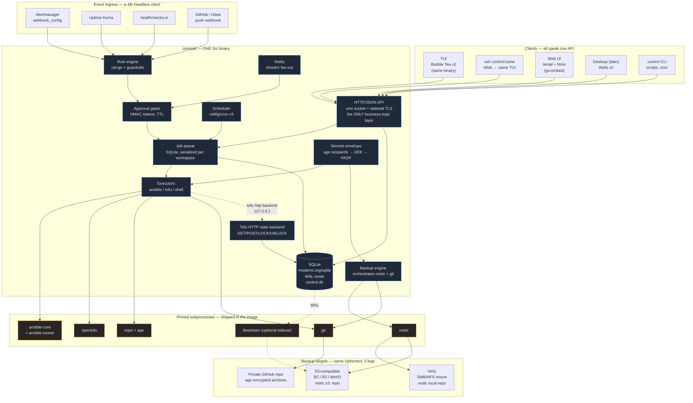
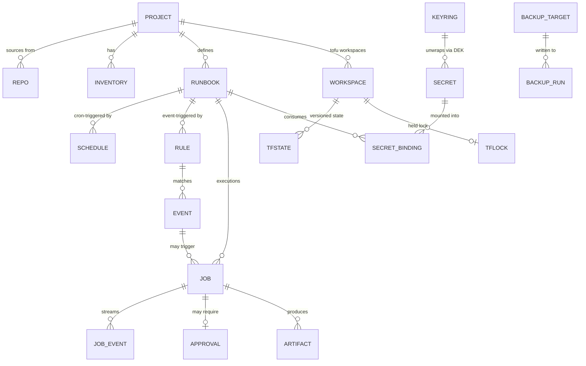
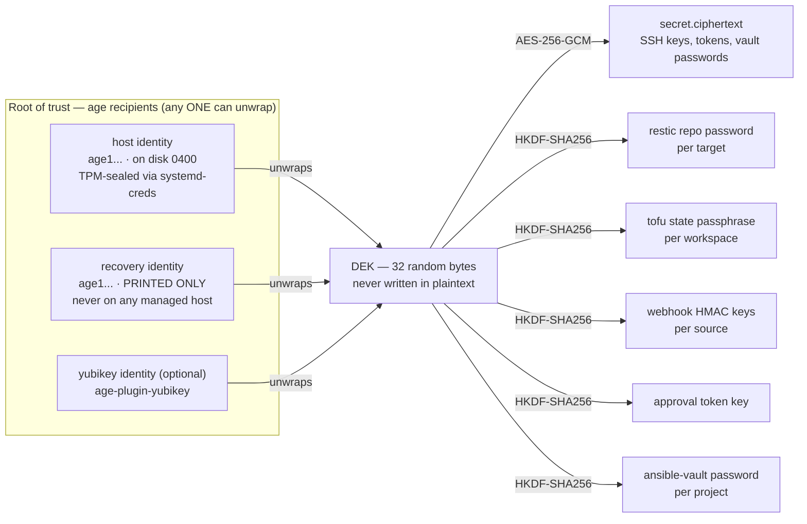
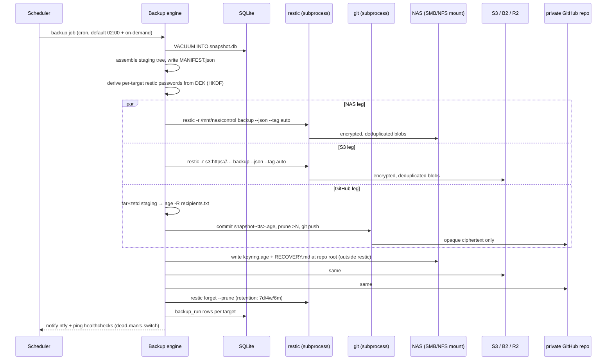
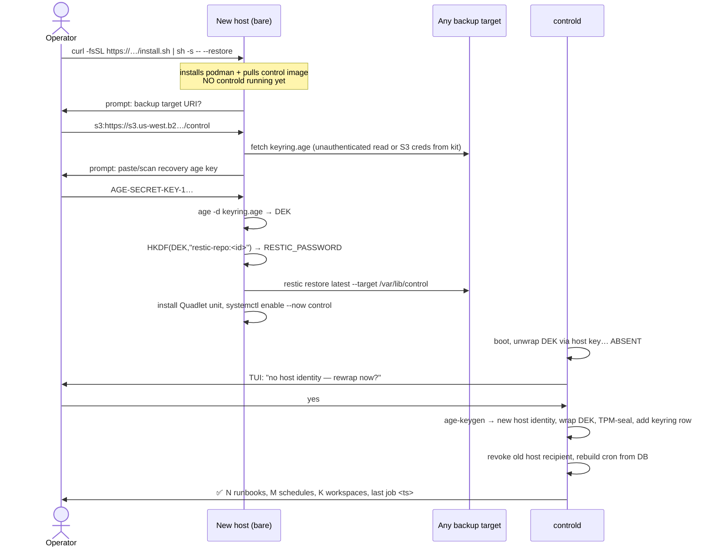
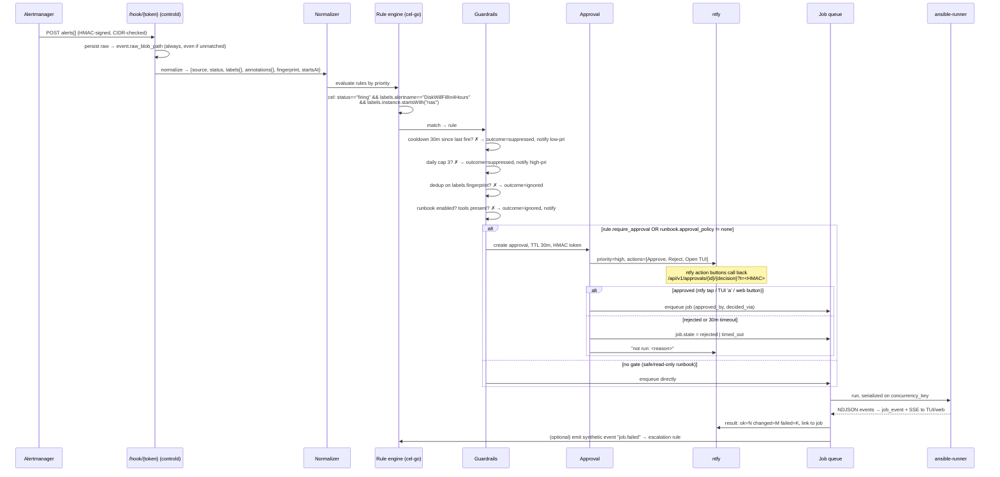

# Candidate design: THIN-CORE

**One Go binary. SQLite inside it. Everything else is a subprocess.**

Status: design candidate · Date: 2026-08-21 · Angle: thin-core / PocketBase-shaped

---

## 1. Thesis

Every research note lands on the same uncomfortable spot: the *components* are all
mature and boring (OpenTofu, restic, age, sops, ansible-core, ntfy), and the *glue* —
job history, scheduling, secrets envelope, backup fan-out, event rules, approval gates,
a TUI — is what nobody ships. `prior-art.md` says it outright: "the gaps are glue, not
missing primitives," and `terraform-orchestration.md` says the run-orchestration layer
"is the actual gap."

Two ways to fill that gap:

1. **Compose-heavy**: adopt Semaphore UI as the execution core and write scripts around
   it. You inherit a web-first product with a Pro paywall on Terraform state
   (`ansible-executors.md` §Semaphore, `prior-art.md`), no backup story
   ([semaphore#1024](https://github.com/semaphoreui/semaphore/issues/1024),
   [#2227](https://github.com/semaphoreui/semaphore/issues/2227) — restores reported as
   not working cleanly), no TUI, and no place to put approval gates. Your glue is
   scattered across cron jobs, a rules engine, and a second web UI.
2. **Thin-core** (this design): write ~12k lines of Go that owns *only* the glue —
   orchestration, secrets envelope, backup/recovery, event rules, and one API behind
   three UIs — and shell out to `ansible-playbook`, `tofu`, `restic`, `sops`, `age`,
   `git` for everything that already exists.

Thin-core wins on the two goals that Semaphore-plus-scripts structurally cannot deliver:
**cohesive UX** (one API, one job history, one auth path, TUI-first) and **bulletproof
recovery** (a recovery chain designed as a first-class feature, not a cron job bolted
onto someone else's SQLite file).

The cost is honest and bounded: this is real software to write and maintain, ~3 months
of engineer-time for v1.0 (§11), against a Semaphore-based alternative that is maybe 3
weeks of scripting but permanently ceilinged.

### The single hard rule

> The core never reimplements a tool that exists. It owns *state, sequencing, keys, and
> recovery*. Everything else is `exec.CommandContext` with a pinned binary and a parsed
> stream.

Concretely, what the core does **not** contain: a backup engine, an encryption
primitive beyond age/HKDF wiring, a Terraform executor, an Ansible executor, a
notification transport per service, a rules DSL of its own invention, or a database
server.

---

## 2. Architecture overview



### Process model

One long-lived process, `controld`, plus short-lived subprocesses per job. No broker, no
external DB, no second service. Idle footprint target: **< 60 MB RSS, < 1% CPU** — the
same class as Semaphore's measured ~50 MB (`ui-stack.md`) and Headscale.

Deployment is **one container**, not one binary, because `ansible-core` is Python
(`ansible-executors.md`). Be honest about this: the *artifact* is a container image (or
an rpm/deb that pulls `ansible-core` as a package dep); the *control plane* is one static
binary inside it. `control doctor` verifies every tool is present at a pinned version and
refuses to start a job whose tool is missing or mismatched.

---

## 3. Chosen components, with justification

### 3.1 Core runtime

| Choice | Why this, not the alternative |
|---|---|
| **Go 1.24+, single module** | `ui-stack.md` is decisive: TUI (Bubble Tea), web (templ/htmx), desktop (Wails) and daemon all compile to one binary in one language. Rust (ratatui) means rewriting a subprocess-shelling daemon in a language whose advantage — memory safety in hot loops — is irrelevant here. Python (Textual) has no static-binary story and Textualize wound down in 2025. |
| **`modernc.org/sqlite`** (pure Go, no CGO) | `bootstrap-recovery.md` §2.1 names it first for the PocketBase pattern. CGO-free means `CGO_ENABLED=0 go build` produces a genuinely static binary, cross-compiles to arm64 for a Pi without a toolchain, and can't segfault the daemon from a C driver. Pay ~2× the query cost of `mattn/go-sqlite3`; at homelab write volume (tens of rows/minute) that is free. |
| **WAL mode, `busy_timeout=5000`, `synchronous=NORMAL`** | WAL is required for Litestream (§7) and for readers not blocking the job writer. |
| **`robfig/cron/v3`** | Boring, correct, supports seconds field and `@every`. Schedules live in SQLite; cron entries are rebuilt from the DB on boot and on mutation, never held only in memory. |
| **`google/cel-go`** | Event matching needs an expression language that is *sandboxed and non-Turing-complete* — you do not want arbitrary code in a rule that fires `tofu apply`. CEL is Google's, widely deployed (Kubernetes admission policy), and evaluates `event.labels.severity == "critical" && event.labels.job.startsWith("node-")` safely with a hard time budget. The alternative — `ansible-rulebook` — costs ~250 MB RAM and a Java/Drools dependency (`event-driven-automation.md` §2.1) and adds a *second* rules language next to the playbooks. |
| **`containrrr/shoutrrr`** | Go-native notification fan-out (ntfy, Gotify, Discord, Slack, SMTP, Telegram, generic webhook) as a *library*, not a Python service. `event-driven-automation.md` recommends Apprise for fan-out; Apprise is MIT-family and excellent but is Python + a Flask container. shoutrrr gives 90% of the coverage with zero extra process. Keep an `apprise://` escape hatch as a generic-webhook URL to `apprise-api` for the long tail. |

### 3.2 Shelled-out tools (pinned, checksummed, version-gated)

| Tool | Pin | Why | Interface contract |
|---|---|---|---|
| **`ansible-core` + `ansible-runner` 2.4.x** | image-pinned | `ansible-executors.md`: ansible-runner is "the correct primitive to shell out to rather than hand-rolling `subprocess.run(["ansible-playbook", ...])`" — it gives per-task JSON events, artifact capture, and is what AWX itself uses. It is actively maintained (2.4.3, Mar 2026). | `ansible-runner start --json` into a per-job private dir; tail `artifacts/<id>/job_events/*.json` → stream into `job_event` table and to SSE subscribers. Fallback: bundled stdout callback plugin emitting NDJSON if ansible-runner is absent. |
| **`opentofu` 1.12.x** | image-pinned | `terraform-orchestration.md`: Terraform is BSL since Aug 2023; OpenTofu is MPL-2.0, CNCF-hosted, and is *the only one with native state/plan encryption*. There is no reason to prefer Terraform CLI. | `tofu init/plan/apply -json` (machine-readable UI stream, stable since TF 1.0) → parsed into `job_event`. `-detailed-exitcode` for drift. |
| **`restic` 0.19.x** | image-pinned + sha256 | `backup-primitives.md`: BSD-2, client-side AES-256+Poly1305, native S3/B2/SFTP/local backends, mature `check`/`restore`/`mount`/`dump`. Its "no Go library" stance is *permanent and deliberate* ([restic#4406](https://github.com/restic/restic/issues/4406)), so shelling out is the designed integration, not a workaround — and the process boundary means a restic crash cannot take down the control plane. | `restic --json` for backup/check/snapshots/restore; exit codes gate success. |
| **`age` + `sops`** | image-pinned | `secrets-management.md` TL;DR: sops+age is the pragmatic homelab stack — no daemon, no unseal ceremony, key is one line of text. `community.sops` gives Ansible a lookup plugin; sops covers `.tfvars`. | age used as a *library* (`filippo.io/age`) for the envelope; the `age` and `sops` **binaries** are shelled out only for repo-file operations that Ansible/Tofu also perform, so behavior is identical to what the operator gets on the CLI. |
| **`git`** | image-pinned | Project sources, and the GitHub backup leg. | plumbing only: `clone/fetch/checkout/bundle/commit/push`. |
| **`litestream` 0.5.x** | optional sidecar | `backup-primitives.md` §Litestream + `bootstrap-recovery.md` §2.2: continuous WAL → S3, and `litestream restore -if-db-not-exists` is safe in `ExecStartPre=`. **Optional**, because it lowers RPO from 15 min to seconds but adds a process; §7 explains the default without it. | CLI, config generated by `controld` from the DB. |

### 3.3 Deliberately not adopted

- **Semaphore UI** — the closest sibling and a good data-model reference, but web-only,
  Terraform state is Pro-tier, no backup/DR primitive, and no seam for approval gates.
  Adopting it means the thin glue lives *outside* the thing that has the job history.
- **AWX** — frozen since 24.6.1 (July 2024) with no release timeline
  (`ansible-executors.md`). Disqualified on project health alone.
- **ansible-rulebook / EDA** — right idea, wrong weight (~250 MB, Drools) and mid-flight
  collection reshuffle between `ansible.eda` and `community.eda`.
- **StackStorm, Windmill, Kestra, n8n** — all need Postgres and/or a JVM/Node runtime;
  `event-driven-automation.md` §3 explicitly says "compose, don't adopt a platform."
- **OpenBao** — deferred, not rejected. `secrets-management.md` is clear it earns its
  seal/unseal lifecycle only when *dynamic* secrets are needed. §6.6 keeps the seam open.
- **Dagu** — genuinely the right shape (16 MB, no DB, GPL-3.0) but it is a DAG engine, and
  this design's queue is a 400-line SQLite state machine. Embedding a GPL-3.0 engine into
  the core also forces the whole binary's license. Not worth it.

---

## 4. Data model sketch

One SQLite file, `/var/lib/control/control.db`. One blob dir,
`/var/lib/control/blobs/` (job artifacts, plan files). Schema version in
`PRAGMA user_version`, migrations embedded and forward-only.



### Tables (essential columns only)

```sql
-- ── Sources & scope ────────────────────────────────────────────────────────
project(id, name UNIQUE, description, created_at)
repo(id, project_id, url, ref, auth_secret_id, last_fetch_at, last_sha,
     verify_signatures BOOL)
inventory(id, project_id, kind /* file|static|script */, path_or_body,
          vault_secret_id)

-- ── Units of work ──────────────────────────────────────────────────────────
runbook(id, project_id, name, kind /* ansible|tofu|shell */,
        entrypoint     /* playbook path | tofu dir | script path */,
        args_json, workspace_id NULL,
        approval_policy /* none|always|on_apply|on_destroy|if_changes>N */,
        max_runtime_s, concurrency_key /* default: workspace or project */,
        cooldown_s, daily_cap, enabled)
schedule(id, runbook_id, cron_expr, timezone, jitter_s, next_at, last_job_id, enabled)

-- ── Execution ──────────────────────────────────────────────────────────────
job(id, runbook_id, trigger /* manual|schedule|event|api|drift */,
    trigger_ref /* event.id | schedule.id | actor */,
    state /* queued|awaiting_approval|running|succeeded|failed|cancelled|
             timed_out|rejected */,
    queued_at, started_at, finished_at, exit_code,
    changed_count, failed_count, drift BOOL,     -- normalized outcome summary
    plan_artifact_id NULL, parent_job_id NULL,   -- apply links to its plan
    dedup_key, idempotency_key UNIQUE NULL)
job_event(job_id, seq, ts, level, phase, host, task, msg, raw_json)   -- append-only
artifact(id, job_id, kind /* plan|log|diff|tofu_show|recovery_kit */,
         path, sha256, size, encrypted BOOL)

-- ── Approvals ──────────────────────────────────────────────────────────────
approval(id, job_id, requested_at, expires_at, token_hash,
         state /* pending|approved|rejected|expired */,
         decided_at, decided_by, decided_via /* tui|web|ntfy|api */, reason)

-- ── Terraform Cloud half: state lives HERE ─────────────────────────────────
workspace(id, project_id, name, tofu_dir, auto_apply BOOL, drift_cron,
          last_plan_job_id, last_apply_job_id, serial)
tfstate(id, workspace_id, serial, md5, created_at, created_by_job_id,
        ciphertext BLOB)                 -- opaque; encrypted by tofu itself
tflock(workspace_id PK, lock_id, who, operation, created_at, job_id)

-- ── Secrets envelope ───────────────────────────────────────────────────────
keyring(id, kind /* host|recovery|yubikey|extra */, recipient /* age1... */,
        wrapped_dek BLOB, label, created_at, revoked_at)
secret(id, name UNIQUE, kind /* ssh_key|vault_pass|token|env|tfvar|file */,
       nonce BLOB, ciphertext BLOB,      -- AES-256-GCM under the DEK
       aad TEXT,                          -- = name|kind, bound into GCM
       created_at, rotated_at, last_used_at)
secret_binding(runbook_id, secret_id, mode /* env|file|vault_pass|ssh_agent */,
               target /* env var name | mount path */)

-- ── Reactive layer ─────────────────────────────────────────────────────────
event_source(id, name, kind /* alertmanager|uptimekuma|healthchecks|github|generic */,
             path_token UNIQUE, hmac_secret_id, allow_cidrs, enabled)
event(id, source_id, received_at, dedup_key, normalized_json, raw_blob_path,
      matched_rule_id NULL, outcome /* ignored|matched|suppressed|gated|fired */)
rule(id, name, source_id NULL, cel_expr, runbook_id, priority,
     var_map_json,               -- CEL expressions → runbook extra vars
     cooldown_s, daily_cap, require_approval BOOL, only_when_alert_firing BOOL,
     enabled)
rule_fire(rule_id, ts, job_id)   -- the cooldown/cap ledger, indexed on (rule_id, ts)

-- ── Backup ─────────────────────────────────────────────────────────────────
backup_target(id, name, kind /* restic_local|restic_s3|restic_sftp|git */,
              uri, cred_secret_id, retention_policy, enabled, priority)
backup_run(id, target_id, started_at, finished_at, state, snapshot_id,
           bytes_added, files_new, duration_s, verify_state, error)

-- ── Audit ──────────────────────────────────────────────────────────────────
audit(id, ts, actor, actor_kind /* operator|token|rule|schedule|system */,
      action, subject_kind, subject_id, before_json, after_json, ip)
```

**Design notes.**

- `job_event` is append-only and the *only* high-write table. Retained 90 days, pruned
  nightly; full stdout stays in `artifact` (gzipped on disk), so the DB stays small
  enough that a `VACUUM INTO` snapshot is sub-second.
- `job.idempotency_key` is what makes a retried Alertmanager webhook (Alertmanager
  *will* re-send) not fire the same runbook twice.
- `concurrency_key` is the answer to `terraform-orchestration.md`'s MinIO
  conditional-write gap: the queue serializes by key, so a single control plane never
  runs two applies against one workspace, regardless of what the storage backend can
  promise. This *removes* the dependency on backend-level locking entirely.
- `tfstate` keeps every serial (pruned to last 100 + all from the last 30 days). This is
  the Terraform-Cloud "state version history" feature, for free, in a table.
- `audit` is written *before* the action for anything destructive, so a crash mid-apply
  still leaves a record of intent.

---

## 5. Terraform Cloud, in 400 lines

`terraform-orchestration.md` identified state/locking as "solved without a service" via
S3 + native encryption, with a large caveat: **MinIO's conditional-write implementation
rejects the `*` wildcard etag that `use_lockfile` requires**
([minio#20346](https://github.com/minio/minio/issues/20346)), Garage has no conditional
PUT at all, and RustFS has ETag-quoting bugs. So the "just use S3" answer quietly assumes
you pay a real cloud provider.

Thin-core sidesteps it: **`controld` implements the OpenTofu HTTP backend protocol
itself.** The protocol is four handlers:

| Method | Path | Behavior |
|---|---|---|
| `GET` | `/api/v1/tf/state/{workspace}` | latest `tfstate.ciphertext`, or 404 → tofu treats as empty |
| `POST` | `/api/v1/tf/state/{workspace}?ID={lock}` | insert new row, `serial+1`, verify lock holder |
| `LOCK` | `/api/v1/tf/state/{workspace}` | `INSERT INTO tflock` — a UNIQUE PK gives atomic locking from SQLite's own transaction, and 423 + the lock JSON on conflict |
| `UNLOCK` | same | delete, checking `lock_id` |

Generated backend config, injected per job:

```hcl
terraform {
  backend "http" {
    address        = "http://127.0.0.1:7433/api/v1/tf/state/prod-net"
    lock_address   = "http://127.0.0.1:7433/api/v1/tf/state/prod-net"
    unlock_address = "http://127.0.0.1:7433/api/v1/tf/state/prod-net"
    lock_method    = "LOCK"
    unlock_method  = "UNLOCK"
    username       = "job"
    password       = "<per-job bearer, valid for job lifetime only>"
  }
}
```

What this buys, all at once:

- **Real locking** on any storage, including MinIO/Garage/a NAS mount, because the lock
  is a SQLite row, not an object-store race.
- **Version history + rollback** in the UI (`tfstate` rows).
- **Drift** as a first-class object: a `drift_cron` schedule runs
  `tofu plan -detailed-exitcode -json`; exit 2 → `job.drift = true` → notify + optionally
  open an approval-gated apply.
- **State is still encrypted before it reaches us.** `controld` sets `TF_ENCRYPTION` with
  the `pbkdf2` key provider and a passphrase derived as
  `HKDF(DEK, "tofu-state:" || workspace.id)`. So the ciphertext in our table is opaque to
  the control plane, and the passphrase is *deterministically recoverable from the DEK
  alone* — no extra secret to lose. (OpenTofu 1.7+ native state encryption,
  `terraform-orchestration.md`; PBKDF2 chosen over the experimental OpenBao Transit
  provider and over the community `tofu-age-encryption` plugin precisely because it needs
  no third party in the DR path.)
- Stale-lock recovery is a UI button (`force-unlock`) with an audit row, instead of a
  DynamoDB console trip.

Effort: this is genuinely small. The protocol is four handlers and the hard part
(encryption) is done by `tofu`.

---

## 6. Secrets: root of trust, envelope, recovery

### 6.1 The chain



**Why envelope, not per-secret age encryption.** age is natively multi-recipient, so
encrypting every secret to three recipients would also work — but adding a YubiKey later
would force a decrypt/re-encrypt of every row, and each secret carries ~200 bytes of
recipient stanzas. With an envelope, `keyring` holds N age-encrypted copies of one 32-byte
DEK; adding a recipient is one unwrap and one wrap, O(1), and touches no secret.

**Why HKDF-derived subkeys.** `bootstrap-recovery.md` §2.4 flags the k3s failure mode:
"don't let the master secret live *only* inside the thing it protects." Deriving the
restic repository password from the DEK means the recovery kit does **not** have to carry
a separate backup password that could drift out of sync with reality. One printed
identity recovers everything. Derivation is
`HKDF-SHA256(secret=DEK, salt="control/v1", info="restic-repo:"||target.id)` → 32 bytes →
base64. Documented in the recovery kit so it is reproducible with `openssl` and `age` if
`controld` itself will not build.

### 6.2 Where the host key lives (the honest part)

There is no way to have an unattended control plane and a key that is not readable by the
control plane. The design is layered, and the threat model is stated, not hidden:

1. **Default**: `/var/lib/control/host.key`, mode 0400, owned by the rootless container
   user. Threat model: protects against backup-tape theft, off-host attackers, and a
   stolen NAS — *not* against root on this box.
2. **Better (auto-detected)**: `systemd-creds encrypt --with-key=host+tpm2` at
   `control init`, delivered via `LoadCredentialEncrypted=` into the Quadlet unit.
   `secrets-management.md` calls this out exactly as the last-mile complement: the key
   becomes TPM-sealed at rest and lands in a non-swappable tmpfs. Now a stolen disk is
   useless without the motherboard.
3. **Best (opt-in)**: `age-plugin-yubikey` recipient added to the keyring, host identity
   *removed*. Now the daemon cannot decrypt unattended — you touch the key on boot. This
   is a deliberate availability/confidentiality trade the operator chooses; the TUI's
   first-run wizard explains it in one screen and defaults to (2).

The DEK lives in locked (`mlock`ed), zeroed-on-shutdown memory. Decrypted secret values
are written to a `tmpfs` job dir (`/run/control/jobs/<id>/`, mode 0700, unmounted at job
end), never to `control.db`, never into `job_event` (a redaction filter scrubs known
secret values from every event line before it is persisted — `ui-stack.md` flags exactly
this discipline).

### 6.3 What each tool actually receives

| Consumer | Mechanism |
|---|---|
| Ansible vault | `--vault-id <project>@/run/control/jobs/<id>/vault-pass` — a tmpfs file whose content is `HKDF(DEK,"ansible-vault:"||project.id)`, or a stored `vault_pass` secret if the repo predates this tool |
| Ansible sops vars | `community.sops` lookup plugin, with `SOPS_AGE_KEY_FILE` pointed at a tmpfs copy of the host identity for the job's lifetime |
| SSH to managed hosts | `ssh-agent` started per job, key loaded from memory via `ssh-add -` (never touches disk), `SSH_AUTH_SOCK` in the job env |
| OpenTofu state | `TF_ENCRYPTION` env, PBKDF2 provider, derived passphrase (§5) |
| OpenTofu variables | sops-encrypted `.tfvars` in the repo, decrypted to tmpfs; or `TF_VAR_*` from `secret_binding` |
| restic | `RESTIC_PASSWORD` from derived key; target credentials (S3 keys) from `secret` |
| Webhook verification | `HKDF(DEK,"webhook-hmac:"||source.id)` — so a source's shared secret is also reproducible after DR |

### 6.4 The recovery kit

Generated once at `control init`, regenerable with `control recovery-kit --print`.
Modeled directly on the Bitwarden/Vaultwarden emergency-kit pattern
(`bootstrap-recovery.md` §2.4). Rendered as a printable HTML page **and** as ASCII in the
TUI, containing:

1. The **recovery age secret key** (`AGE-SECRET-KEY-1…`) and its QR code.
2. The **backup target URIs** (repo URLs only — no credentials; those are in the keyring).
3. A **key-independent restore one-liner** (§8).
4. The **derivation recipe**, in plain text, so a future human with `age` + `openssl` +
   `restic` and no `controld` binary can still get their data out.
5. Fingerprints of all active recipients, so the operator can verify which YubiKey.

The kit is displayed once, never stored in the DB, and the TUI requires typing
`I HAVE STORED THIS` before proceeding. `control doctor` warns if the DB has no
`kind='recovery'` keyring row.

### 6.5 Rotation

- `control secrets rotate-dek` — new DEK, re-encrypt all `secret` rows in one
  transaction, re-wrap for all recipients. **Note the sharp edge**: derived subkeys change
  too, so restic repos must be re-keyed (`restic key add` with the new derived password,
  then `restic key remove` the old) and tofu state re-encrypted
  (`tofu init -migrate-state` or a plan/apply cycle). `controld` sequences all of this as
  a single job with a rollback point, and refuses to start if any backup target is
  unreachable. This is the most dangerous operation in the system and is gated behind an
  approval even for the operator.
- `control keyring add-recipient age1…` / `revoke <id>` — O(1), no secret touched.

### 6.6 OpenBao seam (deferred, not closed)

`secret.kind` gets an `external` variant whose `ciphertext` holds a reference
(`bao://kv/data/homelab/foo#password`) instead of a value. When dynamic secrets become a
real need, a `SecretResolver` interface gains a second implementation and nothing else
changes. Per `secrets-management.md`, this stays off the v1 critical path — the
seal/unseal lifecycle is a real cost and static secrets do not need it.

---

## 7. Backup and restore

### 7.1 What gets backed up

One staging tree, assembled to tmpfs, identical bytes to all three legs:

```
/run/control/backup-<ts>/
├── MANIFEST.json          schema_version, tool versions, host, ts, sha256 of every file
├── control.db             ← VACUUM INTO (consistent, WAL-checkpointed, sub-second)
├── config.toml            non-secret daemon config
├── keyring.age            *** the N age-wrapped DEK copies — see 7.3 ***
├── blobs/                 job artifacts, plan files (retention-pruned first)
└── repos/
    ├── homelab-ansible.bundle   git bundle create --all
    └── homelab-tofu.bundle
```

`tfstate` ciphertext rides inside `control.db`. Ansible-vault and sops files ride inside
the git bundles as ciphertext — `backup-primitives.md` notes restic treats them as opaque
blobs with zero extra integration.

### 7.2 Fan-out



Each leg is independent: one failing does not abort the others; each gets its own
`backup_run` row and its own alert. A target that fails twice consecutively raises a
`critical` ntfy notification — because `event-driven-automation.md` §2.6 is right that
the failure mode that actually kills you is silent non-execution, healthchecks.io gets a
ping only on full success.

### 7.3 The one detail that makes DR work

**`keyring.age` is written to every target root, outside the restic repository, in the
clear.**

It is ciphertext — N age-wrapped copies of the DEK — so publishing it is safe. But it must
not be *inside* the encrypted backup, because the restic password is derived from the DEK
that the keyring wraps. Putting it inside would be a perfect circular dependency and the
single most likely way to build an unrecoverable system.

So the recovery chain is:

```
printed recovery key  →  fetch keyring.age from ANY target  →  unwrap DEK
                      →  HKDF → restic password  →  restore  →  running control plane
```

Every arrow is executable with off-the-shelf tools. Nothing in the chain requires
`controld` to run, or the internet, or a vendor.

### 7.4 RPO / RTO

| Configuration | RPO | RTO (dead host → serving) |
|---|---|---|
| Default (restic every 15 min for the DB-only fast path, full tree nightly) | ≤ 15 min | ~5 min |
| With Litestream sidecar → S3 | ~1 s | ~5 min |

The 15-minute fast path is a `VACUUM INTO` + `restic backup` of just `control.db` — a few
hundred KB after dedup, cheap enough to run constantly. Litestream is offered because
`bootstrap-recovery.md` documents `litestream restore -if-db-not-exists -if-replica-exists`
as an `ExecStartPre=` line that makes a fresh host self-heal, which is genuinely elegant —
but it is *optional*, because a control plane losing 15 minutes of job history is not a
data-loss event worth a second process for most operators.

### 7.5 Verification — the part people skip

`restic check --read-data-subset=1/12` weekly per target, rotating through the whole
repository quarterly (`backup-primitives.md`'s suggestion, so bandwidth stays sane). Plus
a monthly **restore rehearsal**: `control dr-drill` restores the newest snapshot into a
throwaway container, boots `controld` against it with `--dry-run --no-network`, asserts
row counts and that a canary secret round-trips, then destroys it — and posts the result
to ntfy. An untested backup is a rumor; making the drill a scheduled job in the same
engine costs nothing new.

---

## 8. Disaster recovery runbook

**Scenario: the control host is gone. You have a printed recovery kit and any one backup
target.**



Literal commands, for the printed card:

```bash
# 1. Get the tool. The installer is versioned SEPARATELY from controld
#    (bootstrap-recovery.md §2.7: the recovery path must not depend on the
#     thing that broke), and is a POSIX shell script with no dependencies
#     beyond curl + podman.
curl -fsSL https://get.control.sh/install.sh | sh -s -- --restore

# 2. …or fully by hand, with no control binary at all:
export DEK=$(age -d -i recovery.key keyring.age | base64)
export RESTIC_PASSWORD=$(printf '%s' "$DEK" | base64 -d \
  | openssl kdf -keylen 32 -kdfopt digest:SHA256 \
      -kdfopt hexkey:$(xxd -p -c256) \
      -kdfopt info:restic-repo:s3-primary -kdfopt salt:control/v1 HKDF \
  | base64)
restic -r s3:https://… restore latest --target /var/lib/control

# 3. Start it.
systemctl enable --now control.service

# 4. Verify, don't assume.
control doctor --deep        # tool versions, DB integrity, keyring, targets reachable
control jobs list --limit 5  # last known activity — does it match your memory?
```

### Failure modes explicitly handled

| What died | Recovery |
|---|---|
| Host disk | Above. |
| Host key (disk gone, kit intact) | Above — DEK unwrapped by recovery key, new host key minted, old revoked. |
| **Recovery kit lost, host alive** | `control recovery-kit --regenerate` mints a new recovery identity, wraps the DEK, revokes the old row. Zero downtime. This is why the kit is regenerable. |
| Recovery kit lost **and** host key lost | Unrecoverable, by design. Same property as any real vault. `control doctor` nags weekly if only one recipient exists, and the first-run wizard refuses to finish without a second. |
| DB corrupt, backups fine | `control restore --snapshot <id>` in place; `controld` refuses to start on `PRAGMA integrity_check` failure rather than serving garbage. |
| One backup target unreachable | Others proceed; alert fires; `control doctor` shows per-target last-success age with a red threshold at 48 h. |
| `controld` will not build/run at all | The manual path in step 2 uses only `age`, `openssl`, `restic`. The bundles are plain `git bundle`s; `control.db` is plain SQLite. **Nothing is in a bespoke format.** |

---

## 9. Event → runbook, with approval gates

### 9.1 Flow



### 9.2 Normalization

Every source collapses to one shape, so rules are written once:

```json
{ "source": "alertmanager", "kind": "alert", "status": "firing",
  "labels": {"alertname":"…","severity":"critical","instance":"nas.home"},
  "annotations": {"summary":"…","runbook_url":"…"},
  "fingerprint": "…", "startsAt": "…", "receivedAt": "…" }
```

Adapters: Alertmanager `webhook_config` (fans one POST into N events, one per alert),
Uptime Kuma, healthchecks.io, GitHub/Gitea push, and `generic` (raw JSON under `.body`,
CEL can reach anything). Per `event-driven-automation.md` §2.7, the Alertmanager route
should keep `continue: true` so a human is paged even when automation fires.

### 9.3 Guardrails — non-negotiable

Both `bootstrap-recovery.md` §2.8 and `event-driven-automation.md` independently warn
that a self-healing loop that re-triggers itself turns a minor alert into an outage. So:

- **Cooldown** per rule (default 15 min), enforced by a query against `rule_fire`, not by
  in-memory state — survives restart.
- **Daily cap** per rule (default 5). Exceeding it *disables the rule* and sends a
  `max` priority notification. Manual re-enable only.
- **Dedup** on `event.dedup_key` (Alertmanager fingerprint by default) within a window.
- **Global kill switch**: `control pause --reactive` (and a big red toggle in TUI/web)
  stops all event-triggered execution while leaving manual and scheduled runs alive.
  Reachable in one keystroke from any TUI screen.
- **Default-deny for destructive kinds**: any `tofu apply`/`destroy` runbook has
  `approval_policy = on_apply` unless explicitly set otherwise, and the wizard warns
  loudly when overriding.
- **Every** event is persisted with its outcome, including `ignored` — so "why didn't it
  fire?" is answerable from the UI, which is where most homegrown automation loses people.

### 9.4 Approvals

An approval is an HMAC token `HMAC(HKDF(DEK,"approval"), approval.id || decision || exp)`,
delivered three ways to the same endpoint:

- **ntfy action button** — one tap on a phone. `event-driven-automation.md` §2.5 notes
  ntfy's action buttons can call back into a URL; this is the whole "approval gate" for a
  one-operator homelab, with no Windmill and no Postgres.
- **TUI** — `a` / `r` on the pending-approvals screen, which is the TUI's home badge.
- **Web** — a button, same endpoint.

Tokens are single-use (`approval.token_hash` cleared on decision), TTL-bounded (default
30 min), and constant-time compared. An expired approval never runs. Plan-then-apply is
modeled as two `job` rows linked by `parent_job_id`, so the approver sees the *actual
plan output* (`tofu show -json` rendered as a diff) before approving, and the apply runs
`tofu apply <saved-plan-file>` — not a fresh plan that might have drifted.

---

## 10. UI plan: one API, three clients

Per `ui-stack.md`'s core recommendation, restated as a hard rule: **business logic exists
only behind the API.** The TUI is an API client even though it is in the same process — it
calls the same `service` package functions the HTTP handlers call, so there is no
"TUI-only" code path that can diverge.

```
controld
 ├── internal/service/    ← ALL business logic. No HTTP, no terminal, no HTML.
 ├── internal/api/        ← thin HTTP/JSON over service. OpenAPI 3.1 generated from it.
 ├── internal/tui/        ← Bubble Tea v2; calls service directly (local) or api (remote)
 ├── internal/web/        ← templ components; handlers call service; go:embed assets
 └── cmd/control/         ← one cobra CLI; default subcommand = tui
```

### API surface (v1, stable)

```
GET    /api/v1/projects|runbooks|inventories|workspaces|secrets|targets
POST   /api/v1/runbooks/{id}/run          {vars, idempotency_key} → job
GET    /api/v1/jobs?state=&runbook=&since=
GET    /api/v1/jobs/{id}/events           SSE stream (and ?after=seq for replay)
POST   /api/v1/jobs/{id}/cancel
GET    /api/v1/approvals?state=pending
POST   /api/v1/approvals/{id}/{approve|reject}?t=<hmac>
GET    /api/v1/workspaces/{id}/state/versions        (+ /{serial}/download)
POST   /api/v1/workspaces/{id}/plan|apply|force-unlock
POST   /api/v1/backups/run   ·  GET /api/v1/backups  ·  POST /api/v1/restore/preview
GET    /api/v1/events?outcome=            ← "why didn't my rule fire"
POST   /hook/{source_token}                          (HMAC + CIDR, no bearer)
GET    /api/v1/health|doctor|version
```

Transport: **Unix socket by default** (`/run/control/control.sock`, 0660, operator group)
— no port, no TLS, no auth question for the local case. `--listen` adds loopback/LAN TCP
with bearer tokens (argon2id-hashed in `secret`) for the web UI and remote CLI.

### TUI (priority 1) — Bubble Tea v2 + Bubbles + Lip Gloss v2

Bubble Tea v2 shipped Feb 2026 with synchronized-output support, which matters here: live
job-log tailing at 100+ events/sec without flicker.

```
┌ control ─────────────────────── nas.home ─ ⏸ reactive: ON ─ ⚠ 2 approvals ┐
│ [1]Dashboard [2]Runbooks [3]Jobs [4]Workspaces [5]Secrets [6]Backups [7]Events│
├──────────────────────────────────────────────────────────────────────────┤
│ APPROVALS ── 2 pending                                                    │
│ ▸ prune-logs        rule#7 DiskWillFillIn4Hours  nas.home     28m left    │
│   tofu apply prod   drift: 3 to change, 0 destroy              12m left    │
│                                                                            │
│ JOBS ── last 24h: 14 ok · 1 failed · 2 gated                              │
│   ✓ 14:02 nightly-patching      ansible  ok=12 chg=3     2m14s            │
│   ✗ 13:40 tofu plan prod-net    tofu     drift detected  0m31s            │
│                                                                            │
│ BACKUPS   nas 6m ago ✓ · b2 6m ago ✓ · github 14h ago ✓ · drill 3d ago ✓  │
└ a approve · r reject · enter details · / filter · p pause reactive · ? ────┘
```

Screens: Dashboard, Runbooks (run/edit/schedule), Jobs (live tail with `f` follow,
searchable), Workspaces (plan diff viewer, state version history, force-unlock),
Secrets (names/kinds/last-used only — **values are never rendered**), Backups
(targets, last run, `restore`, `dr-drill`), Events (the audit of what did and did not
fire), Doctor.

**Remote access via Wish**: `control serve --ssh :2222` wires each SSH session's PTY into
a `tea.Program`, authenticated by SSH public key mapped to an operator row. `ssh
control.home` from a laptop or a phone SSH client *is* the whole interface — no port
forwarding, no TLS certificate, no browser. Charm's own soft-serve proves this pattern at
this scale.

### Web (priority 2) — templ + htmx, `go:embed`

Same handlers, thin HTML views. htmx SSE extension binds directly to
`/api/v1/jobs/{id}/events`, so live log tailing is ~10 lines of markup and zero JavaScript
framework. No Node in the build. This keeps the web UI at maybe 2,500 lines of templ
rather than a 40 MB `node_modules` and a second dependency ecosystem to patch. Mobile
matters here specifically for one flow: **approve a gated job from a phone** (the ntfy
notification deep-links into it).

### Desktop (priority 3) — Wails v2, later or never

Wraps the identical embedded web UI in an OS-native WebView. It is packaging work, not UI
work — window chrome, tray icon showing pending-approval count, native notifications. Do
it only if someone actually asks. Tauri is the fallback if Wails' multi-window/notification
gaps bite, at the cost of a Rust shim.

---

## 11. Bootstrap: zero to working in minutes

### First run

```bash
# One command. Podman Quadlet is primary (rootless, systemd-native, journald,
# smaller blast radius for a box holding key material — bootstrap-recovery.md §2.5);
# a docker-compose.yml ships as the fallback for Synology/TrueNAS/Docker-only hosts.
curl -fsSL https://get.control.sh/install.sh | sh

# → installs ~/.config/containers/systemd/control.container + control.volume
# → systemctl --user daemon-reload && start
# → prints:  ssh control@localhost -p 2222   (or: control tui)
```

Then the wizard, which is the TUI's first-run mode. Six screens, each idempotent
(check-before-create, never the Miniflux `CREATE_ADMIN=1` footgun that
`bootstrap-recovery.md` §2.3 calls out):

1. **Identity** — generate host age identity; auto-detect TPM2 and offer `systemd-creds`
   sealing (default yes); generate DEK; wrap.
2. **Recovery kit** — mint the recovery identity, render the printable kit + QR, require
   `I HAVE STORED THIS`. **The wizard cannot be skipped past this screen.** Optional:
   add a YubiKey recipient now.
3. **Backup targets** — add ≥1 (NAS path / S3 URI / GitHub repo). Each is *tested
   immediately*: init the restic repo, write a canary, read it back, delete it. A target
   that fails the round-trip cannot be saved.
4. **First project** — git URL (+ deploy key generated and displayed for pasting into
   GitHub/Gitea), fetch, then **auto-discover**: `*.yml` at repo root with a `hosts:` key
   become candidate Ansible runbooks; directories containing `*.tf` become candidate tofu
   workspaces. Operator checkboxes what to import. This is the difference between "5
   minutes to working" and "an afternoon of forms."
5. **Notifications** — ntfy server + topic (default: `ntfy.sh/control-<random>`), send a
   test push. Optional healthchecks.io ping URL.
6. **Verify** — runs `control doctor --deep`, runs the first backup, runs `dr-drill`
   *immediately*, and shows the result. **You have a proven restore path before you have
   done any real work.**

Target: **under 10 minutes**, dominated by typing the git URL and printing the kit.

### Dogfooding node zero

Per `bootstrap-recovery.md` §2.7, the control plane manages its own deployment as just
another project: the wizard seeds a `control-self` project containing the Quadlet unit,
`config.toml`, and a `self-update` runbook. Updating `controld` becomes a normal,
approval-gated, logged, rollback-able job. But — and this is the point of §2.7 — the
*recovery* primitive is deliberately **not** "run the control plane": it is the separately
versioned `install.sh`. Self-update is opt-in and never automatic; an unattended bad
update of the thing that manages everything else is a single point of failure for the
whole homelab.

---

## 12. Build effort estimate

Assumes one experienced Go developer, full-time-equivalent weeks, including tests and
docs. Ordered so each milestone is independently useful.

| # | Module | FTE-weeks | Notes |
|---|---|---|---|
| 1 | Skeleton: cobra CLI, config, SQLite + migrations, service/api split, `doctor` | 1.0 | |
| 2 | Secrets envelope: age wrap/unwrap, DEK, HKDF, keyring CRUD, tmpfs job dirs, redaction filter | 1.5 | Highest-care code in the project. Property tests + fuzzing on the redactor. |
| 3 | Job queue + executor framework: state machine, concurrency keys, cancel, timeouts, NDJSON event ingest, artifact store | 2.0 | |
| 4 | Ansible executor (ansible-runner + fallback callback), inventory, vault/sops wiring | 1.5 | |
| 5 | OpenTofu executor + **HTTP state backend** + plan/apply linkage + drift + state versions | 2.0 | Backend itself is ~2 days; plan-diff rendering is the rest. |
| 6 | Scheduler (cron, jitter, catch-up policy, rebuild-from-DB) | 0.5 | |
| 7 | Backup engine: staging, restic wrapper, 3-leg fan-out, retention, `keyring.age` placement, verify, `dr-drill` | 2.0 | |
| 8 | Restore + `install.sh` + recovery kit render + **rehearsed DR on a clean VM** | 1.5 | Budget half of this for actually breaking and restoring things. Non-negotiable. |
| 9 | Event ingress: adapters, normalizer, cel-go rules, guardrails, ledger | 1.5 | |
| 10 | Approvals: tokens, ntfy actions, TTL/expiry, plan-gated applies | 1.0 | |
| 11 | Notifications (shoutrrr), healthchecks pings, escalation | 0.5 | |
| 12 | **TUI** — 8 screens, live tail, forms, first-run wizard | 3.0 | The biggest single line item and the one users judge the project by. |
| 13 | Wish/SSH serving + operator key auth | 0.5 | |
| 14 | Web UI (templ + htmx, ~8 pages, SSE tail, mobile approval flow) | 2.0 | |
| 15 | Packaging: container image, Quadlet unit, compose fallback, rpm/deb, CI/release | 1.0 | |
| 16 | Docs: quickstart, DR runbook, threat model, migration-from-Semaphore | 1.0 | |
| | **v1.0 total** | **~22 FTE-weeks (~5 months solo, ~3 with focus)** | |
| — | Desktop (Wails) | +1.0 | Deferred. |
| — | OpenBao resolver | +1.0 | Deferred. |
| — | Litestream embedding | +0.5 | Optional sidecar first. |

**Minimum lovable v0.1 (~7 weeks)**: modules 1, 2, 3, 4, 7, 8 + a two-screen TUI. That is
"run Ansible playbooks with encrypted secrets, back up to three places, prove the
restore." Everything after that is additive and never invalidates the recovery chain —
which is the correct shipping order, because the recovery chain is the part that must be
right on day one.

Reference points for calibration: Semaphore is ~5,200 commits for a *web-only* subset of
this scope; PocketBase is one maintainer. The estimate above is realistic, not optimistic,
precisely because ~70% of the hard work (backup engine, IaC executor, encryption, rules
matching) is delegated to restic/tofu/age/cel-go rather than written.

---

## 13. Top 5 risks

### 1. Solo-maintainer bus factor on a bespoke control plane

**This is the dominant risk and the honest cost of the thin-core angle.** Semaphore has
14k stars and 200+ open PRs; this has one author. If it is abandoned, the operator owns
an unmaintained control plane.

*Mitigation, designed in rather than promised*: **nothing is stored in a bespoke format.**
`control.db` is plain SQLite you can open with `sqlite3`. Backups are plain restic repos
you can `restic mount`. Repos are plain git bundles. Secrets are plain age files. Tofu
state is standard tofu state, encrypted by tofu's own mechanism. §8 step 2 recovers
everything with `age` + `openssl` + `restic` and no project code at all. The exit cost from
an abandoned thin-core is a weekend of scripting, not a data-loss event. Ship an
`control export --portable` that emits a Semaphore-importable project structure as an
explicit escape hatch, and ship the manual-recovery recipe in the printed kit so it is
tested by being *read*.

### 2. Getting the crypto envelope subtly wrong

A nonce reuse, an unauthenticated AAD, a secret leaked into `job_event`, or a key written
to disk turns the vault into theater. Hand-rolled key management is where projects like
this die quietly.

*Mitigation*: use `filippo.io/age` as a library (no custom asymmetric code), Go stdlib
`crypto/cipher` GCM with random 96-bit nonces and `secret.name|kind` bound as AAD, and
`crypto/hkdf` (Go 1.24 stdlib) for derivation — **zero novel cryptography, only wiring.**
The redaction filter is the sneakiest failure: fuzz it, and additionally scan every
`job_event` row against the known-secret set before commit (belt and braces, cheap at this
volume). Get an external review of `internal/secrets` before v1.0 — it is ~600 lines, so
that is a realistic ask. Test `dr-drill` with a canary secret so a silently-broken
envelope fails a scheduled job rather than being discovered during a real disaster.

### 3. Subprocess contract drift

`ansible-runner`'s event schema, `tofu -json`'s UI stream, and `restic --json`'s shape are
stable-ish but not contractual. An upstream change breaks parsing at the worst moment —
mid-restore.

*Mitigation*: pin exact versions in the image and record them in `MANIFEST.json` so a
restore knows what produced it. `control doctor` refuses to run a job whose tool version
is outside a tested range, with a clear message rather than a parse error. Parse
*defensively*: unknown event types are stored raw and surfaced as opaque log lines rather
than dropped or fatal. Keep a golden-file test corpus of real recorded output from each
pinned version, and treat a version bump as a PR that must regenerate them. Critically,
**success/failure is determined by exit code, never by parsed output** — parsing only
enriches the UI, so a schema change degrades the display, not the correctness.

### 4. The reactive loop causing the outage it was meant to prevent

Two research notes flag this independently. A rule that restarts a service on an alert
that the restart itself triggers is a homelab-scale self-DoS, and the same shape with
`tofu destroy` is a genuine data-loss path.

*Mitigation*: guardrails are enforced in the queue, not in rule config, so they cannot be
forgotten — cooldown and daily cap have non-null defaults and the cap *disables the rule*
rather than merely throttling it. Destructive runbook kinds default to
`approval_policy = on_apply`. The global reactive kill switch is one keystroke from every
TUI screen. Every event including ignored ones is persisted, so post-incident analysis is
a query. And the guardrail ledger lives in SQLite, not memory, so a crash-loop restart
does not reset the counters — which is exactly how naive implementations fail.

### 5. Scope creep into a bad AWX

The gravitational pull of RBAC, multi-tenancy, surveys, workflow DAGs, and a
notifications-plugin framework is strong, and each one is individually reasonable. AWX
went there and now needs 16 GB of RAM and has not shipped in two years.

*Mitigation*: write the constraint into the README as a contract — **one operator, a
handful of hosts, one container, no external database, ever.** Concrete rejections stated
up front: no RBAC beyond `operator`/`readonly`, no workflow DAGs (a runbook that needs a
DAG is a playbook with `import_playbook`, or a Dagu job you trigger), no plugin system (a
notification target that shoutrrr lacks is a generic webhook), no multi-node HA. If a
feature needs a second process or a second database, it is out of scope by definition.
Measure idle RSS in CI and **fail the build above 80 MB** — a number in a test is a
constraint; a number in a README is a wish.

---

## 14. Summary of what this design commits to

| Requirement | Answer |
|---|---|
| Single-container | One static Go binary + pinned tools in one rootless Podman/Quadlet container. < 60 MB idle. |
| AWX role | Projects, inventories, runbooks, cron schedules, job history with live per-task event streams. |
| Terraform Cloud role | OpenTofu, native HTTP state backend in SQLite (locking + version history + rollback), plan→approve→apply, scheduled drift. |
| Secrets | age recipients → DEK envelope → HKDF subkeys. sops+age, ansible-vault, tofu PBKDF2 all fed from one root. OpenBao seam left open. |
| Backups | restic to NAS + S3, age-encrypted archives to GitHub. Same ciphertext, three legs, independent failure. Rotating verification + monthly automated restore drill. |
| Reactive | Normalized webhooks → CEL rules → hard guardrails → ntfy-tappable approval gates → the same job path as everything else. |
| UI | One API. Bubble Tea TUI (also over SSH via Wish) → templ+htmx web → Wails desktop, in that order. |
| Bootstrap | One `install.sh`, a six-screen wizard, a proven restore before you finish setup. |
| DR | Printed recovery key + any one backup target + `age`/`openssl`/`restic`. No vendor, no internet, no `controld` required. |
