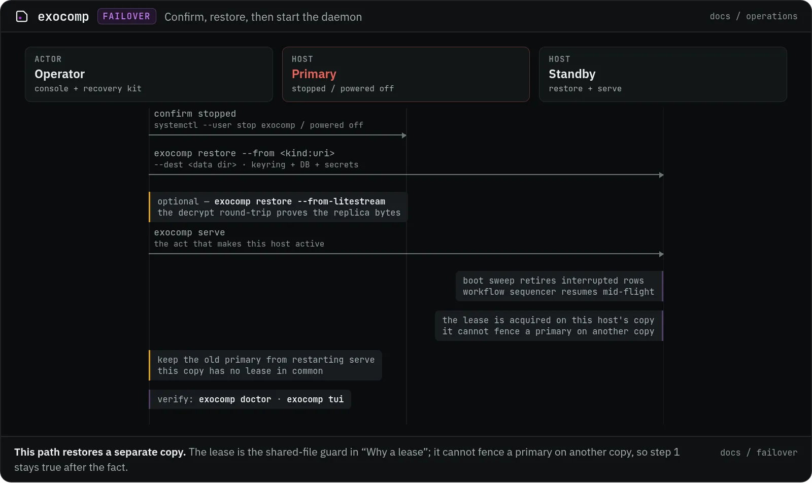

# Cold-standby failover

The primary is down and you want a second host serving. This is the drilled procedure. The
[disaster-recovery](disaster-recovery.md) runbook rebuilds a dead host from a backup target;
this page is the narrower case where a **standby** takes over, and how a fence — the active
lease — stops a split-brain **when both hosts open the same SQLite file**. This procedure's own
restic-restore step gives the standby its own separate copy, not that same file (see below); for
that path, and for the optional Litestream fast-forward, safety rests on step 1 — confirming the
primary is truly stopped — not on the lease.

## Why a lease, on top of the lock

`exocomp serve` has always held a host-local lock on `serve.lock` in the data dir (see
[running the daemon](serve.md)): two daemons on **one** host cannot both start. That lock is a
`flock` on a local file and a check that a local pid is alive — both meaningless across hosts.
Two daemons on two hosts, opening the **same** `exocomp.db` — a shared volume or network
filesystem both mount — would each pass their own local lock and both go active: firing every
schedule twice, racing for every queued job, and — worst — each running the boot sweep, whose
pid-liveness is host-local and would retire the *other* host's in-flight jobs as though their
owner had died.

The fence closes that literal case. A single-row **active lease** lives in the store itself, with
a wall-clock TTL. The active daemon holds it and renews it; a starting daemon that finds a
**live** lease held by another holder refuses to become active and names who holds it. Both
guards stay: the flock is the cheap same-host answer, the lease the cross-host one.

| Guard | Scope | What it settles |
|---|---|---|
| `serve.lock` (flock) | one daemon per host | a local file lock plus a pid-liveness check |
| `serve_lease` (row) | one active daemon across hosts | the same SQLite file opened by more than one host |

In the shared-file case, startup has three outcomes: a free or stale lease is acquired; a live
lease held by another holder refuses and names the holder and last renew; `--force-lease` takes
it over only when the holder cannot be running. Do not reach for it to clear a message.

**The lease does not reach a Litestream replica or a restic restore.** Each is its own separate
copy of `exocomp.db` — the lease row travels with the bytes, but stops updating the instant the
copy is made. A daemon reading a stale replica sees the primary's lease look expired (no fresh
renewal ever arrives there) and takes over while the primary is still live; a primary restored
from its own snapshot never sees a lease a standby acquired on its copy. Both of those paths —
this runbook's own procedure included — depend entirely on step 1: the operator confirming the
primary is stopped *before* the standby ever starts. The lease is a second, independent guard for
the one-shared-file case; it is not a substitute for that confirmation anywhere else.

The lease is not a power controller, even in the shared-file case it does cover. It prevents two
daemons from both **activating against the same open file**; it does not switch off a primary
that is independently mutating external systems out of band. Making sure the primary is truly
stopped is still yours — the fence is what keeps a mistake from corrupting the queue, not a
substitute for confirming the mistake.

## Procedure

<p></p>

*Figure — the procedure. This path restores a separate copy; the lease is the shared-file guard in “Why a lease”.*

1. **Confirm the primary is stopped.** `systemctl --user stop exocomp` on it, or confirm it is
   powered off / partitioned. This is the step the fence cannot do for you.

2. **Restore the store onto the standby** with the authoritative restic chain — it is the only
   one that carries the keyring and sealed secrets:

   ```sh
   exocomp restore --from <kind:uri> --dest <data dir>
   ```

   It refuses a destination that already holds a keyring, so a standby that was itself once a
   primary needs a fresh data dir.

3. **Optionally fast-forward the database** to its freshest state, *if* the Litestream sidecar
   was replicating and seconds of lost job history matter. This recovers `exocomp.db` **only**,
   onto the data dir the restic restore just wrote (it needs the `keyring.age` beside it), and
   it does not trust the replica's unencrypted bytes until a decrypt round-trip proves them:

   ```sh
   exocomp restore --from-litestream --dest <data dir> --identity recovery.key \
     --replica <replica url>        # omitted: read from the litestream.replica_url setting
   ```

   A database that fails the round-trip is discarded and the restic-restored one is left in
   place. See [disaster-recovery](disaster-recovery.md#fast-rpo-restore-litestream) for the
   precedence and the plaintext-remote caveat.

4. **Start the daemon — deliberately.** Neither restore resumes anything; starting `serve` is
   the act that makes this host active:

   ```sh
   exocomp serve
   ```

   On this path the standby opens its own restored copy of `exocomp.db`, so the lease row is
   that copy's and is free or stale; `serve` acquires it and proceeds. The live-holder refusal
   and `--force-lease` are the shared-file case in "Why a lease"; they are not part of this
   procedure.

5. **Interrupted work re-drives itself, mostly.** The boot sweep retires the rows the dead
   primary left `queued`/`running` to `interrupted`, and the workflow sequencer's first pass
   resumes any multi-step workflow the ledger left mid-flight (an apply→play handoff, a
   provision chain) from where it stopped — a succeeded step is never re-run. A **standalone**
   one-shot job that was interrupted is terminal and is not auto-retried; re-issue it yourself
   (`exocomp workspace apply …`, `exocomp playbook run …`) once you have confirmed what the
   primary did and did not finish. Verify with `exocomp tui` and `exocomp doctor`.

## A resurrected primary

This self-healing needs the primary and the standby to open the **same** `exocomp.db`. If the old
primary comes back — a reboot, a healed partition — while the standby is active on that shared
file, it tries to renew or re-acquire the lease and finds the standby holding a live one. A
**starting** primary refuses exactly as in the shared-file outcomes in "Why a lease". A primary that was mid-renew when it was
fenced (you ran `--force-lease`) discovers on its next renew that the lease is no longer its own
and **stands down**, running the same graceful stop a `SIGTERM` triggers. Either way, only one
daemon stays active against the store.

**This runbook's own procedure does not share a file.** Step 2 restores a restic snapshot onto
the standby's own data dir — a separate copy of `exocomp.db` with no lease row in common with
whatever the primary is doing to its own. A resurrected primary serving *its own* store never
queries the standby's lease and has no way to discover it; nothing here stands it down. The only
guard against that is step 1 staying true after the fact: keep the old primary from restarting
`serve` (disable the unit, don't just power it back on) until you deliberately reintegrate it.
The lease protects the shared-file case above; it cannot protect a case where the two daemons
never open the same file.

The TTL is the window this costs you **in the shared-file case**: after an **ungraceful** primary
loss the standby must wait for the lease to go stale before it can acquire without
`--force-lease` (default TTL 30s, tunable with `--lease-ttl` / `--lease-renew`). A **clean**
`serve` shutdown releases the lease on the way out, so a planned failover has no wait at all.

## Drilling it

Rehearse against a throwaway copy so the first real run is not the first run:

- Restore last night's snapshot into a scratch data dir (`exocomp restore --from … --dest /tmp/standby`).
- With no daemon holding the store's lease, `exocomp serve` there acquires cleanly — the free-lease path.
- To rehearse the **refusal**, point a second `serve` at the *same* data dir: the host-local flock
  refuses it first. To rehearse the cross-host refusal specifically, the fence's behaviour is
  covered by the daemon gate tests (`cmd/exocomp`), which stand two holders against one store and
  assert the second refuses, claims nothing, and only takes over once the first releases or its
  lease goes stale.

This complements the [`backup drill`](disaster-recovery.md#verification--the-part-people-skip),
which proves the *restore* half; the failover drill proves the *activation* half.
